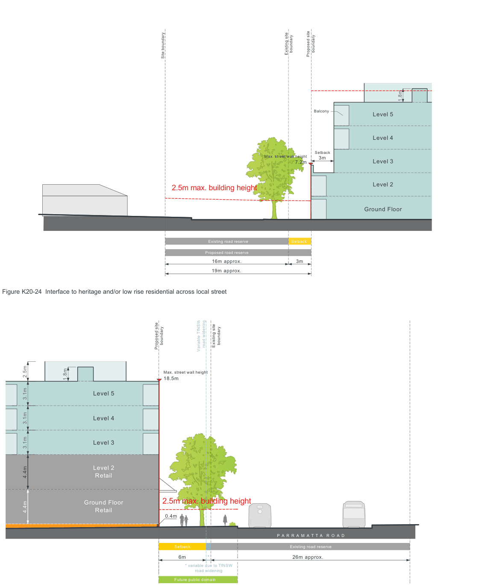

### K20  Kings Bay (PRCUTS)

#### K20.11 Transitions and Interfaces

Changes in height and scale will require transitions to sensitive interfaces such as existing low scale residential areas, heritage items and open spaces. New development will be required to respond to the overall scale and form of existing elements to preserve visual scale and to minimise loss of outlook, and privacy and maximise sun access of adjoining properties.

#### Objectives

O1 To encourage new development that is sensitive and complementary in scale and site location to surrounding properties.

O2 To minimise the impact on the visual curtilage and setting of existing heritage items.

O3 To protect residential amenity at the interface to existing low rise development.

O4 To ensure streets and open spaces receive adequate sunlight and ventilation.

20m max. building height

Setback

3m Max. street wall height

13.4m

Level 4

Level 3

Level 2

Ground Floor

Deep soil zone

12m min.

Figure K20-23 Interface to adjacent heritage and/or low rise residential

| Controls |  |
|---|---|
| C1. | Where adjacent to low density residential interfaces and heritage items, new development should gradually step away in height and provide appropriate setbacks as identified in Figure K20-23 and Figure K20-24. |
| C2. | Development along 'sensitive interfaces' (opposite lower residential uses and/ or heritage) pays particular attention to quality landscape and architectural detail along lower levels, and complies with the maximum building envelope identified in Figure K20-12, Figure K20-13, Figure K20-23 and Figure K20-24. |
| C3. | Along all streets where future public domain is required to be delivered (such as the 'linear green edge' interface to Parramatta Road), development must comply with the primary and upper level setbacks shown in Figure K20-8, Figure K20-9, Figure K20-12, Figure K20-13 and Figure K20-25. The following applies: a) treatment of the setback area is designed to be an extension of the public footpath area, is publicly accessible 24/7 and focuses on pedestrian amenity; and b) the setback area maximises deep soil to allow for mature vegetation with trees provided as outlined in Section K20.18 Landscape Design. |
|  | built form |

Existing

> [Picture on page 318: a map, saved as a picture (images/part-k-special-precincts-page-318-1.gif, 150 dpi); the street names and other small labels are on the picture.]
> Labels printed on the map (copied from the PDF, in no particular order):
> boundary · boundary · Existing site Proposed site · Site boundary · 1.8m · Balcony · Level 5 · Level 4 · Setback · Max. street wall height 3m · Level 3 · 7.2m · Level 2 · 2.5m max. building height · Ground Floor · Q U E E N S R O A D · Existing road reserve · Setback · Proposed road reserve · 16m approx. · 3m · 19m approx. · Figure K20-24 Interface to heritage and/or low rise residential across local street · boundary · boundary · Existing site · road widening · Proposed site Variable TfNSW · 1.8m · Max. street wall height · 18.5m · Level 5 · Level 4 · 3.1m · 3.1m · Level 3 · Level 2 · Retail · 2.5m max. building height · Ground Floor · 000 · 3.1m · 4.4m · 4.4m · 2.5m · Retail · 0.4m · P A R R A M A T T A R O A D · Setback · Existing road reserve · 6m · 26m approx. · * · * variable due to TfNSW · road widening · Future public domain

Figure K20-25 'Green edge' interface to Parramatta Road
