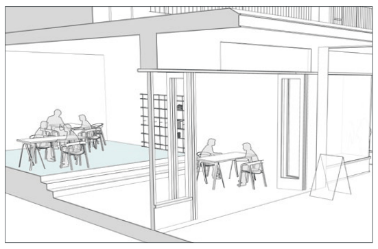
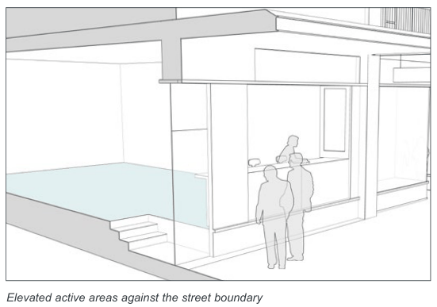
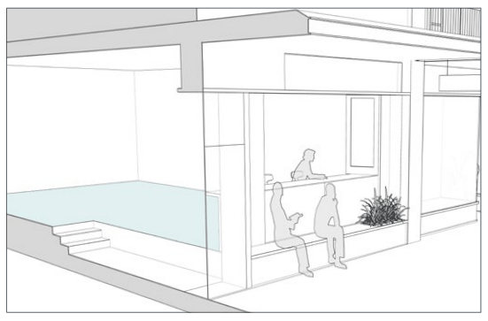
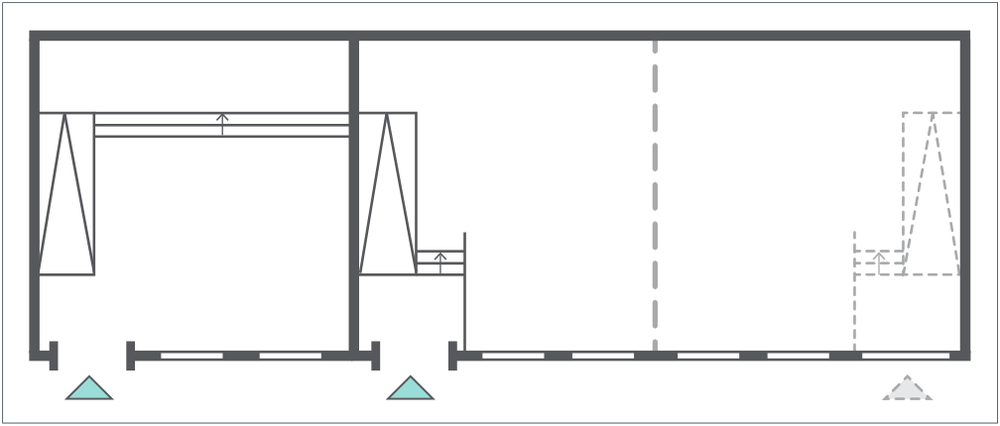

### K20  Kings Bay (PRCUTS)

#### Controls

C9. Active frontages are provided as identified in Figure K20-10.

C10. Along active frontages:

a) the finished ground floor level is to match the footpath level; where this is not possible due to topography, the ground floor level is to be a maximum of 0.4m above the footpath, unless the building is located within an area vulnerable to flooding;

b) in flood prone areas where the ground floor is elevated above the footpath or adjoining public open space, street activation is to be created by locating entries at footpath level, and with internal steps. Any elevated areas outside are to form an activated continuation of the interior and are not to create a visual barrier to the interior (see Figure K20-30).

c) continuous awnings must be provided to shelter pedestrians from weather conditions;

d) awnings should be designed to allow for street tree planting;

e) awnings are to be between 3.5m and 5m above ground level (see Figure K20-28;

f) consistent paving, street furniture, signage, planting and lighting is desireable; and

g) design guidance in Figure K20-11 is applied where possible with long expanses of floor to ceiling glass prohibited.

> [Picture on page 325: a picture, saved as a picture (images/part-k-special-precincts-page-325-38.gif, 150 dpi).]

Building entry at street with internal steps/ ramp/ retractable stair/ lift system to elevated floor above flood level

> [Picture on page 325: a picture, saved as a picture (images/part-k-special-precincts-page-325-41.gif, 150 dpi).]

Elevated active areas against the street boundary

> [Picture on page 325: a picture, saved as a picture (images/part-k-special-precincts-page-325-43.gif, 150 dpi).]

Elevated active areas against the street boundary with integrated seating

Figure K20-30 Strategies to achieve street level activation in flood prone areas

> [Picture on page 326: a picture, saved as a picture (images/part-k-special-precincts-page-326-1.gif, 150 dpi).]

Figure K20-31 Example of design options that provide street activation and flexibility for future changes in a flood zone. The right-hand tenancy has been designed to allow future subdivision, including a new doorway and internal transition area.
