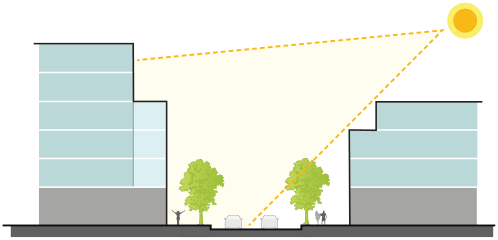
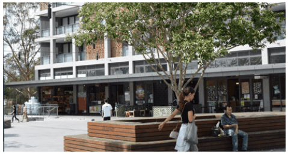
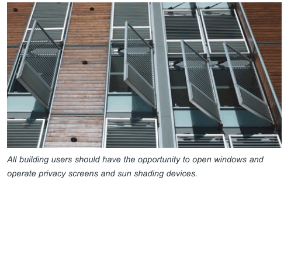
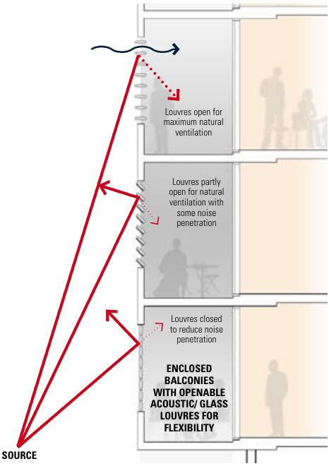
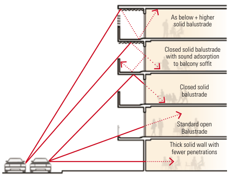

### K20  Kings Bay (PRCUTS)

#### K20.16 Amenity

> [Picture on page 327: a picture, saved as a picture (images/part-k-special-precincts-page-327-3.gif, 150 dpi).]

New housing and employment uses need to provide a high level of amenity for future residents and building users. At the same time, development is required to protect and where possible enhance the quality of the public domain and adjoining private properties. The following controls seek to help maximise privacy, solar access and outlook for all. This section also identifies design treatments to mitigate air quality and noise impacts for development along Parramatta Road.

#### Objectives

C1. To minimise the impact of new development on the outlook, privacy and sun access of adjoining properties.

C2. To minimise overshadowing of streets, links and public open spaces.

C3. To protect building users from negative impacts (noise, air quality, vibration) from Parramatta Road.

| Controls |  |
|---|---|
| C1. | Siting and built form configuration optimises solar access within the development and minimises overshadowing of adjoining properties. |
| C2. | Taller elements of built form are oriented north-south where possible. The height and modulation of east-west buildings allows solar access to courtyard spaces (where courtyards are appropriate). |
| C3. | Louvres, shading devices and windows are able to be operated by buildings users where possible, to allow building occupants to regulate climatic conditions rather than rely solely on mechanical systems. |
| C4. | Development along Parramatta Road is to consider the provisions of the State Environmental Planning Policy (Infrastructure) 2007 and Development Near Rail Corridors and Busy Roads Interim Guidelines and the design approaches illustrated in Figure K20-32. |
| C5. | For residential components of new development, noise sensitive areas (living rooms, bedrooms) are located away from Parramatta Road where possible. |
| C6. | Windows located towards Parramatta Road are double-glazed (or use laminated glazing) and have acoustic seals. |
| C7. | Habitable rooms (excluding balconies) are to be designed to achieve internal noise levels of no greater than 50dBA. |

> [Picture on page 328: a picture, saved as a picture (images/part-k-special-precincts-page-328-1.gif, 150 dpi).]

Example of a public square with good solar access, seating facilities and active frontages.

> [Picture on page 328: a picture, saved as a picture (images/part-k-special-precincts-page-328-4.gif, 150 dpi).]
> Words printed on the picture (copied from the PDF):
> Where balconies are required, solid balustrades with
> sound absorption material added to the underside of
> balconies above is a good means of reducing noise
> entering the building.

road

All building users should have the opportunity to open windows and operate privacy screens and sun shading devices.

Providing enclosed balconies (or winter gardens) is another means of reducing the noise entering a building. Where enclosed balconies are used ventilation may need to be considered. By installing acoustic louvres ventilation requirements and reduced noise can be addressed. These approaches are shown in figure 3.16.

> [Picture on page 328: a map, saved as a picture (images/part-k-special-precincts-page-328-15.gif, 150 dpi); the street names and other small labels are on the picture.]
> Labels printed on the map (copied from the PDF, in no particular order):
> figure 3.16: Enclosable · balconies facing the · Louvres open for · maximum natural · ventilation · Louvres partly · open for natural · ventilation with · some noise · penetration · Louvres closed · to reduce noise · penetration · ENCLOSED · BALCONIES · WITH OPENABLE · ACOUSTIC/ GLASS · LOUVRES FOR · FLEXIBILITY

> [Picture on page 328: a map, saved as a picture (images/part-k-special-precincts-page-328-16.gif, 150 dpi); the street names and other small labels are on the picture.]
> Labels printed on the map (copied from the PDF, in no particular order):
> As below + higher · figure 3.15: Balcony treatments · which reduce traffic noise · intrusion · solid balustrade · Closed solid balustrade · with sound adsorption · to balcony soffit · Closed solid · balustrade · Standard open · Balustrade · Thick solid wall with · fewer penetrations

#### SOURCE

Figure K20-32 Noise mitigating facade treatments

(Source: Development Near Rail Corridors And Busy Roads Interim Guideline, NSW)
