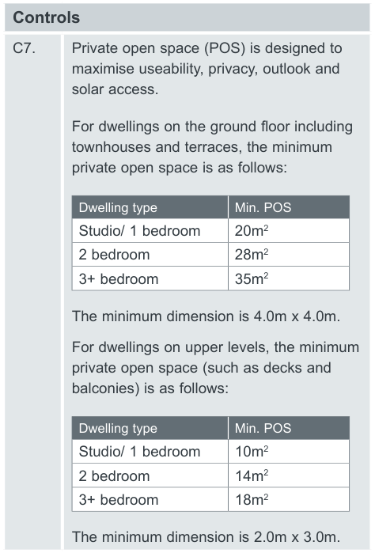
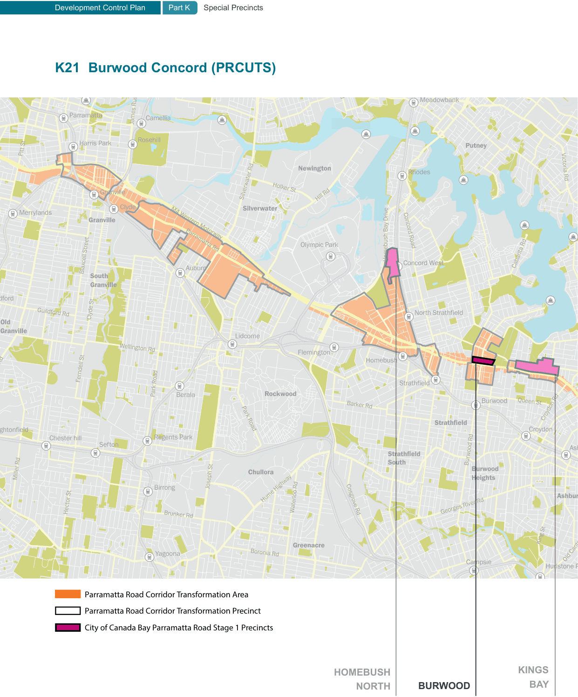

### K20  Kings Bay (PRCUTS)

#### K20.21 Housing Diversity

A mix of dwelling types in the precinct will provide greater housing choice and support equitable housing access by offering a diversity of dwelling types, amount of floor space, number of bedrooms and level of accessibility and affordability.

#### Objectives

O1 To provide a diverse range of dwelling types and sizes to cater for the needs of the existing and future residents over time, and encourage social diversity.

O2 To ensure that low to moderate income households can afford to live in the precinct by increasing the stock of appropriate affordable housing.

| Controls |  |
|---|---|
| C1. | For mix of residential flat buildings and residential components of mixed use developments, refer to LEP clause - 6.11 Mix of dwelling sizes in residential flat buildings and mixed use development |
| C2. | Regarding the amount of adaptable (accessible) housing to be provided refer to requirements in City of Canada Bay DCP Part B1.1 Adaptable Housing. |
| C3. | Contributions towards Affordable Housing is to be provided according to Council’s Affordable Housing Contributions Scheme. |
| C4. | Affordable housing is to be consistent with the requirements of the City of Canada Bay Affordable Housing Program and Policy. |

K20.22 Residential Uses not covered by the

#### Apartment Design Guide

The NSW Apartment Design Guide (ADG) applies to buildings that are three or more storeys high and that comprise at least four dwellings. For other residential development types, such as 2-3 storey terraces, low rise up-over or walk-up apartments, multiplexes, urban courtyard houses and the like, the following controls apply.

#### Objective

O1 To ensure design quality, performance of and amenity created by new residential development is of a high standard and consistent across the precinct.

| Controls |  |
|---|---|
| C1. | The maximum building depth is 18m unless it can be demonstrated that all habitable rooms receive adequate ventilation and solar access, e.g. through the use of a courtyard design. |
| C2. | The minimum private open space of a ground floor dwelling is calculated by the number of bedrooms x 4m2. |
| C3. | Single aspect dwellings, if unavoidable, are only permitted if they have a northerly or easterly aspect. |
| C4. | Living rooms and private open spaces of at least 70% of apartments receive a minimum of 2 hours direct sunlight between 9 am and 3 pm in mid winter (21 June). |
| C5. | Master bedrooms have a minimum area of 10m2 and other bedrooms 9m2. |
| C6. | Building separation is as per the Apartment Design Guide, Section 3F Visual Privacy. |

> [Picture on page 340: a picture, saved as a picture (images/part-k-special-precincts-page-340-1.gif, 150 dpi).]

#### Controls

C7. Private open space (POS) is designed to maximise useability, privacy, outlook and solar access.

For dwellings on the ground floor including townhouses and terraces, the minimum private open space is as follows:

| Dwelling type | Min. POS |
|---|---|
| Studio/ 1 bedroom | 20m2 |
| 2 bedroom | 28m2 |
| 3+ bedroom | 35m2 |

The minimum dimension is 4.0m x 4.0m. For dwellings on upper levels, the minimum private open space (such as decks and balconies) is as follows:

| Dwelling type | Min. POS |
|---|---|
| Studio/ 1 bedroom | 10m2 |
| 2 bedroom | 14m2 |
| 3+ bedroom | 18m2 |

The minimum dimension is 2.0m x 3.0m.

> [Picture on page 341: a map, saved as a picture (images/part-k-special-precincts-page-341-1.gif, 150 dpi); the street names and other small labels are on the picture.]
> Labels printed on the map (copied from the PDF, in no particular order):
> Wharf Rd · Meadowbank · Meadowb · Parramatta · Camellia · James Ruse Dr · Rosehill · Harris Park · Putney · O’Connell St · Pitt St · Newington · Rhodes · Rhodes · Victoria Rd · Holker St · Granville · Silverwater Rd · Hill Rd · Silverwater · Clyde · Merrylands · Granville · M4 Western Motorway · Concord Road · Concord Road · Olympic Park · Olympic Park · Parramatta Rd · e · vir · D · y · a · B · h · s · u · b · e · m · o · H · Concord West · Concor · Cabarita Rd · Auburn · Blaxcell Street · South · Granville · dford · North Strathfield · Guildford Rd · Old · Granville · Lidcome · Wellington Rd · Flemington · Flemington · Homebush · bush · Ferndell St · Clyde St · Strathf · Strathfield · Park Road · Rockwood · Berala · Burwood Queen St · Barker Rd · Croydon Rd · Strathfield · Park Road · Croydon · Regents Park · Sefton · Chester hill · ghtonfield · Ash · ield · Burwood Rd · Strathfie · South · Chullora · Miller Rd · Burwood · Heights · Joseph St · Birrong · Ashbur · Hume Highway · Waterloo Rd · Hector St · Georges River Rd · Cosgrove Rd · Brunker Rd · King St · Greenacre · a · Yagoona · Boronia Rd · Old Canter · Hurlstone P · Campsie · Parramatta Road Corridor Transformation Area · Parramatta Road Corridor Transformation Precinct · City of Canada Bay Parramatta Road Stage 1 Precincts · BAY
