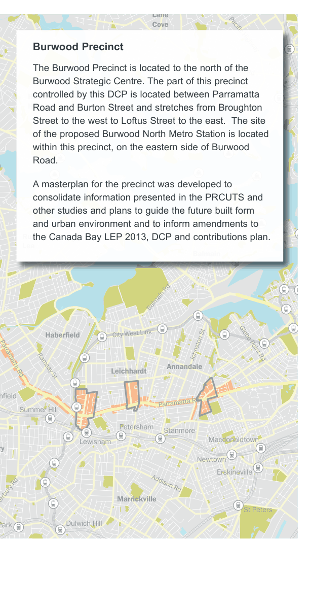
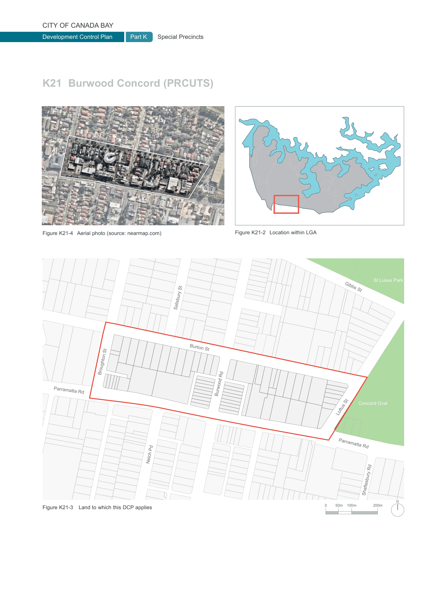

### K21  Burwood Concord (PRCUTS)

e Rd

d

#### KINGS

#### HOMEBUSH

#### NORTH BURWOOD

Figure K21-1 PRCUTS Parramatta Road Corridor (Source: PRCUTS, 2016)

> [Picture on page 342: a map, saved as a picture (images/part-k-special-precincts-page-342-1.gif, 150 dpi); the street names and other small labels are on the picture.]
> Labels printed on the map (copied from the PDF, in no particular order):
> Lane · Cove · Pacific Highway · River Rd · Hunters · Hill · Burns Bay Road · Victoria Road · Darling St · Lyons Rd · Russell · Lea · Balmain · Balmain Rd · City West Link · Haberfield · Johnston St Glebe Point Rd · Leichhardt · Annandale · Parramatta Rd Ramsay St · hfield · Parramatta Rd · Summer Hill · Petersham · Stanmore · Macdonaldtown · Lewisham · ry · Newtown · Erskineville · Addison Rd · Marrickville · anterbury Rd · St Peters · Dulwich Hill · Park

#### Burwood Precinct

The Burwood Precinct is located to the north of the Burwood Strategic Centre. The part of this precinct controlled by this DCP is located between Parramatta Road and Burton Street and stretches from Broughton Street to the west to Loftus Street to the east.  The site of the proposed Burwood North Metro Station is located within this precinct, on the eastern side of Burwood Road.

A masterplan for the precinct was developed to consolidate information presented in the PRCUTS and other studies and plans to guide the future built form and urban environment and to inform amendments to the Canada Bay LEP 2013, DCP and contributions plan.

#### K21.1 Parramatta Road Corridor Urban Transformation Strategy (PRCUTS)

This DCP has been prepared to support the implementation of the NSW Government Parramatta Road Corridor Urban Transformation Strategy (PRCUTS) published in November 2016.

PRCUTS aims to renew Parramatta Road and adjacent communities through investments in homes, jobs, transport, open spaces and public amenity. It presents significant urban renewal opportunities for land within defined development precincts.

The DCP has been prepared to deliver the desired future character envisaged in PRCUTS, with refinements to achieve better urban design and community outcomes.

Two development pathways are available:

1\) Land is developed to the standards identified on the Floor Space Ratio and Height of Building maps.

2\) Where development achieves the minimum lot size and/or identified community infrastructure is delivered, the land may be developed to the standards identified on the Community Infrastructure Floor Space Ratio and Height of Building Maps. The provisions in this DCP describe the planning controls permitted under Option 2.

> [Picture on page 343: a map, saved as a picture (images/part-k-special-precincts-page-343-1.gif, 150 dpi); the street names and other small labels are on the picture.]
> Labels printed on the map (copied from the PDF, in no particular order):
> Broughton St · Broughton St · Salisbury St · Salisbury St · Burton St · Burton St · Loftus St · Loftus St · Parramatta Rd · Parramatta Rd · Nelch Pd · Nelch Pd · Parramatta Rd · Parramatta Rd · Burwood Rd · Burwood Rd · Burwood Rd · Burwood Rd · Figure K21-2 Location within LGA · Figure K21-4 Aerial photo (source: nearmap.com) · Shaftesbury Rd · Shaftesbury Rd · Salisbury St · Burton St · Broughton St · Parramatta Rd · Burwood Rd · Nelch Pd · Figure K21-3 Land to which this DCP applies · St Lukes Park · Gibbs St · Concord Oval · Loftus St · Parramatta Rd · Shaftesbury Rd · N · 200m · 100m · 50m · 0
