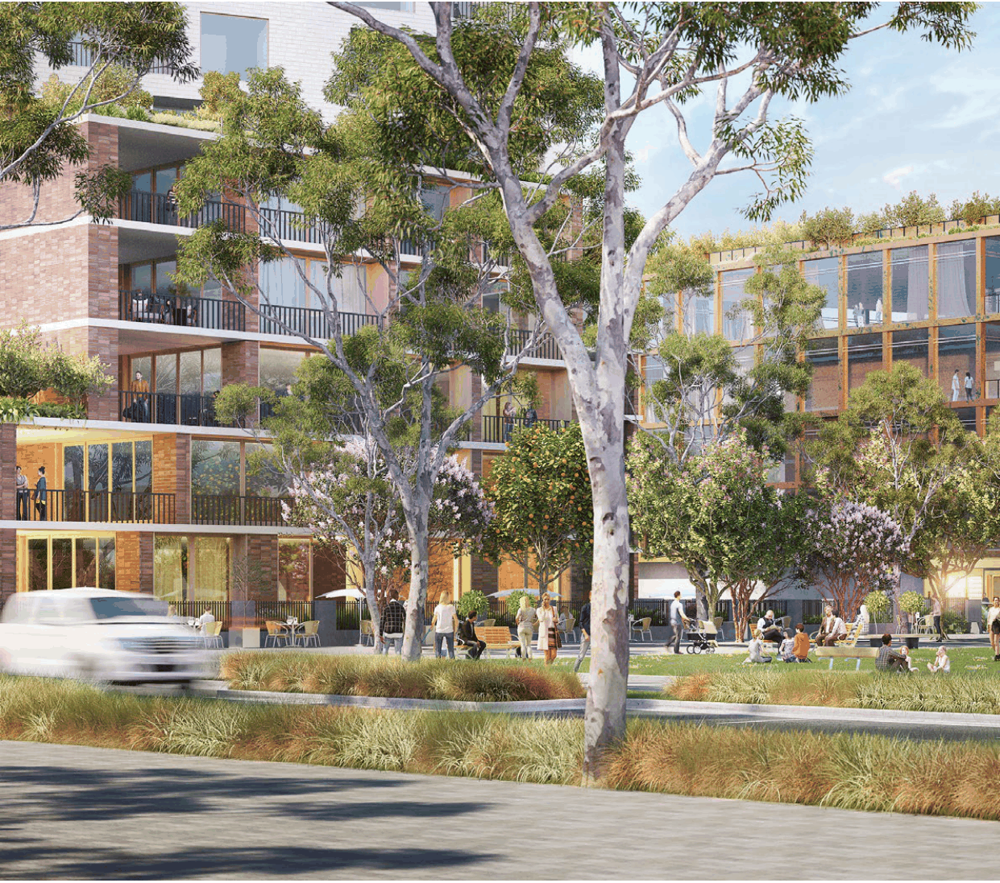
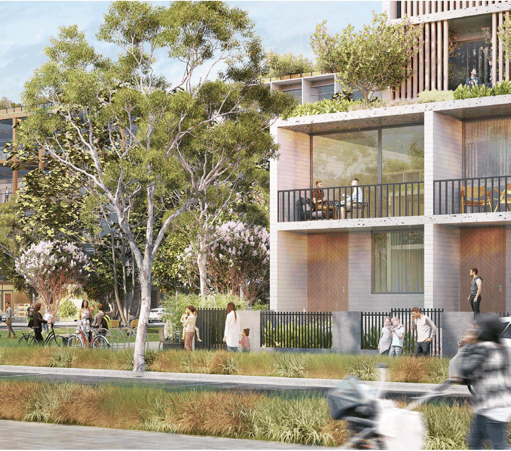

### K21  Burwood Concord (PRCUTS)

> [Picture on page 345: a picture, saved as a picture (images/part-k-special-precincts-page-345-2.gif, 150 dpi).]

Figure K21-5 Artist impression of indicative future character along Burton Street, Burwood

Development Control Plan

Part K Special Precincts

> [Picture on page 346: a picture, saved as a picture (images/part-k-special-precincts-page-346-3.gif, 150 dpi).]
