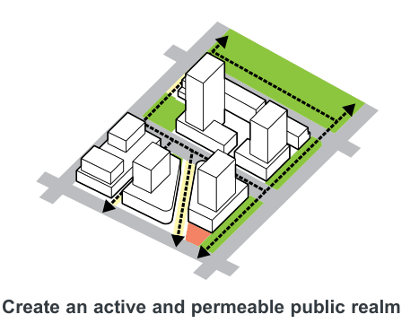
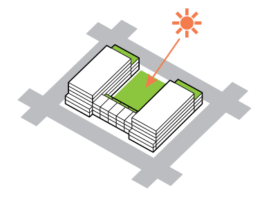
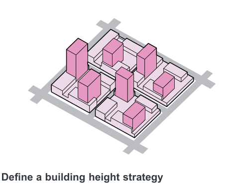
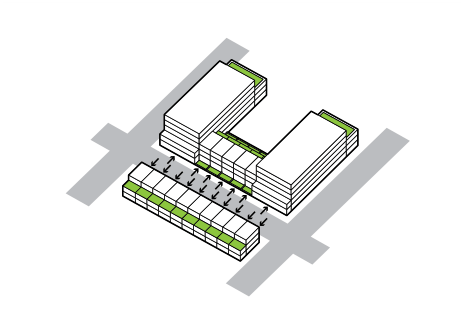
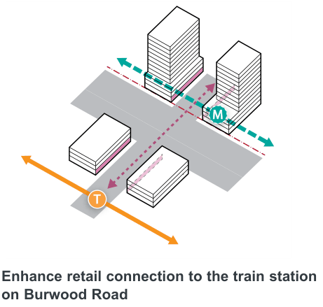
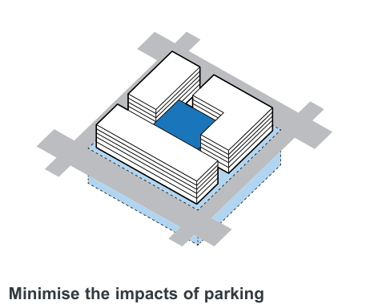
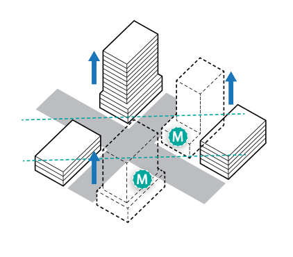

### K21  Burwood Concord (PRCUTS)

#### K21.4 Urban Design Principles

> [Picture on page 347: a picture, saved as a picture (images/part-k-special-precincts-page-347-3.gif, 150 dpi).]

#### Create an active and permeable public realm

Expand open space network and provide easy access and connection throughout the public realm.

Promote active transport such as walking and cycling.

> [Picture on page 347: a picture, saved as a picture (images/part-k-special-precincts-page-347-8.gif, 150 dpi).]

#### Maximise solar access and amenity

Ensure all public open spaces have adequate solar access.

Putting height towards the southern boundaries to ensure solar access penetrates the site and minimises overshadowing.

> [Picture on page 347: a picture, saved as a picture (images/part-k-special-precincts-page-347-15.gif, 150 dpi).]

#### Define a building height strategy

Create a dynamic skyline by spreading higher built form.

#### Promote fine grain and active frontages

Reinforce Burwood Road as a Place for People by appropriate frontage treatment, including fine grain facade and activation.

PRCUTS definition: Places for People are “streets with high demand for activities and lower levels of vehicle movement. They create places people enjoy, attract visitors, and are places communities value".

> [Picture on page 348: a picture, saved as a picture (images/part-k-special-precincts-page-348-1.gif, 150 dpi).]

#### Promote passive surveillance through ground

floor modulation

Enhance passive surveillance along residential streets by providing:

• entrances to ground floor units that are accessible from the street

• planted landscape buffers & low-height fencing that are designed to maximise visual connectivity to living areas.

> [Picture on page 348: a picture, saved as a picture (images/part-k-special-precincts-page-348-11.gif, 150 dpi).]
> Words printed on the picture (copied from the PDF):
> M
> T

#### Enhance retail connection to the train station

on Burwood Road

Enhance the north-south retail link on Burwood Road and form the Northern gateway to Burwood Town Centre.

> [Picture on page 348: a picture, saved as a picture (images/part-k-special-precincts-page-348-17.gif, 150 dpi).]

#### Minimise the impacts of parking

Parking should be put underground as a priority. Where underground option is not possible, due to proximity to the Metro West rail tunnel and limitations on excavation, parking will not be required. If parking is required to be provided above ground, parking should be sleeved with active uses or considerable facade treatment to avoid exposing the structure directly to the

> [Picture on page 348: a picture, saved as a picture (images/part-k-special-precincts-page-348-26.gif, 150 dpi).]
> Words printed on the picture (copied from the PDF):
> M
> M

street.

#### Integrate future Metro station

Metro West is a catalyst for renewal. Development is likely to occur around and above the new stations, including new commercial development along Parramatta Road and residential towers to the north and throughout the precinct.

New development will take into consideration the metro tunnel going underground and potential entry plaza that will be provided within the precinct.
