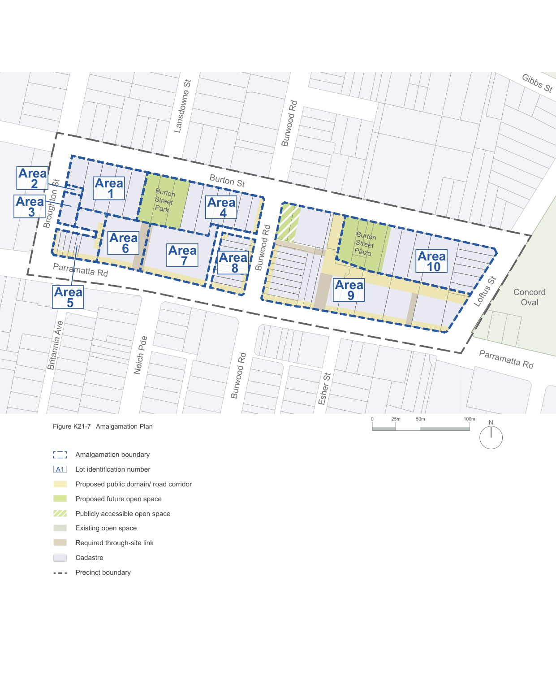

### K21  Burwood Concord (PRCUTS)

#### K21.6 Block Configuration

The scale, height, arrangement and orientation of new built form defines the proportion and level of enclosure of streets and public spaces. Good site planning and block configuration maximises the level of sun access and visual and acoustic privacy for all, including neighbouring properties.

Together with primary and upper level setbacks (see Section K21.9 Street Wall Heights and Setbacks), the following controls set the basic building footprints and envelopes for new development in the Burwood Parramatta Road Precinct.

#### Objectives

O1 To arrange building forms including heights and massing that reinforce the future desired character of the area and protect valued character attributes.

O2 To facilitate daylight access and ventilation to streets, public places and neighbouring properties, including properties on the south side of Parramatta Road.

O3 To maximise visual and acoustic privacy.

O4 To consider future development opportunities on adjoining sites and avoid isolated sites.

O5 To maximise permeable ground surfaces to allow rainwater to penetrate the soil.

#### Controls

C1. New development is to consider future development on adjoining sites by providing sufficient separation and setbacks, and avoid creating isolated sites.

New development is to follow the desired Site Amalgamation Plan (Figure K21-7).

C2. The delivery of identified amalgamation and community infrastructure is a prerequisite for the heights and densities identified in the LEP. If this is achieved new development is to conform to the maximum number of storeys as shown in Figure K21-11. Further controls regarding the permissible building envelope are contained in Section K21.9 Street Wall Heights and Setbacks and Section K21.13 Massing and Articulation.

C3. The maximum length of any building above 5 storeys is 60m.

C4. Residential towers above podium level shall have a maximum enclosed area of 750sqm (including circulation and excluding balconies) and a maximum total floor area of 875sqm (including and assuming 15% for balconies).

C5. For commercial uses on all floors above the ground level, any wall with windows must be set back from the side and rear boundary by 3m. Any wall without windows is not required to be setback.

C6. Built form is to be positioned for optimal access to daylight and direct sunlight for internal and external spaces, and for adjoining public and private land.

C7. Buildings are adaptable to a variety of uses over time. The following minimum floor to floor heights apply:

| Use | Minimum height |
|---|---|
| Retail | 4.4m |
| Commercial | 3.7m |
| Adaptable | 3.7m |
| Residential | 3.1m |

C8. The ground floor of all lots fronting Parramatta Road is to be a minimum of 4.4m in height to facilitate a wide variety of uses.

Development on the ground floor fronting Parramatta Road is to prioritise urban services and light industrial uses, consistent with Active Frontages.

The second floor of development fronting Parramatta Road in the B4 Mixed Use zone is also to have retail and/or commercial uses.

> [Picture on page 352: a map, saved as a picture (images/part-k-special-precincts-page-352-1.gif, 150 dpi); the street names and other small labels are on the picture.]
> Labels printed on the map (copied from the PDF, in no particular order):
> Burton St · Burton · Street · Park · Broughton St · Burwood Rd · Parramatta Rd · Britannia Ave · Lansdowne St · Neich Pde · Burwood Rd · Burwood Rd · Figure K21-7 Amalgamation Plan · Amalgamation boundary · A1 Lot identification number · Proposed public domain/ road corridor · Proposed future open space · Publicly accessible open space · Walker St · Existing open space · Required through-site link · Bayview Rd · Cadastre · Renown St · Precinct boundary · Thomas St · Watts St · Louden St · Burton · Street · Plaza · Esher St · 25m · 0 · 50m · Gibbs St · Concord · Oval · Loftus St · Parramatta Rd · 100m · N

### Area

### Area

### 1

### 2

### Area

### Area

### 3

### 4

### Area
