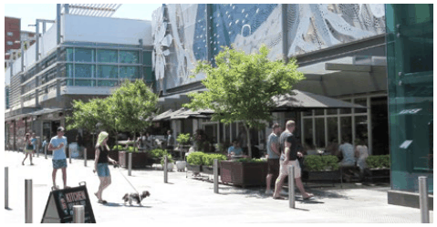
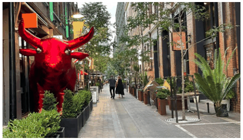
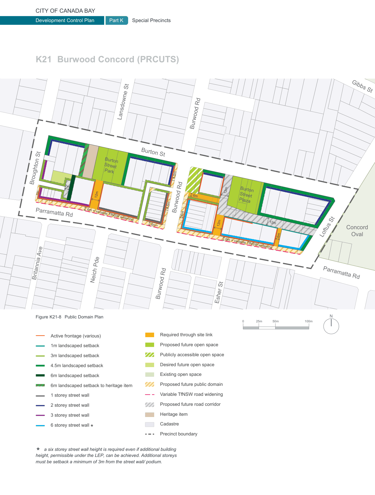

## 6 Area

### Area

### 7

### 8

### Area

### 5

### Area

### 9

### Area

### 10

### K21  Burwood Concord (PRCUTS)

#### K21.7 Access Network

A permeable urban structure is key to successful places. The provision of new links and open spaces is encouraged to build upon the existing access network and support the uptake of active and public transport and linking key destinations within and beyond the precinct.

#### Objectives

O1 To build upon and further improve the fine grain access network to more effectively link to open spaces, public transport stops and Burwood Town Centre to the south.

O2 To encourage travel behaviour change by discouraging car usage and supporting sustainable travel choices such as public and active transport.

O3 To improve network permeability, in particular for pedestrians, by breaking up long blocks with new streets and quality pedestrian prioritised links.

O4 To meet access requirements for future development and enable increased density in selected locations.

> [Picture on page 353: a picture, saved as a picture (images/part-k-special-precincts-page-353-24.gif, 150 dpi).]

A more permeable urban structure and a focus on a high quality pedestrian environment will support walking and cycling.

> [Picture on page 353: a picture, saved as a picture (images/part-k-special-precincts-page-353-27.gif, 150 dpi).]

Slow speed, shared spaces provide links that encourage pedestrian access across the precinct.

| Controls |  |
|---|---|
| C1. | The existing movement network is retained and new public open spaces and new north-south and east-west pedestrian links are provided as a minimum as identified in Figure K21-8. See Section K21.8 Public Domain Experience for more detail. |
| C2. | New public open spaces are located as identified in Figure K21-8. See Section K21.8 Public Domain Experience for more detail. |
| C3. | Wherever possible, long blocks are broken up with new high quality pedestrian prioritised links, particularly where new connections would facilitate access to public transport, open spaces and community facilities. |
| C4. | Size and location of footpaths, laneways, cycleways, planting and parks are to be provided according to Council’s PRCUTS Public Domain Plan and PRCUTS Masterplan. |
| C5. | New roads, public domain widenings, parks and cycleways are required to be in public ownership where identified in the LEP. New roads and parks that are identified in the LEP to be publicly accessible but not in public ownership, may be delivered as a public access easement over private land. Future pedestrian links may be delivered as a public access easement over private land. Provision is to be in accordance with the LEP, PRCUTS Infrastructure Strategy and Council’s specifications. |
| C6. | Pedestrian/ cycle links are to be naturally lit and ventilated, appropriately lit after hours, publicly accessible 24/7, and have clear sightlines from end to end. |
| C7. | All new pedestrian/ cycle links are to be defined by built form and quality edge treatments such as low semi-transparent fences and landscaping. |
| C8. | Bicycle facilities, such as parking, secure storage and end-of-trip facilities are to be easily accessible from the public domain and conveniently located near entrances and/or lifts of new development. |

#### K21.8 Public Domain Experience

Private development has a large influence on the local character and the support of the existing or future functioning of the public realm, for example by clearly addressing popular walking routes and providing good levels of surveillance. The scale of built form, its appearance and the design of private-public interfaces has a significant impact on how people experience a streetscape and the safety of a place.

Key elements apart from the built form that need to be considered include front setbacks, boundary treatments, vegetation and landscape design, vehicular access, visible activity at street level, and surveillance provided by doors, windows and balconies.

#### Objectives

O1 To protect and improve the quality, accessibility and safety of the public domain across the precinct.

O2 To support walking and cycling to key destinations and local schools.

O3 To improve the interface to Parramatta Road and support increased activity levels, safety and comfort.

O4 To increase tree canopy cover and provide for more greenery associated with the public domain.

#### Controls

C1. New development that fronts onto streets identified as active frontages, including  vibrant, friendly and mixed facades (see Figure K21-9) must:

a) minimise the number and width of vehicular driveways across the footpath;

b) ensure building entries are clearly visible and pedestrian access to entries and lobbies is direct;

c) pay particular attention to the 'human-scale' of lower levels and display a high degree of detailed design and articulation

d) maximise the number of doors and windows on upper levels overlooking the street; and

e) provide vehicular access off a rear laneway; driveways off Burwood Road and Parramatta Road are strictly prohibited.

C2. New development that fronts onto Parramatta Road supports the upgraded strategic walking link ('green edge') along Parramatta Road between Broughton and Loftus Streets. Development is to:

a) set back as per Figure K21-8;

b) apply coordinated urban and landscape design features that unify the linear green edge along Parramatta Road; and.

c) prioritise urban services uses.

C3. Development fronting Burton Street is to maximise entry doors and windows overlooking the street, minimise vehicular entry points and pay particular attention to quality landscape and architectural detail along lower levels. For more controls see Section K21.11 Transitions and Interfaces.

C4. Development on a corner site including corners of the two new open spaces along Burton Street must pay particular attention to overall design quality due to the location's high visibility and impact on the local character, i.e. well proportioned facades and quality material, finishes and plant species selection.

C5. Development is to support the experience and safety of the two new public open spaces along Burton Street as identified in Figure K21-8 by giving consideration to CPTED principles. Development that faces the open space must:

a) maximise the number of doors and windows overlooking the open space to maximise survelliance and activation of the open space;

b) pay particular attention to quality architectural detail at the lower levels; and

c) ensure that at least 50% of each open space receives a minimum of 3h direct solar access in mid-winter (21 June) between 9am and 3pm.

C6. The maximum number of storeys may be exceeded where additional building height is permissible under the LEP, the minimum floor to floor heights can be achieved, and where it is demonstrated that the solar access requirements of the Apartment Design Guide will be satisfied for buildings on the southern side of Parramatta Road.

C7. Any built structures within the area identified as 'Publicly accessible open space' at the corner of Burwood Road and Burton Street are to be a maximum of two storeys and should maintain sight-lines to the station entry.

> [Picture on page 355: a map, saved as a picture (images/part-k-special-precincts-page-355-1.gif, 150 dpi); the street names and other small labels are on the picture.]
> Labels printed on the map (copied from the PDF, in no particular order):
> Gibbs St · Lansdowne St · Burton St · Burton · Street · Park · 4.5m · Broughton St · 7m · 3m · 12m · 6m · Burton · Street · Plaza · 4.5m · Burwood Rd · 6m · Parramatta Rd · 6m + variable TfNSW widening · 12m · 12m · 12m · 6m+ · Concord · 6m · Oval · Loftus St · 6m + variable TfNSW widening · Britannia Ave · Parramatta Rd · Neich Pde · Burwood Rd · Burwood Rd · Esher St · Renown St · Figure K21-8 Public Domain Plan · N · 100m · 50m · 25m · 0 · Required through site link · Thomas St · Watts St · Active frontage (various) · Proposed future open space · 1m landscaped setback · Publicly accessible open space · 3m landscaped setback · Desired future open space · 4.5m landscaped setback · Louden St · Existing open space · 6m landscaped setback · Proposed future public domain · Walker St · 6m landscaped setback to heritage item · Variable TfNSW road widening · 1 storey street wall · Bayview Rd · Proposed future road corridor · 2 storey street wall · Renown St · Heritage item · 3 storey street wall · Cadastre · Precinct boundary · height, permissible under the LEP, can be achieved. Additional storeys · must be setback a minimum of 3m from the street wall/ podium.
