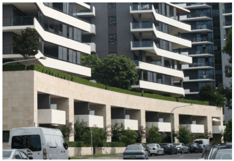

### K21  Burwood Concord (PRCUTS)

#### 6 storey street wall *

### *    a six storey street wall height is required even if additional building

#### K21.9 Street Wall Heights and Setbacks

Street setback areas are an integral part of the streetscape and their treatment is fundamental to the amenity and character of a place. Combined with building height and road reserve width, they define the proportion, scale and visual enclosure of the street. Street setbacks not only establish the alignment of buildings along the street, they also provide for landscaping and deep soil areas, building entries and a transition between public and private space.

Street wall heights and upper level setbacks further define the proportion, scale and visual enclosure of the public domain and provide a level of consistency across the precinct. Upper level setbacks lessen the visual impact of taller development and help create a more unified, human-scale streetscape environment.

#### Objectives

O1 To ensure setbacks contribute positively to the pedestrian environment at street level.

O2 To provide a sense of enclosure to the street and contribute to a consistent built form scale across the precinct over time.

O3 To enhance development and its relationship with adjoining sites and the public domain, particularly in regard to access to sunlight, outlook, view sharing, ventilation and privacy.

> [Picture on page 356: a picture, saved as a picture (images/part-k-special-precincts-page-356-27.gif, 150 dpi).]

A lower street wall height helps to integrate taller development with lower residential scales

#### Controls

| C1. | All development is to comply with the setbacks shown on Figure K21-8. |
|---|---|
| C2. | Where applicable, a portion of the setback area is to provide deep soil zones and tree planting. Refer to Section K21.18 Landscape Design for more detailed controls. |
| C3. | ‘Undesirable’ elements such as vents, electrical substations, or plant and equipment spaces are not permissible within the setback area and should be accommodated within the building. Service cabinets are to be co-located internally, accessible from loading, waste or parking areas where possible to avoid impact on the public realm. |
| C4. | Upper level setbacks are required towards all public domain interfaces as identified in Figure K21-11. |

C5. The following street wall heights apply:

| Location | Maximum street wall height |
|---|---|
| Parramatta Road | 1, 3 & 6 storeys |
| Burwood Road | 1, 2 & 6 storeys |
| Burton Street | 2 storeys |
| Loftus Street | 2 & 6 storeys |
| Broughton Street | 2 & 3 storeys |
| Laneways | nil |

See Figure K21-8.
