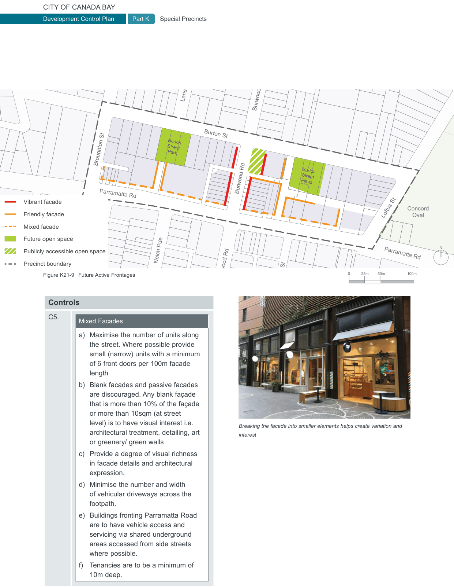

### K21  Burwood Concord (PRCUTS)

#### K21.10 Active Frontages

The quality and attractiveness of buildings at the streetscape level plays an important role in the attractiveness and vibrancy of the street. Active streetscapes have frequent doors, many windows with transparent glass and narrow frontages providing a vertical rhythm along the street with few blank walls.

Successful buildings make a positive contribution to the streets and public spaces around them. They visually activate the street and encourage people to use the street.

It is important to focus on active frontages in commercial and mixed use zones as these are areas where activity and vibrancy is critical to the success of the centre. Ensuring streets and open spaces are overlooked can increase the sense of safety, especially at night.

#### Objectives

O1 To create lively and attractive streetscapes that are safe and attractive.

O2 To support walking in the precinct along streets and within public open spaces.

O3 To provide attractive streets and public spaces that encourage activity and provide opportunities for passive surveillance.

O4 To ensure that the ground level of buildings in mixed use areas are well designed and able to attract a variety of uses that will activate the streetscapes.

#### Controls

C1. Active frontages are to be provided as identified in Figure K21-9. For more controls see Section K21.15 Safety and Accessibility.

Three different types of active frontage have been identified. The type of active frontage  desired is dependent on the location and the intended character of the street.

C2. A maximum of 70% of the ground floor facade is to be glazing and balanced with solid vertical elements creating a rhythm along the street.

C3.

Vibrant Facades

a) Maximise the number of units along the street. Provide small (narrow) units with a minimum of 15 front doors per 100m of facade length.

b) Cater for a wide variety of uses such as shops, cafes, restaurants, bars, fruit/ vegetable markets, community uses and live-work units.

c) Provide a high degree of visual richness in facade details and architectural expression with a focus on vertical facade articulation. Provide ’ins and outs’ (recesses and projections) to create shadows and interest.

d) Vehicle access and servicing zones are not permitted along a Vibrant Façade.

e) Blank facades are not permissible. Passive facades are strongly discouraged and are only permissible where alternatives are not available.

f) Tenancies are to be a minimum of 10m deep.

C4.

Friendly Facades

a) Maximise the number of units along the street. Provide relatively small (narrow) units with a minimum of 10 front doors per 100m facade length

b) Cater for some variety of uses such as shops and live-work units including residential lobbies.

c) Blank facades and passive facades are strongly discouraged

d) Provide a degree of visual richness in facade details and architectural expression.

e) Minimise the number and width of vehicular driveways across the footpath with limited vehicle access and servicing permitted. Openings, when permitted are to be narrow and recessed.

f) Tenancies are to be a minimum of 10m deep.

> [Picture on page 358: a map, saved as a picture (images/part-k-special-precincts-page-358-1.gif, 150 dpi); the street names and other small labels are on the picture.]
> Labels printed on the map (copied from the PDF, in no particular order):
> Burton St · Burton · Street · Park · Broughton St · Burton · Street · Plaza · Burwood Rd · Parramatta Rd · Vibrant facade · Concord · Friendly facade · Oval · Loftus St · Mixed facade · Future open space · N · Publicly accessible open space · Britannia Ave · Parramatta Rd · Lansdowne St · Neich Pde · Walker St · Precinct boundary · 100m · 50m · 25m · 0 · Figure K21-9 Future Active Frontages · Burwood Rd · Burwood Rd · Esher St · C5. · Breaking the facade into smaller elements helps create variation and · interest · 10m deep.

#### Controls

Mixed Facades

a) Maximise the number of units along the street. Where possible provide small (narrow) units with a minimum of 6 front doors per 100m facade length

b) Blank facades and passive facades are discouraged. Any blank façade that is more than 10% of the façade or more than 10sqm (at street level) is to have visual interest i.e. architectural treatment, detailing, art or greenery/ green walls

c) Provide a degree of visual richness in facade details and architectural expression.

d) Minimise the number and width of vehicular driveways across the footpath.

e) Buildings fronting Parramatta Road are to have vehicle access and servicing via shared underground areas accessed from side streets where possible.

f) Tenancies are to be a minimum of
