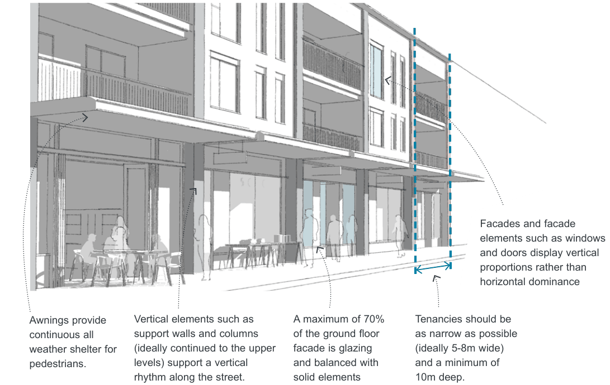
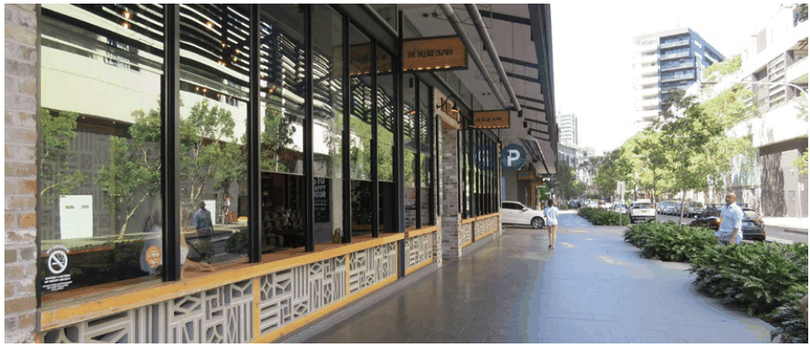
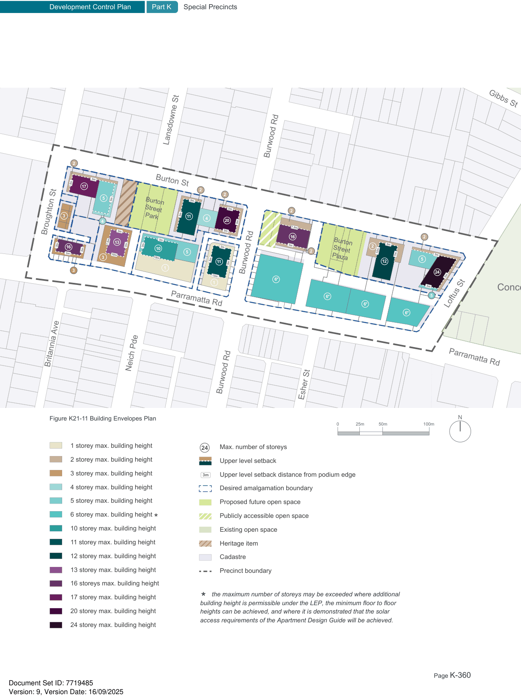

### K21  Burwood Concord (PRCUTS)

> [Picture on page 359: a picture, saved as a picture (images/part-k-special-precincts-page-359-2.gif, 150 dpi).]
> Words printed on the picture (copied from the PDF):
> Facades and facade
> proportions rather than
> horizontal dominance

Awnings provide continuous all weather shelter for pedestrians.

Vertical elements such as support walls and columns (ideally continued to the upper levels) support a vertical rhythm along the street.

Figure K21-10 Active Frontage Design Guidance

A maximum of 70% of the ground floor facade is glazing and balanced with solid elements

elements such as windows and doors display vertical

Tenancies should be

as narrow as possible

(ideally 5-8m wide)

and a minimum of

10m deep.

> [Picture on page 359: a picture, saved as a picture (images/part-k-special-precincts-page-359-25.gif, 150 dpi).]

Stall risers, richness of material choices and operable glazing contribute to high quality street interfaces

> [Picture on page 360: a map, saved as a picture (images/part-k-special-precincts-page-360-1.gif, 150 dpi); the street names and other small labels are on the picture.]
> Labels printed on the map (copied from the PDF, in no particular order):
> Gibbs St · Lansdowne St · 2 · 3m · Burton St · 17 · 2 · 2 · 5 3m · 3m · 3m · 2 · 3m · 3 · 4 · Burton · Street · Park 11 · 20 · 4 · 3m · 7.5m · 3m · Broughton St · 16 · 2 · 3m · 3m · 7.5m · 3m · 3m · 3m 3m · 3m · 2 · 3m · 16 · 13 · 10 · 3m · 12m · 2 · 5 · 3m · 7m · 3m · 3m · 18m · 3 · 3m · Burton · Street · Plaza · 5 · 12 · 11 3m · 1 · 3 · Burwood Rd · 24 · 10m · 13m · 3m · 6* · 1 · 3m · 5 · 6* · 6* · Parramatta Rd · Loftus St · 6* · Britannia Ave · Parramatta Rd · Neich Pde · Burwood Rd · Burwood Rd · Esher St · Figure K21-11 Building Envelopes Plan · N · 100m · 50m · 25m · 0 · 1 storey max. building height · Max. number of storeys · 24 · 2 storey max. building height · Upper level setback · 3 storey max. building height · 3m Upper level setback distance from podium edge · 4 storey max. building height · Desired amalgamation boundary · 5 storey max. building height · Proposed future open space · Walker St · Publicly accessible open space · 10 storey max. building height · Existing open space · Bayview Rd · 11 storey max. building height · Heritage item · Renown St · 12 storey max. building height · Cadastre · 13 storey max. building height · Precinct boundary · Regatta Rd · 16 storeys max. building height · Thomas St · 17 storey max. building height · 20 storey max. building height · building height is permissible under the LEP, the minimum floor to floor · heights can be achieved, and where it is demonstrated that the solar · access requirements of the Apartment Design Guide will be achieved. · 24 storey max. building height · Louden St

#### Conco
