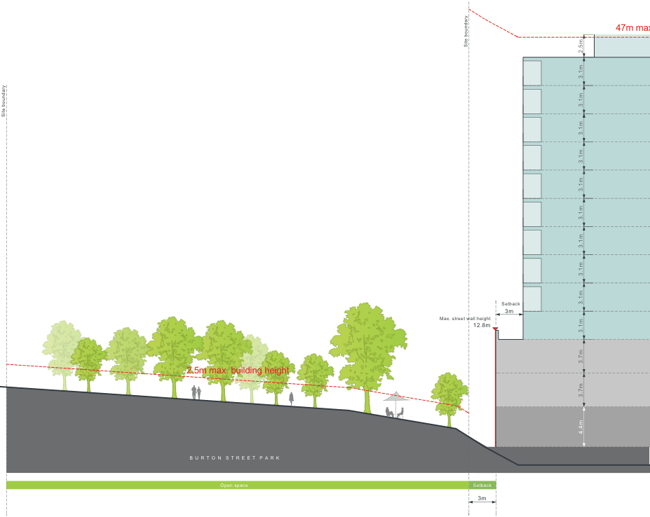
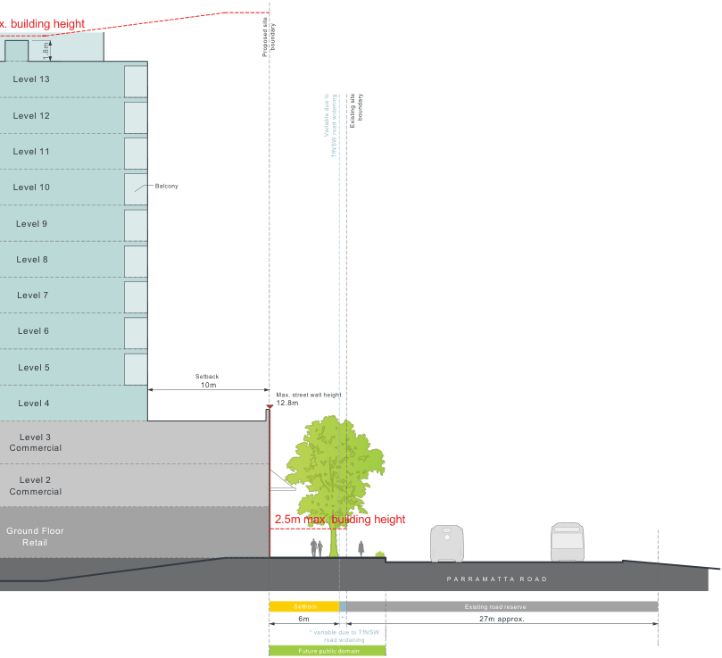
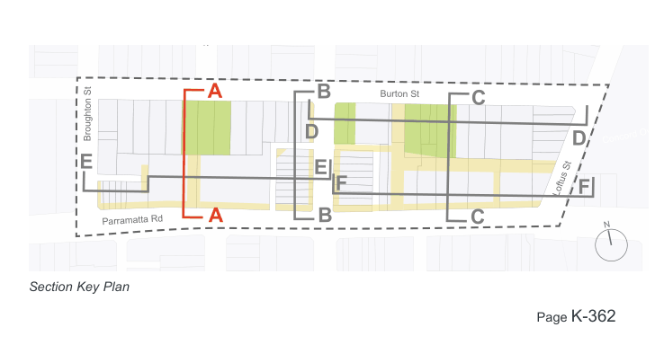

#### 6 storey max. building height *

### *    the maximum number of storeys may be exceeded where additional

#### wood Park

### K21  Burwood Concord (PRCUTS)

> [Picture on page 361: a map, saved as a picture (images/part-k-special-precincts-page-361-2.gif, 150 dpi); the street names and other small labels are on the picture.]
> Labels printed on the map (copied from the PDF, in no particular order):
> 2.5m max. building height · B U R T O N S T R E E T P A R K · Open space · 47m max · Site boundary · Setback · 3m · Max. street wall height · 12.8m · 3.1m · 3.1m · 3.1m · 3.7m · 3.7m · 4.4m · 3.1m · 3.1m · 3.1m · 3.1m · 2.5m · 3.1m · 3.1m · 3.1m · Setback · 3m

Site boundary

Figure K21-12 Built Form Envelope - Section A

> [Picture on page 362: a map, saved as a picture (images/part-k-special-precincts-page-362-1.gif, 150 dpi); the street names and other small labels are on the picture.]
> Labels printed on the map (copied from the PDF, in no particular order):
> x. building height · boundary · Proposed site · 1.8m · Level 13 · Level 12 · boundary · Existing site · Variable due to · Level 11 · TfNSW road widening · Balcony · Level 10 · Level 9 · Level 8 · Level 7 · Level 6 · Level 5 · Setback · 10m · Max. street wall height · 12.8m · Level 4 · Level 3 · Commercial · Level 2 · Commercial · 2.5m max. building height · 000 · Ground Floor · Retail · P A R R A M A T T A R O A D · Existing road reserve · Setback · 27m approx. · 6m * · * variable due to TfNSW · road widening · Future public domain

> [Picture on page 362: a picture, saved as a picture (images/part-k-special-precincts-page-362-2.gif, 150 dpi).]
> Words printed on the picture (copied from the PDF):
> Salisbury St
> Burton St
> Broughton St
> Concord Oval
> Parramatta Rd
> N
> Section Key Plan

#### A

#### B

#### C

#### D

#### D

#### Loftus St F

#### F

#### E

#### E B

#### A

#### C
