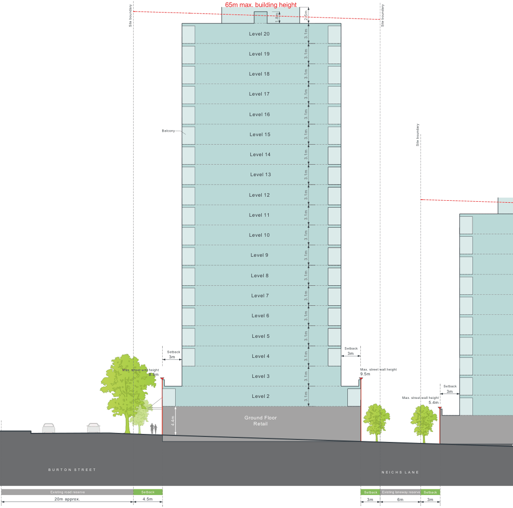
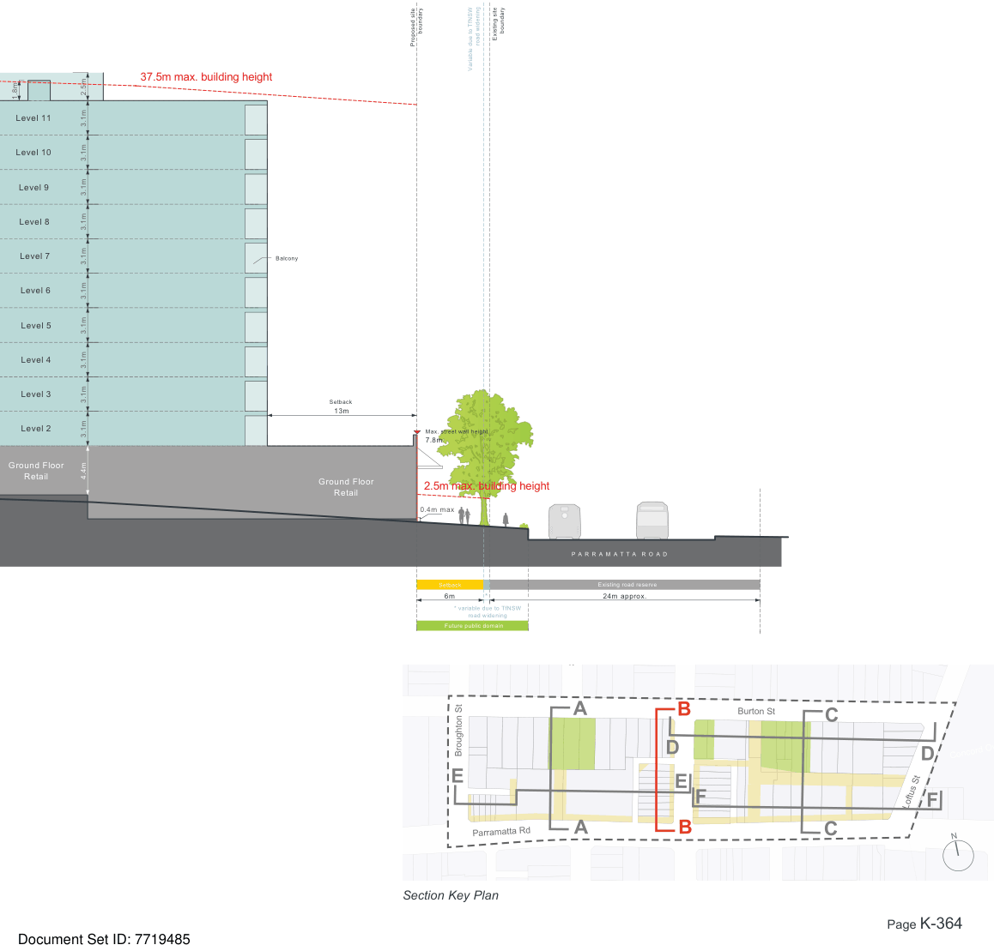

### K21  Burwood Concord (PRCUTS)

> [Picture on page 363: a map, saved as a picture (images/part-k-special-precincts-page-363-2.gif, 150 dpi); the street names and other small labels are on the picture.]
> Labels printed on the map (copied from the PDF, in no particular order):
> B U R T O N S T R E E T · Existing road reserve · 20m approx. · Site boundary · Balcony · Setback · 3m · Max. street wall height · 8.5m · 4.4m · Setback · 4.5m · 65m max. building height · 1.8m · Level 20 · Level 19 · Level 18 · Level 17 · Level 16 · Level 15 · Level 14 · Level 13 · Level 12 · Level 11 · Level 10 · Level 9 · Level 8 · Level 7 · Level 6 · Level 5 · Level 4 · Level 3 3.1m · Level 2 · 3.1m · 3.1m · 3.1m · 3.1m · 2.5m · 3.1m · 3.1m · 3.1m · 3.1m · 3.1m · 3.1m · 3.1m · 3.1m · 3.1m · 3.1m · 3.1m · 3.1m · 3.1m · 3.1m · Ground Floor · Retail · Site boundary · Site boundary · Setback · 3m · Max. street wall height · 9.5m · Setback · 3m · Max. street wall height · 5.4m · N E I C H S L A N E · Existing laneway reserve · Setback Setback · 3m · 6m · 3m

Figure K21-13 Built Form Envelope - Section B

Development Control Plan

Part K Special Precincts

> [Picture on page 364: a map, saved as a picture (images/part-k-special-precincts-page-364-3.gif, 150 dpi); the street names and other small labels are on the picture.]
> Labels printed on the map (copied from the PDF, in no particular order):
> 1.8m · Level 11 · Level 10 · Level 9 · Level 8 · Level 7 · Level 6 · Level 5 · Level 4 · Level 3 · Level 2 · Ground Floor · Retail · 37.5m max. building height · Balcony · 3.1m · 3.1m · 3.1m · 3.1m · 3.1m · 2.5m · 3.1m · 3.1m · 3.1m · 3.1m · 3.1m · 4.4m · boundary · boundary · Existing site · road widening · Proposed site · Variable due to TfNSW · Setback · 13m · Max. street wall height · 7.8m · Ground Floor · 2.5m max. building height · Retail · 0.4m max · Setback · 6m * · * variable due to TfNSW · road widening · Future public domain · Broughton St · Parramatta Rd · Section Key Plan · 000 · P A R R A M A T T A R O A D · Existing road reserve · 24m approx. · Salisbury St · Burton St · Concord Oval · N

#### E

#### A

#### B D F

#### E

#### C

#### D

#### Loftus St F
