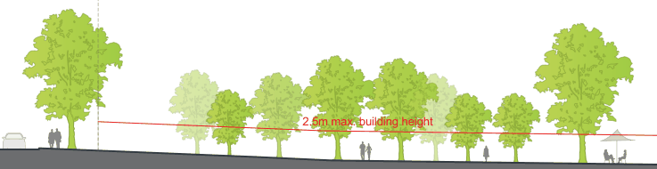
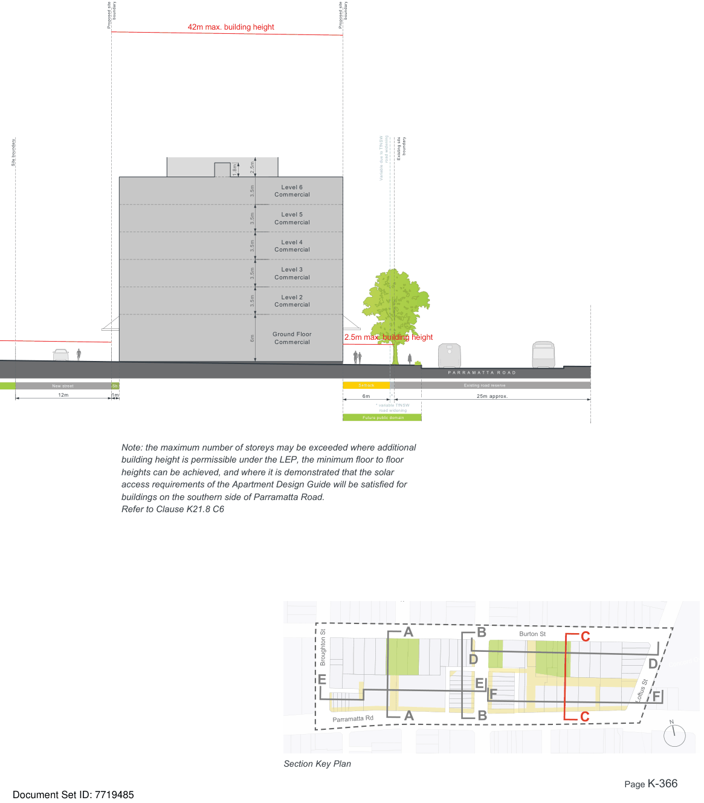

### K21  Burwood Concord (PRCUTS)

Site boundary

B U R T O N S T R E E T

Existing road reserve

20m approx.

Figure K21-14 Built Form Envelope - Section C

> [Picture on page 365: a picture, saved as a picture (images/part-k-special-precincts-page-365-7.gif, 150 dpi).]
> Words printed on the picture (copied from the PDF):
> 2.5m max. building height

B U R T O N S T R E E T P L A Z A

Open space

Site boundary

> [Picture on page 366: a map, saved as a picture (images/part-k-special-precincts-page-366-2.gif, 150 dpi); the street names and other small labels are on the picture.]
> Labels printed on the map (copied from the PDF, in no particular order):
> boundary · boundary · Proposed site · Proposed site · 42m max. building height · boundary · Existing site · road widening · 2.5m · 1.8m · Variable due to TfNSW · 3.5m · Level 6 · Commercial · Level 5 · Commercial · Level 4 · Commercial · Level 3 · Commercial · 3.5m · 3.5m · 3.5m · Level 2 · Commercial · Ground Floor · 2.5m max. building height · 3.5m · 6m · Commercial · 000 · P A R R A M A T T A R O A D · Existing road reserve · Setback · Sb. · New street · 12m 1m · 6m * · 25m approx. · * variable TfNSW · road widening · Future public domain

Note: the maximum number of storeys may be exceeded where additional building height is permissible under the LEP, the minimum floor to floor heights can be achieved, and where it is demonstrated that the solar access requirements of the Apartment Design Guide will be satisfied for

> Words printed on the picture (copied from the PDF):
> Salisbury St
> Burton St
> Broughton St
> Concord Oval
> Parramatta Rd
> N
> Section Key Plan

buildings on the southern side of Parramatta Road. Refer to Clause K21.8 C6

#### A

#### B

#### C

#### D

#### D

#### Loftus St F

#### F

#### E

#### E
