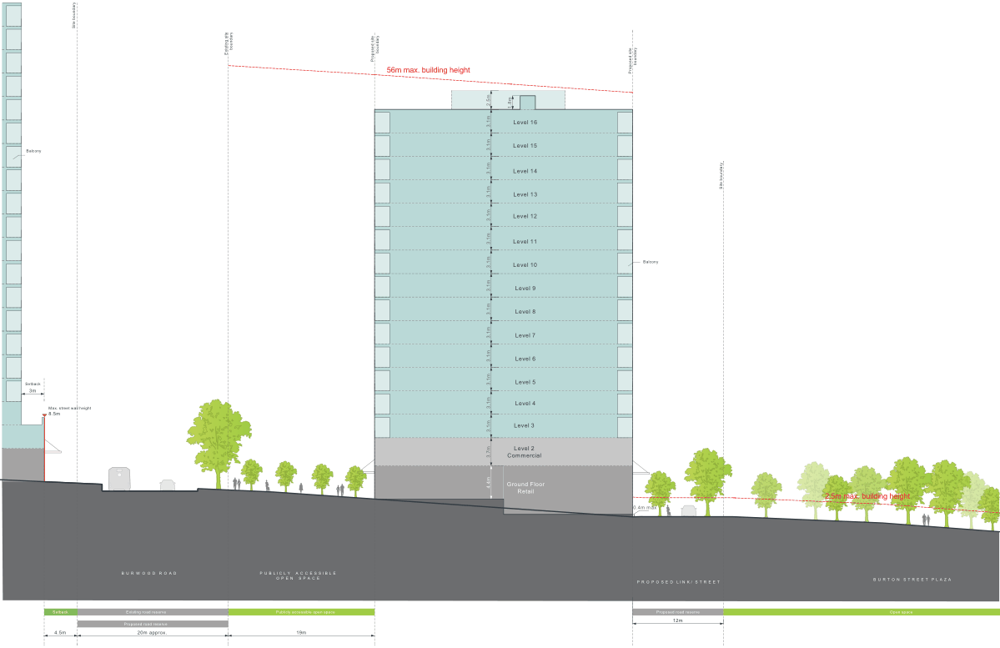
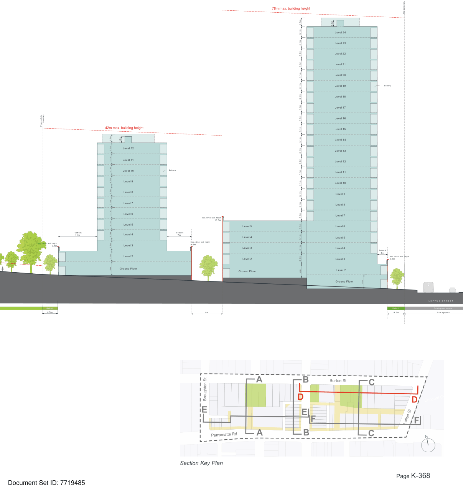

### K21  Burwood Concord (PRCUTS)

> [Picture on page 367: a map, saved as a picture (images/part-k-special-precincts-page-367-2.gif, 150 dpi); the street names and other small labels are on the picture.]
> Labels printed on the map (copied from the PDF, in no particular order):
> Site boundary · boundary · boundary · Existing site · Proposed site · 56m max. building height · 2.5m 1.8m · Level 16 · 3.1m · Level 15 · Balcony · Level 14 · 3.1m · 3.1m · 3.1m Level 13 · Level 12 · Level 11 · Level 10 · Level 9 · Level 8 · Level 7 · Level 6 · Level 5 · Setback · 3m · Level 4 · Max. street wall height · 8.5m · Level 3 · 3.1m · 3.1m · 3.1m · 3.1m · 3.1m · 3.1m · 3.1m · 3.1m · 3.1m · 3.1m · 3.7m · Level 2 · Commercial · 000 · Ground Floor · 4.4m · Retail · B U R W O O D R O A D · P U B L I C L Y  A C C E S S I B L E · O P E N  S P A C E · Existing road reserve · Setback · Publicly accessible open space · Proposed road reserve · 4.5m 20m approx. · 19m · boundary · Proposed site · Site boundary · Balcony · 0.4m max · P R O P O S E D L I N K / S T R E E T · Proposed road reserve · 12m · 2.5m max. building height · B U R T O N S T R E E T P L A Z A · Open space

Figure K21-15 Built Form Envelope - Section D

Development Control Plan

Part K

Special Precincts

> [Picture on page 368: a map, saved as a picture (images/part-k-special-precincts-page-368-4.gif, 150 dpi); the street names and other small labels are on the picture.]
> Labels printed on the map (copied from the PDF, in no particular order):
> boundary · Proposed site · Setback · 11m · Max. street wall height · 8.1m · Setback · 4.5m · 42m max. building height · 1.8m · Level 12 · Level 11 · Level 10 · Level 9 · Level 8 · Level 7 · Level 6 · Level 5 · Level 4 · Level 3 · Level 2 · Ground Floor · 3.1m · 3.1m · 3.1m · 3.1m · 3.1m · 3.1m · 3.1m · 3.1m · 3.1m · 3.1m · 3.1m · 4m · 2.5m · Balcony · Max. street wall height · 18.5m · Level 5 · Setback · 7m · Level 4 · Max. street wall height · 9.5m · Level 3 · Level 2 · Ground Floor · 9m · 78m max. building height · 3.1m · 3.1m · 3.1m · 3.1m · 3.1m · 3.1m · 3.1m · 3.1m · 2.5m · 3.1m · 3.1m · 3.1m · 3.1m · 3.1m · 3.1m · 3.1m · 3.1m · 3.1m · 3.1m · 3.1m · 3.1m · 3.1m · 3.1m · 4m · 1.8m · Level 24 · Level 23 · Level 22 · Level 21 · Level 20 · Level 19 · Level 18 · Level 17 · Level 16 · Level 15 · Level 14 · Level 13 · Level 12 · Level 11 · Level 10 · Level 9 · Level 8 · Level 7 · Level 6 · Level 5 · Level 4 · Level 3 · Level 2 · Ground Floor · Site boundary · Balcony · Setback · 3m · Max. street wall height · 8.1m · 4m · 000 · L O F T U S S T R E E T · Setback Existing road reserve · 21m approx. · 4.5m

> Words printed on the picture (copied from the PDF):
> Salisbury St
> Broughton St
> Section Key Plan
> Burton St
> Concord Oval
> N

#### A

#### E

#### Parramatta Rd A

#### B D F

#### E

#### C

#### D

#### Loftus St F
