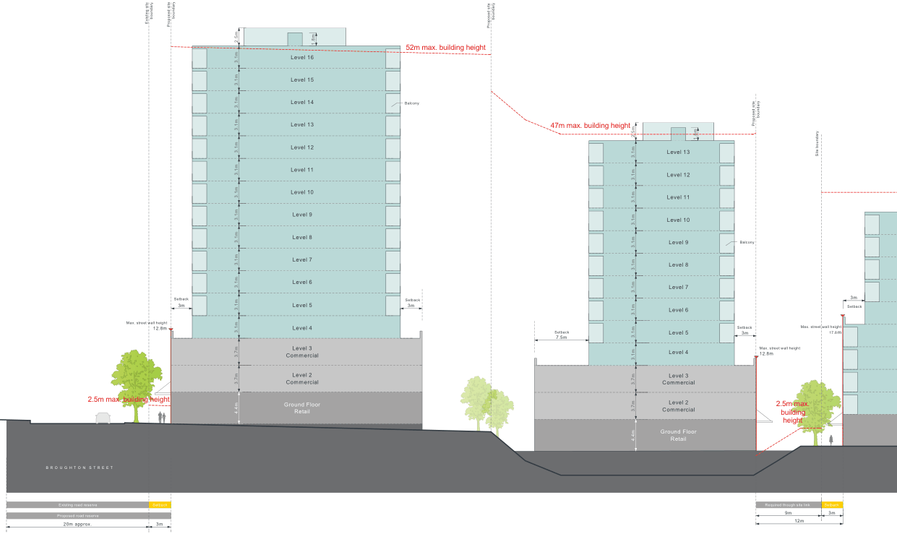
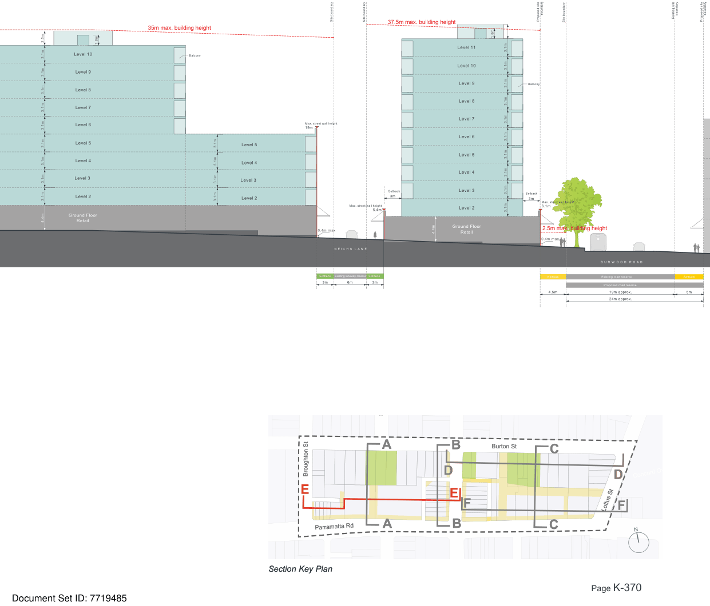
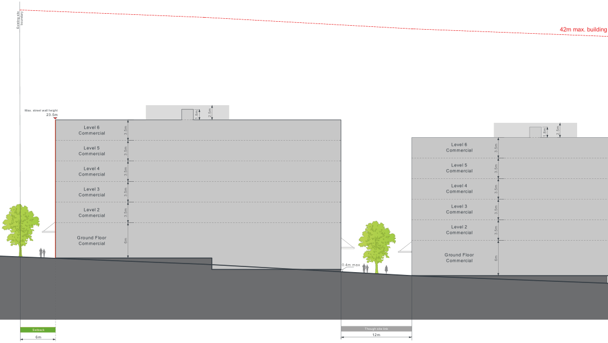
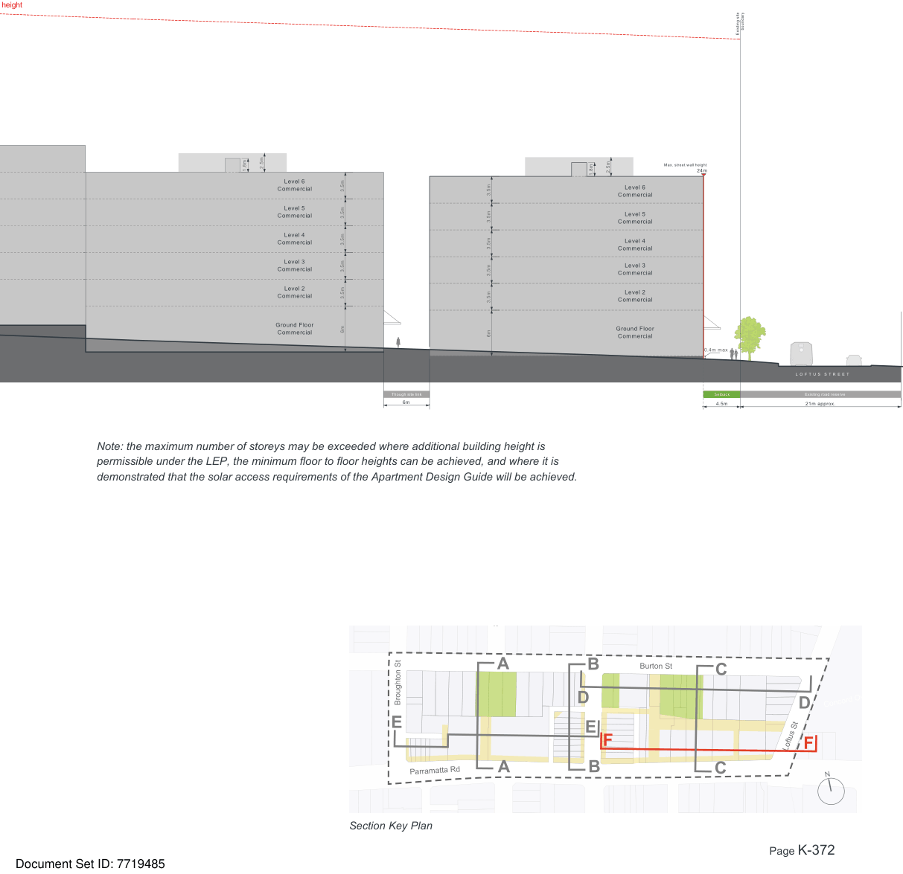

### K21  Burwood Concord (PRCUTS)

> [Picture on page 369: a map, saved as a picture (images/part-k-special-precincts-page-369-2.gif, 150 dpi); the street names and other small labels are on the picture.]
> Labels printed on the map (copied from the PDF, in no particular order):
> boundary · boundary · boundary · Existing site Proposed site · Proposed site · 1.8m · 52m max. building height · Level 16 · Level 15 · Level 14 · Balcony · Level 13 · Level 12 · Level 11 · Level 10 · Level 9 · Level 8 · Level 7 · Level 6 · Setback · Setback · Level 5 · 3m · 3m · Max. street wall height · 12.8m · Level 4 · 3.1m · 3.1m · 3.1m · 3.1m · 3.1m · 3.1m · 3.1m · 2.5m · 3.1m · 3.1m · 3.1m · 3.1m · 3.1m · 3.1m · Level 3 · Commercial · Level 2 · Commercial · 2.5m max. building height · Ground Floor · 3.7m · 3.7m · 4.4m Retail · B R O U G H T O N S T R E E T · Existing road reserve Setback · Proposed road reserve · 3m · 20m approx. · 47m max. building height · 2.5m 1.8m · Level 13 · Level 12 · Level 11 · Level 10 · Level 9 · Level 8 · Level 7 · Level 6 · Setback · Level 5 · 7.5m · Level 4 · Level 3 · Commercial · Level 2 · Commercial · Ground Floor · 3.1m · 3.1m · 3.7m · 3.7m · 4.4m · 3.1m · 3.1m · 3.1m · 3.1m · 3.1m · 3.1m · 3.1m · 3.1m · Retail · boundary · Proposed site · Site boundary · Balcony · 3m · Setback · Max. street wall height · Setback · 17.8m · 3m · Max. street wall height · 12.8m · 2.5m max. · building · height · Required though site link Setback · 9m 3m · 12m

Figure K21-16 Built Form Envelope - Section E

#### A

#### A

#### B

#### B D

#### D F

#### E

#### E

#### F

#### E

#### E

Existing road reserve

Setback

Proposed road reserve

4.5m

20m approx.

> [Picture on page 370: a map, saved as a picture (images/part-k-special-precincts-page-370-18.gif, 150 dpi); the street names and other small labels are on the picture.]
> Labels printed on the map (copied from the PDF, in no particular order):
> Site boundary Site boundary · 37.5m max. building height · 35m max. building height · 2.5m 1.8m · Level 11 · Level 10 · Balcony · Level 10 · Level 9 · Level 9 · Level 8 · Level 8 · Level 7 · Level 7 · Level 6 · Max. street wall height · 19m · Level 6 · Level 5 · Level 5 · Level 5 · Level 4 · Level 4 · Level 4 · Level 3 · Level 3 · Level 3 · Setback · 3m · Level 2 · Level 2 · 3.1m · 3.1m · 3.1m · 3.1m · Max. street wall height · Level 2 · 5.4m · Ground Floor · 3.1m · 3.1m · 4.4m · 3.1m · 3.1m · 3.1m · 3.1m · 3.1m · 3.1m · 3.1m · Retail · Ground Floor · 0.4m max · 4.4m Retail · N E I C H S L A N E · Setback Setback · Existing laneway reserve · 3m · 6m · 3m · boundary · boundary · Existing site · Proposed site · Proposed site · Site boundary · 1.8m · Balcony · 3.1m · 3.1m · 3.1m · 3.1m · 3.1m · 3.1m · 3.1m · 3.1m · 3.1m Setback · 3m Max. street wall height · 6.1m · 3.1m · 2.5m max. building height · 000 · 0.4m max · B U R W O O D R O A D · Setback Existing road reserve Setback · Proposed road reserve · 4.5m 19m approx. · 5m · 24m approx.

> Labels printed on the map (copied from the PDF, in no particular order):
> Salisbury St · Salisbury St · Broughton St · Broughton St · Parramatta Rd · Parramatta Rd · Section Key Plan · Section Key Plan · Burton St · Burton St · Concord Oval · Concord Oval · Loftus St · N · N

boundary

#### C

#### C

#### D

#### D

#### Loftus St F

#### F

000

B U R W O O D R O A D

> [Picture on page 371: a map, saved as a picture (images/part-k-special-precincts-page-371-3.gif, 150 dpi); the street names and other small labels are on the picture.]
> Labels printed on the map (copied from the PDF, in no particular order):
> boundary · Existing site · Max. street wall height · 23.5m · 2.5m · 1.8m · Level 6 · Commercial · Level 5 · Commercial · Level 4 · Commercial · Level 3 · Commercial · Level 2 · Commercial · Ground Floor · 3.5m · 3.5m · 3.5m · 3.5m · 3.5m · 6m · Commercial · Setback · 6m · 0.4m max · Though site link · 12m · Level 6 · Commercial · Level 5 · Commercial · Level 4 · Commercial · Level 3 · Commercial · Level 2 · Commercial · Ground Floor · 3.5m · 3.5m · 3.5m · 3.5m · 3.5m · 6m · Commercial · 42m max. building · 2.5m · 1.8m

Note: the maximum number of storeys may be exceeded where additional building height is permissible under the LEP, the minimum floor to floor heights can be achieved, and where it is demonstrated that the solar access requirements of the Apartment Design Guide will be achieved.

Figure K21-17 Built Form Envelope - Section F

Development Control Plan

height

Part K

Special Precincts

> [Picture on page 372: a map, saved as a picture (images/part-k-special-precincts-page-372-5.gif, 150 dpi); the street names and other small labels are on the picture.]
> Labels printed on the map (copied from the PDF, in no particular order):
> 1.8m · 2.5m · Level 6 · Commercial · Level 5 · Commercial · Level 4 · Commercial · Level 3 · Commercial · Level 2 · Commercial · Ground Floor · Commercial · 3.5m · 3.5m · 3.5m · 3.5m · 3.5m · 6m · 3.5m · 3.5m · 3.5m · 3.5m · 3.5m · 6m · Though site link · 6m · boundary · Existing site · Max. street wall height · 2.5m · 24m · 1.8m · Level 6 · Commercial · Level 5 · Commercial · Level 4 · Commercial · Level 3 · Commercial · Level 2 · Commercial · Ground Floor · Commercial · 0.4m max · Setback · 4.5m · 000 · L O F T U S S T R E E T · Existing road reserve · 21m approx.

Note: the maximum number of storeys may be exceeded where additional building height is permissible under the LEP, the minimum floor to floor heights can be achieved, and where it is demonstrated that the solar access requirements of the Apartment Design Guide will be achieved.

> Words printed on the picture (copied from the PDF):
> Salisbury St
> Broughton St
> Section Key Plan
> Burton St
> Concord Oval
> N

#### A

#### E

#### Parramatta Rd A

#### B D F

#### E

#### C

#### D

#### Loftus St F
