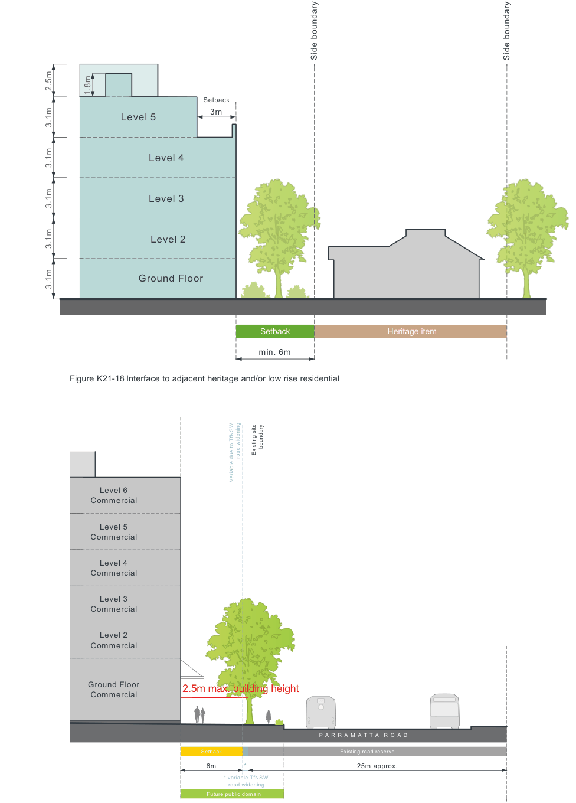

### K21  Burwood Concord (PRCUTS)

#### K21.11 Transitions and Interfaces

Changes in height and scale will require transitions to sensitive interfaces such as existing low scale residential areas, heritage items and open spaces. New development will be required to respond to the overall scale and form of existing elements to preserve visual scale and to minimise loss of outlook, and privacy and maximise sun access of adjoining properties.

#### Objectives

O1 To encourage new development that is sensitive and complementary in scale and site location to surrounding properties.

O2 To minimise the impact on the visual curtilage and setting of existing heritage items.

O3 To protect residential amenity at the interface to existing low rise development.

O4 To ensure streets and open spaces receive adequate sunlight and ventilation.

| Controls |  |
|---|---|
| C1. | Where adjacent to low density residential interfaces and heritage items, new development should gradually step away in height and provide appropriate setbacks as identified in Figure K21-18. |
| C2. | Development along Burton, Loftus and Broughton Streets: a) sets back as identified in Figure K21-8 and Figure K21-11 with the setback area to be landscaped and at least 50% deep soil; and b) maximises windows and balconies of the upper levels that provide effective passive surveillance of the streetscape. |
| C3. | Along all streets where future public domain is required to be delivered (such as the 'linear green edge' interface to Parramatta Road), development must comply with the primary and upper level setbacks shown in Figure K21-8, Figure K21-11 and Figure K21-19. The following applies: a) treatment of the setback area is designed to be an extension of the public footpath area, is publicly accessible 24/7 and focuses on pedestrian amenity; and b) 50% of the setback is deep soil to allow for mature vegetation in order to create a linear park with trees provided as outlined in Section K21.18 Landscape Design. |

Side boundary

Side boundary

> [Picture on page 374: a map, saved as a picture (images/part-k-special-precincts-page-374-3.gif, 150 dpi); the street names and other small labels are on the picture.]
> Labels printed on the map (copied from the PDF, in no particular order):
> 1.8m · Setback · 3m · Level 5 · Level 4 · Level 3 · Level 2 · Ground Floor · Setback · Heritage item · min. 6m · Figure K21-18 Interface to adjacent heritage and/or low rise residential · boundary · Existing site · road widening · Variable due to TfNSW · Level 6 · Commercial · Level 5 · Commercial · Level 4 · Commercial · Level 3 · Commercial · Level 2 · Commercial · Ground Floor · 2.5m max. building height · Commercial · 000 · P A R R A M A T T A R O A D · Existing road reserve · Setback · 6m * · 25m approx. · * variable TfNSW · road widening · Future public domain

3.1m

3.1m

3.1m

3.1m

2.5m

3.1m

Figure K21-19 'Green edge' interface to Parramatta Road
