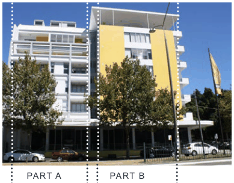
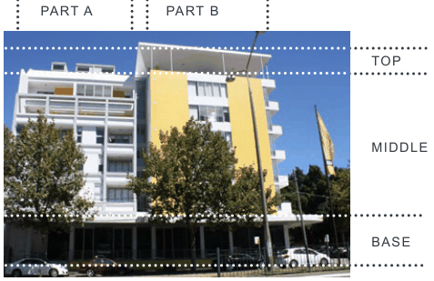

### K21  Burwood Concord (PRCUTS)

#### K21.13 Massing and Articulation

Detailed articulation and appropriate scale of built form defines and reinforces the identity and desired character of a place. The following architectural treatments are encouraged to create variety and interest in the streetscape while contributing to a sense of continuity and overall visual quality.

#### Objectives

O1 To ensure buildings and their individual elements are appropriately scaled to define and respond to the surrounding character.

O2 To add visual quality and interest to new buildings with a focus on breaking up massing of higher density forms when viewed from public places and neighbouring properties.

#### Controls

C1. Buildings that are 3 storeys or more are to be designed so that they clearly articulate a base, middle and top.

C2. Facades are articulated using techniques such as projections, recesses, eave overhangs and deep window reveals. Where development is set back at least 3m from the site boundary, elements can protrude up to 0.3m into the front setback (articulation zone).

C3. The maximum length of straight wall on any storey above ground floor level, without articulation such as a balcony or return, is 15m.

C4. New development is to place particular focus on creating a 'human scale' at the lower levels through the use of detailed design, insets and projections that create interest and, where relevant, the appearance of finer grain buildings.

C5. Where frontages are more than 20m wide, building massing is also to be vertically articulated.

C6. For built form that is 3 storeys or more, the upper-most level is set back and visually unobtrusive. Ways to achieve this include the use of lightweight construction techniques, darker colours, solid balustrades and roof overhangs that create deep shadows.

C7. Adjoining buildings are considered in terms of setbacks, awnings, parapets, cornice lines and facade proportions.

C8. Roof plant, lift overruns, vents, carpark entries and other service related elements are integrated into the built form and complement the architecture of the building.

C9. Buildings on corners address both streets and architectural elements are composed so that they 'turn the corner'.

> [Picture on page 377: a picture, saved as a picture (images/part-k-special-precincts-page-377-58.gif, 150 dpi).]

PART A PART B

> [Picture on page 377: a picture, saved as a picture (images/part-k-special-precincts-page-377-60.gif, 150 dpi).]

TOP

MIDDLE

BASE

Example of an building that is vertically articulated into two components and differentiates between base, middle and top

#### K21.14 Heritage and Fine Grain

A 'fine grain' of narrow lots provides a significant contribution to the character of the precinct and often includes traditional shop fronts, roofs with parapets, corner buildings and upper level verandahs. This historic pattern of elements creates a streetscape of character and, together with listed heritage items, should be retained and protected wherever possible.

#### Objectives

O1 To ensure that development in the vicinity of heritage items is designed and sited to protect its heritage significance.

O2 To avoid new development physically dominating and overwhelming heritage items.

O3 To enable the consolidation of small individual lots into larger lots whilst ensuring the original subdivision pattern is represented.

#### Controls

C1. Development in the vicinity of a heritage item is to minimise the impact on the setting of the item by:

a) providing an adequate area around the building to allow interpretation of the heritage item;

b) retaining original or significant landscaping (including plantings with direct links or association with the heritage item);

c) protecting, where possible and allowing the interpretation of archaeological features; and

d) retaining and respecting significant views to and from the heritage item.

C2. All development of and in the vicinity of a heritage item is to address the requirements of Part C Heritage of the City of Canada Bay DCP.

| C3. | Alterations and additions to buildings and structures and new development of sites in the vicinity of a heritage item are to be designed to respect and complement the heritage item in terms of the building envelope, proportions, materials, colours and finishes, and building and street alignment. |
|---|---|
| C4. | Where additional storeys are proposed above a heritage building, the new front wall should be set back from the existing front building line by a minimum of 8m. |
| C5. | Where the finer grain existing pattern is present and lot consolidation is proposed, the subdivision pattern and fine grain is to be interpreted in the architectural treatment of the facades, e.g. through building layout, composition, modulation and vertical articulation. |
| C6. | All development of, or in the vicinity of, heritage items must submit a heritage impact assessment as part of the DA. It should be noted that the assessment may lead to setbacks, building heights, and built form modulation that may differ (are less than) the minimum provisions outlined in this DCP. |
