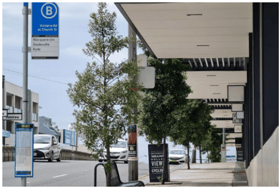
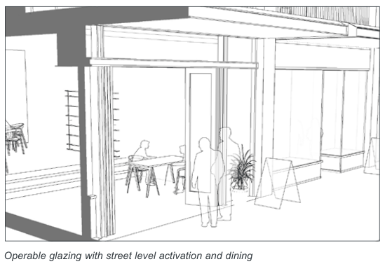
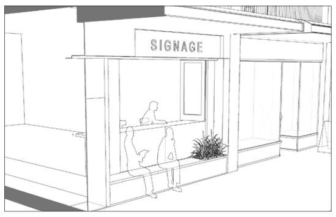

### K21  Burwood Concord (PRCUTS)

#### K21.15 Safety and Accessibility

The way in which buildings address streets, links and open space creates an important transition between public and private land. The careful design of this interface zone contributes to the liveliness, interest, comfort and safety of the public domain. Good accessibility to and from new development increases activity levels further and contributes to the visible activity in a neighbourhood.

#### Objectives

O1 To ensure new development supports the wider neighbourhood and community safety and maximises opportunities for passive surveillance.

O2 To encourage ground floor activities to spill out into the public domain and create a vibrant streetscape (active frontages).

O3 To incorporate a high degree of accessibility into the design of new buildings and the public domain that considers the various mobility levels of future users, i.e. disabled and elderly.

### 5m

required

awning

height

zone

### 3.5m

Figure K21-22 Awnings are to be between 3.5m and 5m above ground level along active frontages

#### Controls

C1. New development addresses and defines the public domain through entrances, lobbies, windows and balconies that overlook public spaces, maximising opportunities for passive surveillance.

C2. The location and width of vehicle entries is to minimise impacts on the pedestrian network.

C3. All building entries are clearly visible from the public domain.

Access is to be provided according to:

a) Active Frontages: at ground level unless it can be clearly demonstrated that it is unreasonable to meet this requirement and a suitable urban design outcome can be achieved which would be applicable in this specific instance only.

b) Interactive frontages for residential development in the R3 Medium Density zone: at ground level and set in a landscaped front setback that is to be raised above natural ground level to between 0.6m and 1.0m.

C4. To avoid blank walls and create visual interest, the maximum length of any wall at the ground floor level, without articulation such as a door or window is 5m.

> [Picture on page 379: a picture, saved as a picture (images/part-k-special-precincts-page-379-58.gif, 150 dpi).]

Figure K21-23 Awnings should be designed to allow for street tree planting

#### Controls

C5. Active frontages are provided as identified in Figure K21-9.

C6. Along active frontages:

a) the finished ground floor level is to match the footpath level; where this is not possible due to topography, the ground floor level is to be a maximum of 0.4m above the footpath. Where ground floor level is elevated above the footpath, the elevated area is to form an activated continuation of the interior, and not to create a visual barrier to the interior;

b) continuous awnings must be provided to shelter pedestrians from weather conditions;

c) awnings should be designed to allow for street tree planting;

d) awnings are to be between 3.5m and 5m above ground level (see Figure K21-22);

e) consistent paving, street furniture, signage, planting and lighting is desireable; and

f) design guidance in Figure K21-10 is applied where possible with long expanses of floor to ceiling glass prohibited.

C7. Residential uses on the ground floor can be raised to a maximum of 1.0m above the footpath level to improve internal privacy. Direct access from the footpath to individual dwellings is required wherever possible.

C8. Front fencing for residential uses on the ground floor are to display an appropriate balance of visibility and outlook, informal surveillance of the street and privacy for residents and building users. Fences are to be a maximum height of 1.2m and at least 25% transparent. Solid walls are only acceptable to a maximum height of 0.6m.

C9. Common areas for building users/ residents are encouraged within the front setback with seating facilities located close to the public footpath to encourage surveillance of the street, visible activity and social interaction.

> [Picture on page 380: a picture, saved as a picture (images/part-k-special-precincts-page-380-49.gif, 150 dpi).]

Operable glazing with street level activation and dining

> [Picture on page 380: a picture, saved as a picture (images/part-k-special-precincts-page-380-51.gif, 150 dpi).]

Elevated seating area integrated with street frontage and operable glazing

Figure K21-24 Strategies to achieve street level activation
