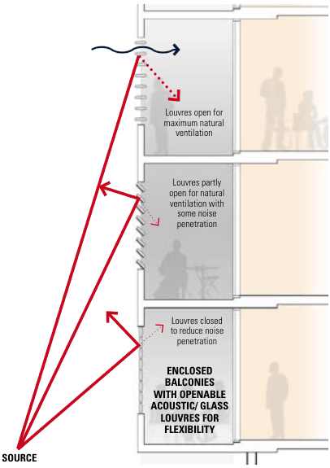
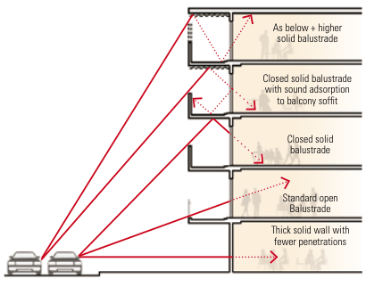
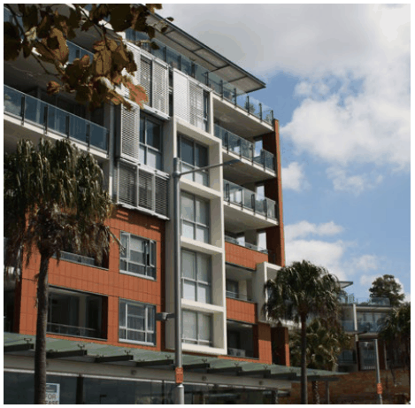

### K21  Burwood Concord (PRCUTS)

#### K21.16 Amenity

C3. Louvres, shading devices and windows are able to be operated by buildings users where possible, to allow building occupants to regulate climatic conditions rather than rely solely on mechanical systems.

New housing and employment uses need to provide a high level of amenity for future residents and building users. At the same time, development is required to protect and where possible enhance the quality of the public domain and adjoining private properties. The following controls seek to help maximise privacy, solar access and outlook for all. This section also identifies design treatments to mitigate air quality and noise impacts for development along Parramatta Road.

#### Objectives

C4. Development along Parramatta Road is to consider the provisions of the State Environmental Planning Policy (Infrastructure) 2007 and Development Near Rail Corridors and Busy Roads Interim Guidelines and the design approaches illustrated in Figure K21-25.

O1 To minimise the impact of new development on the outlook, privacy and sun access of adjoining properties.

C5. For residential components of new development, noise sensitive areas (living rooms, bedrooms) are located away from Parramatta Road where possible.

O2 To minimise overshadowing of streets, links and public open spaces.

C6. Windows located towards Parramatta Road are double-glazed (or use laminated glazing) and have acoustic seals.

O3 To protect building users from negative impacts (noise, air quality, vibration) from Parramatta Road.

#### Controls

C7. Habitable rooms (excluding balconies) are to be designed to achieve internal noise levels of no greater than 50dBA.

> [Picture on page 381: a map, saved as a picture (images/part-k-special-precincts-page-381-44.gif, 150 dpi); the street names and other small labels are on the picture.]
> Labels printed on the map (copied from the PDF, in no particular order):
> figure 3.16: Enclosable · balconies facing the · Louvres open for · maximum natural · ventilation · Louvres partly · open for natural · ventilation with · some noise · penetration · Louvres closed · to reduce noise · penetration · ENCLOSED · BALCONIES · WITH OPENABLE · ACOUSTIC/ GLASS · LOUVRES FOR · FLEXIBILITY

road

C1. Siting and built form configuration optimises solar access within the development and minimises overshadowing of adjoining properties.

Where balconies are required, solid balustrades with sound absorption material added to the underside of balconies above is a good means of reducing noise entering the building.

C2. Taller elements of built form are oriented north-south where possible. The height and modulation of east-west buildings allows solar access to courtyard spaces (where courtyards are appropriate).

Providing enclosed balconies (or winter gardens) is another means of reducing the noise entering a building. Where enclosed balconies are used ventilation may need to be considered. By installing acoustic louvres ventilation requirements and reduced noise can be addressed. These approaches are shown in figure 3.16.

> [Picture on page 381: a map, saved as a picture (images/part-k-special-precincts-page-381-66.gif, 150 dpi); the street names and other small labels are on the picture.]
> Labels printed on the map (copied from the PDF, in no particular order):
> As below + higher · figure 3.15: Balcony treatments · which reduce traffic noise · intrusion · solid balustrade · Closed solid balustrade · with sound adsorption · to balcony soffit · Closed solid · balustrade · Standard open · Balustrade · Thick solid wall with · fewer penetrations

#### SOURCE

Figure K21-25 Noise mitigating facade treatments (Source: Development Near Rail Corridors And Busy Roads Interim Guideline, NSW)

#### K21.17 Appearance

The design of buildings contributes to the streetscape character and adds visual richness, complexity and interest. In addition, the selection of signage, materials, finishes and colours should have regard to compatibility to the surrounds and consider robustness, durability and ease of maintenance.

#### Objectives

O1 To ensure building exteriors positively contribute to the desired future character of the area and streetscape.

O2 To ensure that signage is integrated and not detrimental to the local character by limiting its cumulative impact with other signage.

Facade design

> [Picture on page 382: a picture, saved as a picture (images/part-k-special-precincts-page-382-16.gif, 150 dpi).]

| Controls |  |
|---|---|
| C1. | The composition of facades balances solid and void elements and does not display large areas of a single material, including reflective glass. |
| C2. | External walls are constructed of high quality and durable materials and finishes with low maintenance attributes (‘self-cleaning’) such as face brickwork, rendered brickwork, stone, concrete and glass. |
| C3. | Any blank sidewalls (including temporary walls that may be covered in the future) that are visible from the public domain are designed as an architecturally finished surface that complements the main facade. |
| C4. | Visually prominent elements such as balconies, overhangs, awnings, and roof tops are to be of high design quality. |
| C5. | Roof plant, lift overruns, utilities, vents and other service related elements are to be integrated into the built form design and complementary to the architecture of the building. |

Example of balconies with a balance of solid and void in the facade composition and treatment.

Signage and advertising

| Controls |  |
|---|---|
| C6. | Signage is to comply with the requirements of State Environmental Planning Policy No 64-Advertising and Signage. Also refer to requirements in the City of Canada Bay DCP Part I Signage and Advertising. |
| C7. | Signage is to be integrated into the overall architectural design. Advertising signs should complement the design of buildings and the overall character of the precinct. Signage must relate to an approved use on the site. |
| C8. | The main facades of buildings from the first floor to the rooftop or parapet are to be uncluttered and generally free of signage. |
| C9. | Freestanding signs are not to be located on the top of buildings and should not impact on the skyline when viewed from the street. Signs painted on or applied to the roof of a building are not permitted. |
