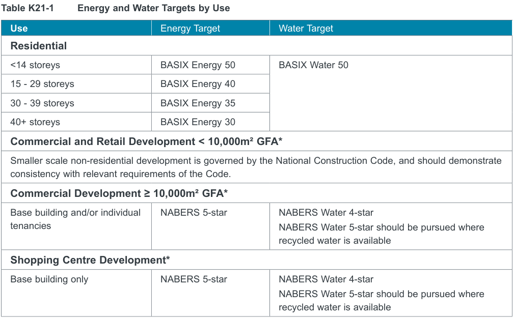
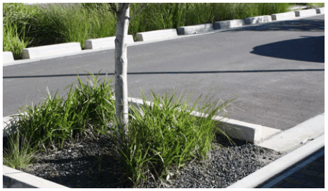
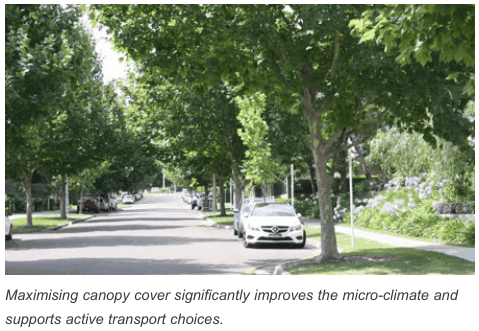

### K21  Burwood Concord (PRCUTS)

#### K21.19 Sustainability and Resilience

To create sustainable, resilient and affordable communities along the Corridor, the PRCUTS identifies that the following three key areas of intervention should be pursued:

1\)  High performance buildings;

2\)  Reduced and decoupled strategic parking; and

3\)  Urban resilience and infrastructure delivery. Further details are provided in the Parramatta Road Corridor Sustainability Implementation Plan and should be considered when assessing proposals.

#### Objectives

O1 To deliver world leading urban transformation of the precinct by exceeding current sustainability requirements.

O2 To mitigate the impacts of climate change on key infrastructure and assets.

#### Controls

C1. A residential flat building or a mixed use development (that contains dwellings) which complies with Table K21-1 is eligible for an amount of additional residential floor space (above that already permitted elsewhere under this Plan) equivalent to that which exceeds the floor space ratio as shown on the Floor Space Ratio Map or Incentive Floor Ratio Map (as applicable to that development) by up to 5%, subject to the consent authority being satisfied that this additional residential floor space does not adversely impact on neighbouring and adjoining land in terms of visual bulk and overshadowing.

C2. Future development should demonstrate consistency with the smart parking strategies and design principles outlined in Section K21.20 Access and Parking.

C3. Public domain and buildings shall be designed to reduce localised heat created by the urban heat island affect by:

a) maximising canopy cover along all streets, particularly along Parramatta Road and Burwood Street;

b) developments within the R3 zone are to provide at least 25% canopy cover across the site, identified on the landscape plan and measured by the extent of canopy at maturity;

c) maximising the use of vegetation on buildings, including above ground parking facilities;

d) encouraging vegetation, green roofs, green walls and materials with a high solar reflectance index on at least 50% of the surfaces of all buildings with western and northern building facades; and

e) complying with landscape DCP guidelines within Section K21.18 Landscape Design.

C4. Flow rates from the site should not be more than pre-development site discharge.

C5. All new streets should implement water sensitive urban design treatments at the point source across all catchment areas.

C6. Stormwater run-off quality should seek to reduce annual loads of:

a) total Nitrogen by 45%;

b) total Phosphorus by 65%; and

c) total suspended solids by 85%.

C7. Development consent must not be granted unless the building, or part of a building, contains both potable water pipes and recycled water pipes for the purposes of all available internal and external water uses.

#### Table K21-1 Energy and Water Targets by Use

> [Picture on page 386: a picture, saved as a picture (images/part-k-special-precincts-page-386-2.gif, 150 dpi).]

| Use | Energy Target | Water Target |
|---|---|---|
| Residential |  |  |
| <14 storeys | BASIX Energy 50 | BASIX Water 50 |
| 15 - 29 storeys | BASIX Energy 40 |  |
| 30 - 39 storeys | BASIX Energy 35 |  |
| 40+ storeys | BASIX Energy 30 |  |
| Commercial and Retail Development < 10,000m² GFA* |  |  |

Smaller scale non-residential development is governed by the National Construction Code, and should demonstrate

> [Picture on page 386: a picture, saved as a picture (images/part-k-special-precincts-page-386-5.gif, 150 dpi).]

consistency with relevant requirements of the Code.

| Commercial Development ≥ | 10,000m² GFA* |  |
|---|---|---|
| Base building and/or individual | NABERS 5-star | NABERS Water 4-star |
| tenancies |  | NABERS Water 5-star should be pursued where recycled water is available |
| Shopping Centre Development* |  |  |
| Base building only | NABERS 5-star | NABERS Water 4-star NABERS Water 5-star should be pursued where recycled water is available |

\*Source: PRCUTS Planning and Design Guidelines, Urban Growth, Nov 2016

> [Picture on page 386: a picture, saved as a picture (images/part-k-special-precincts-page-386-9.gif, 150 dpi).]

Maximising canopy cover significantly improves the micro-climate and All new streets and pedestrian/ cycle links should implement water supports active transport choices.

sensitive urban design treatments (WSUD).
