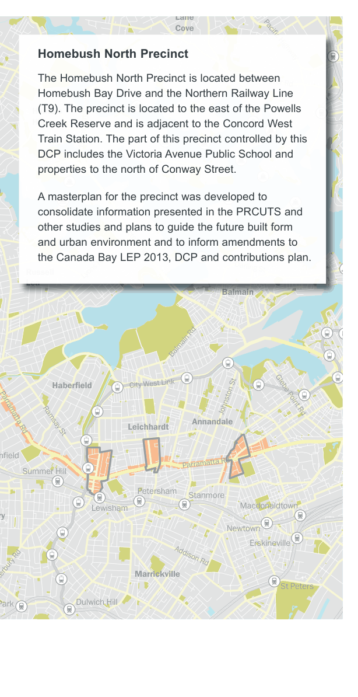
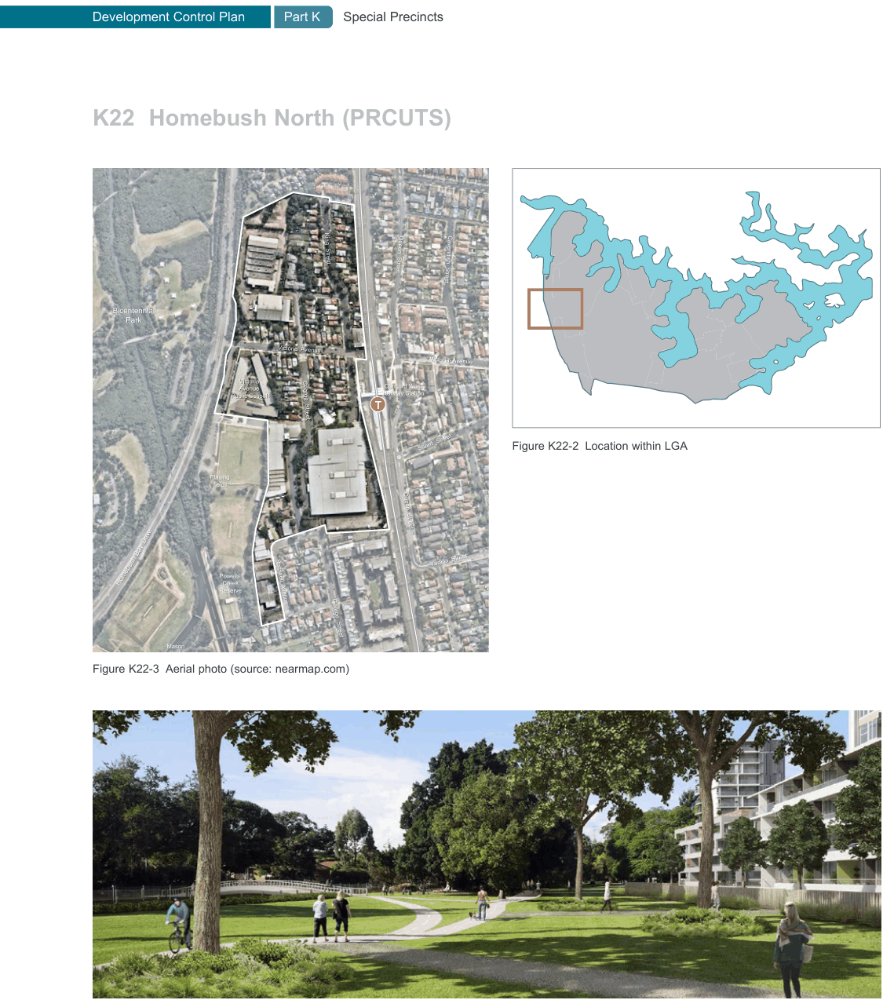

### K22  Homebush North (PRCUTS)

e Rd

d

#### KINGS

#### HOMEBUSH

#### NORTH BURWOOD

Figure K22-1 PRCUTS Parramatta Road Corridor (Source: PRCUTS, 2016)

> [Picture on page 394: a map, saved as a picture (images/part-k-special-precincts-page-394-1.gif, 150 dpi); the street names and other small labels are on the picture.]
> Labels printed on the map (copied from the PDF, in no particular order):
> Lane · Cove · Pacific Highway · River Rd · Hunters · Hill · Burns Bay Road · Victoria Road · Darling St · Lyons Rd · Russell · Lea · Balmain · Balmain Rd · City West Link · Haberfield · Johnston St Glebe Point Rd · Leichhardt · Annandale · Parramatta Rd Ramsay St · hfield · Parramatta Rd · Summer Hill · Petersham · Stanmore · Macdonaldtown · Lewisham · ry · Newtown · Erskineville · Addison Rd · Marrickville · anterbury Rd · St Peters · Dulwich Hill · Park

#### Homebush North Precinct

The Homebush North Precinct is located between Homebush Bay Drive and the Northern Railway Line (T9). The precinct is located to the east of the Powells Creek Reserve and is adjacent to the Concord West Train Station. The part of this precinct controlled by this DCP includes the Victoria Avenue Public School and properties to the north of Conway Street.

A masterplan for the precinct was developed to consolidate information presented in the PRCUTS and other studies and plans to guide the future built form and urban environment and to inform amendments to the Canada Bay LEP 2013, DCP and contributions plan.

#### K22.1 Parramatta Road Corridor Urban Transformation Strategy (PRCUTS)

This DCP has been prepared to support the implementation of the NSW Government Parramatta Road Corridor Urban Transformation Strategy (PRCUTS) published in November 2016.

Previous studies have identified a number of industrial sites within the precinct that are currently underutilised and are suitable for residential purposes, featuring good access to public transport and local amenities. PRCUTS aims to renew Parramatta Road and adjacent communities through investments in homes, jobs, transport, open spaces and public amenity. It presents significant urban renewal opportunities for land within defined development precincts.

> [Picture on page 395: a map, saved as a picture (images/part-k-special-precincts-page-395-1.gif, 150 dpi); the street names and other small labels are on the picture.]
> Labels printed on the map (copied from the PDF, in no particular order):
> King  Street · King  Street · Queen  Street · Queen  Street · Cavendish  Street · Cavendish  Street · Bicentennial · Bicentennial · Park · Park · Victoria  Avenue · Victoria  Avenue · Victoria  Avenue · Victoria  Avenue · Concord West · Railway Station · Concord West · Railway Station · Victoria · Avenue · Public School · Victoria · Avenue · Public School · T · George  Street · George  Street · Stuart  Street · Stuart  Street Figure K22-2 Location within LGA · Playing · Playing · fields · fields · Queen  Street · Queen  Street · ve · ve · h Bay Dri · h Bay Dri · Yaralla  Street · Yaralla  Street · Powells · Powells · Homebus · Homebus · Creek · Reserve · Creek · Reserve · Rothwell  Avenue · Rothwell  Avenue · George  Street · George  Street · Mason · Mason · Park · Park · Figure K22-3 Aerial photo (source: nearmap.com)
