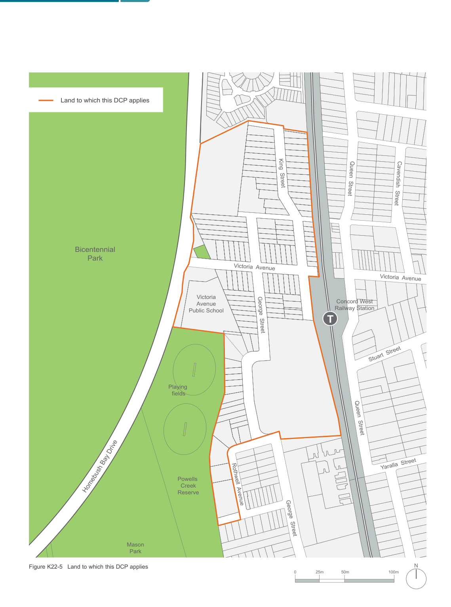

### K22  Homebush North (PRCUTS)

Figure K22-4 Artist impression of indicative future character within Homebush North Precinct (Source: PRCUTS, Urban Growth, Nov 2016)

> [Picture on page 396: a map, saved as a picture (images/part-k-special-precincts-page-396-1.gif, 150 dpi); the street names and other small labels are on the picture.]
> Labels printed on the map (copied from the PDF, in no particular order):
> Land to which this DCP applies · Bicentennial · Park · Victoria · Avenue · Public School · Playing · fields · ve · h Bay Dri · Powells · Homebus · Creek · Reserve · Mason · Park · Figure K22-5 Land to which this DCP applies · King  Street · Victoria  Avenue · George  Street · Rothwell  Avenue · George  Street · 0 · Queen  Street · Cavendish  Street · Victoria  Avenue · Concord West · Railway Station · Stuart  Street · Queen  Street · Yaralla  Street · N · 100m · 50m · 25m

### T

#### T
