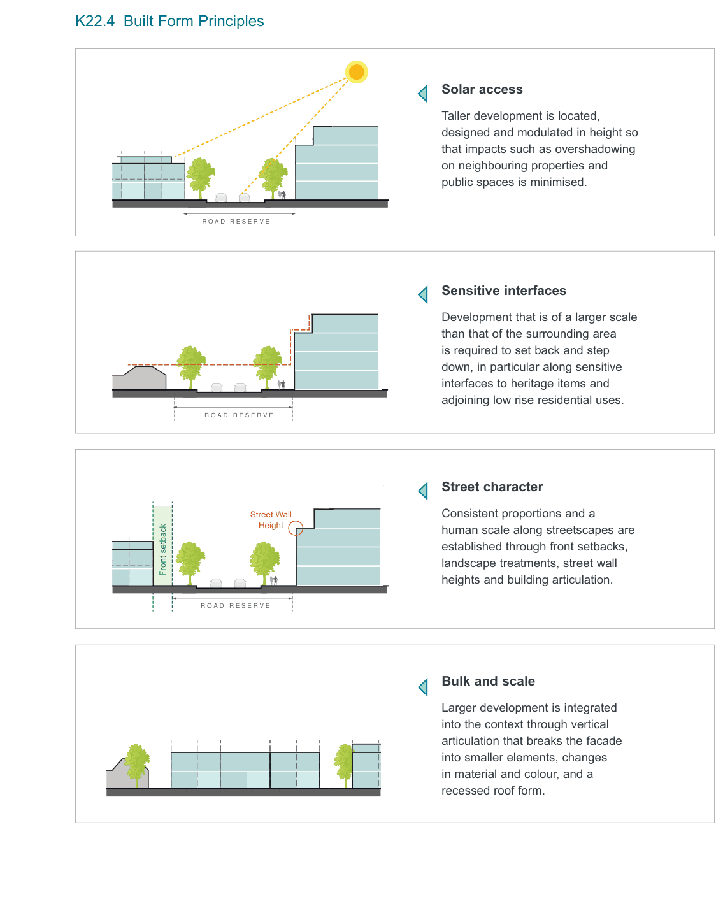

### K22  Homebush North (PRCUTS)

#### K22.2 Existing Character

Homebush North Precinct is characterised by a variety of built form and uses, including a mix of dwelling houses, town houses, apartment buildings, education and industrial uses. In terms of vehicle movement, the precinct is effectively self-contained, with George Street forming the only vehicular access point to the surrounding road network at the southern end of the precinct.

#### Strengths and opportunities

• proximity to high amenity open space, recreation facilities and Sydney Olympic Park;

• enhanced connections to rail transport, including future Metro stations, to increase accessibility to employment, recreation and cultural opportunities;

• some large, unfragmented land holdings and limited number of strata titled properties;

• potential to enhance existing recreational opportunities and linkages for active transport such as better pedestrian connectivity and safety across the railway line and Homebush Bay Drive;

• improved active transport access to regional recreation and open space facilities with a focus on connecting to the existing recreational routes around Olympic Park; and

• reduced car dependency by lowering parking rates in areas with good access to public transport.

#### Challenges and constraints

• Existing high traffic volumes on Homebush Bay Drive;

• Barriers to access for all modes of transport, created by major roads and rail lines;

• Low pedestrian connectivity and permeability; and

• High parking demand and levels of on-street parking.

#### K22.3 Desired Future Character

"Homebush Precinct will become a new, mixed use precinct housing a new community of residents attracted to the area for its high amenity and access to employment at Parramatta CBD and Sydney Olympic Park. The precinct will provide a long term supply of housing stock to meet increasing demand as Sydney Olympic Park grows into a new city."

Sitting between Sydney’s two main CBDs, the wider area of Homebush will be transformed into an active and varied hub, blending higher density housing and a mix of different uses, supported by a network of green links and open spaces with walking access to Concord West train station. Future development will support the delivery of high quality open space and improvements to the area around the station.

The desired future character of the precinct is a transit oriented community which features higher densities that maximise site renewal opportunities. Development proposals in the precinct are to achieve the following desired future characteristics:

• Well Integrated Built Form: Development will provide a built form that steps down in height toward adjoining lower-rise residential areas. The siting, bulk and scale of development will ensure there are no significant adverse impacts to sunlight access and privacy within the precinct.

• Mixed Use: Development adjoining the station square will provide a focal point for the neighbourhood by providing active uses such as shops, cafes and restaurants.

• Accessibility: Development will better connect the precinct as a whole by creating a street network with emphasis on active transport. Connections will strengthen existing or promote new routes to the station and open space.

> [Picture on page 398: a picture, saved as a picture (images/part-k-special-precincts-page-398-1.gif, 150 dpi).]
> [Picture text on page 398 is stored in the PDF without readable letters (no character map), so it could not be copied; see the original PDF.]
> Words printed on the picture (copied from the PDF):
> Street Wall
> Street Wall
> Height
> Height
> Front setback

#### K22.4 Built Form Principles

#### Solar access

Taller development is located,

designed and modulated in height so that impacts such as overshadowing on neighbouring properties and public spaces is minimised.

#### Sensitive interfaces

Development that is of a larger scale than that of the surrounding area is required to set back and step down, in particular along sensitive interfaces to heritage items and adjoining low rise residential uses.

#### Street character

Consistent proportions and a

human scale along streetscapes are established through front setbacks, landscape treatments, street wall heights and building articulation.

#### Bulk and scale

Larger development is integrated into the context through vertical articulation that breaks the facade into smaller elements, changes in material and colour, and a

recessed roof form.
