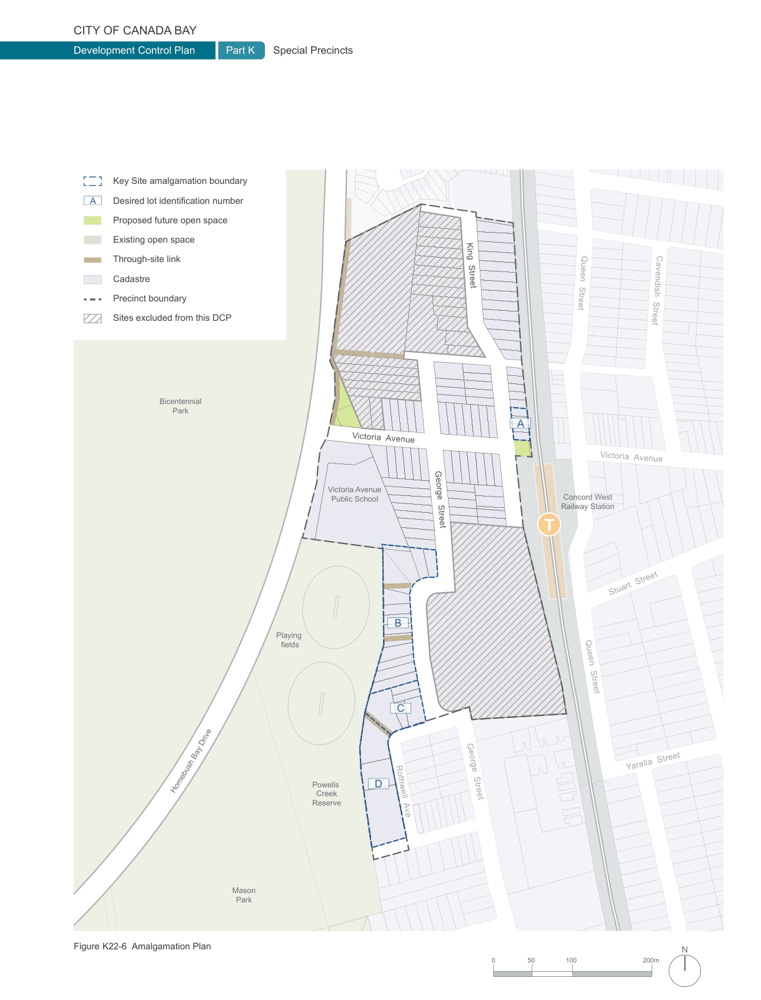

### K22  Homebush North (PRCUTS)

#### K22.5 Block Configuration

The scale, height, arrangement and orientation of new built form defines the proportion and level of enclosure of streets and public spaces. Good site planning and block configuration maximises the level of sun access and visual and acoustic privacy for all, including neighbouring properties.

Together with building setbacks (see Section K22.8 Street Setbacks), the following controls set the basic building footprints and envelopes for new development in the Homebush North Precinct.

#### Objectives

O1 To arrange building forms including heights and massing that reinforce the future desired character of the area and protect valued character attributes.

O2 To facilitate daylight access and ventilation to streets, public places and neighbouring properties.

O3 To maximise visual and acoustic privacy.

O4 To consider future development opportunities on adjoining sites and avoid isolated sites.

O5 To maximise permeable ground surfaces to allow rainwater to penetrate the soil.

#### Controls

C1. New development is to consider future development on adjoining sites by providing sufficient separation and setbacks, and avoid creating isolated sites.

New development is to follow the desired Site Amalgamation Plan (Figure K22-6).

C2. New development is to conform to the maximum number of storeys as shown in Figure K22-8. Further controls regarding the permissible building envelope are contained in Section K22.8 Street Setbacks and Section K22.10 Massing and Articulation.

If a multi dwelling (terrace) development is proposed the maximum height for that development will be 8.5m.

However, if the development complies with the following requirements then it may have a maximum height of 9.0m if:

a) The development follows a 45 degree height plane, measured at the front and rear building line, springing from 7m above the natural ground level, and

b) Only bedrooms and non-habitable spaces are located in the third storey.

C3. The maximum length of any building more than three storeys high is 60m.

C4. Where a one to three storey building is greater than 60 metres in length, the facade is articulated through the use of:

• significant recesses or projections.

• deep balconies.

• elements of a finer scale than the main structural framing including the eaves and overhangs.

• vertical elements such as blade walls or fins.

C5. For commercial uses on all floors above the ground level, any wall with windows must be set back from the side and rear boundary by 3m. Any wall without windows is not required to be setback.

C6. Built form is to be positioned for optimal access to daylight and direct sunlight for internal and external spaces, and for adjoining public and private land.

C7. Buildings are adaptable to a variety of uses over time. The following minimum floor to floor heights apply:

| Use | Minimum height |
|---|---|
| Retail | 4.4m |
| Commercial | 3.7m |
| Adaptable | 3.7m |
| Residential | 3.1m |

> [Picture on page 400: a map, saved as a picture (images/part-k-special-precincts-page-400-1.gif, 150 dpi); the street names and other small labels are on the picture.]
> Labels printed on the map (copied from the PDF, in no particular order):
> Development Control Plan Part K · Key Site amalgamation boundary · A Desired lot identification number · Proposed future open space · Existing open space · Through-site link · Cadastre · Precinct boundary · Sites excluded from this DCP · Bicentennial · Park · ay Drive · Homebush B · Mason · Park · Figure K22-6 Amalgamation Plan · Special Precincts · Victoria  Avenue · Victoria Avenue · Public School · B · Playing · fields · C · Powells D · Creek · Reserve · Rothwell  Ave · King  Street · George  Street · George  Street · 0 · Queen  Street · Cavendish  Street · A · Victoria  Avenue · Concord West · Railway Station · Stuart  Street · Queen  Street · Yaralla  Street · N · 200m · 100 · 50

### T

#### T
