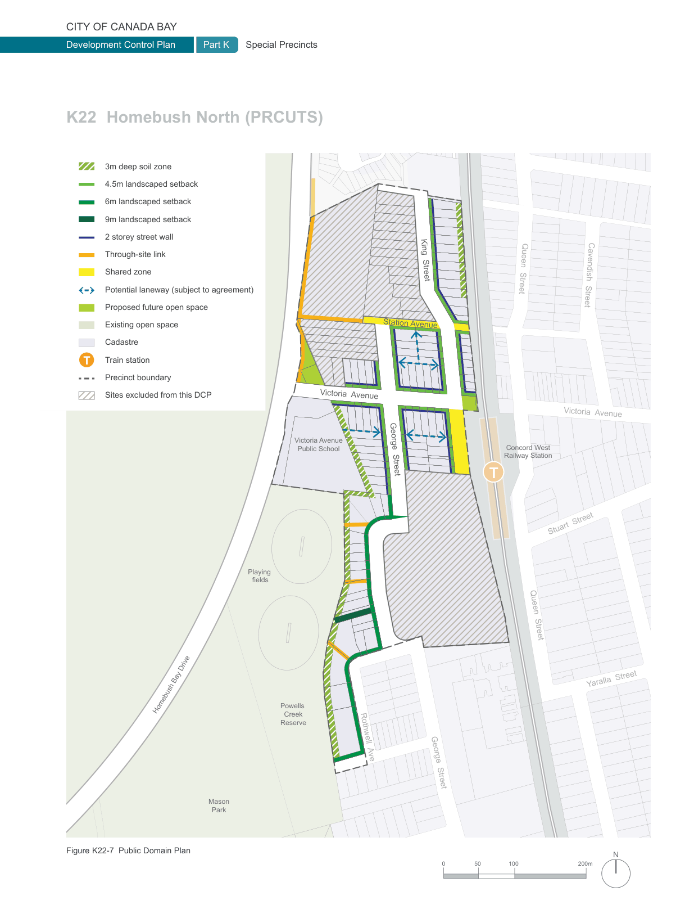

### K22  Homebush North (PRCUTS)

#### K22.6 Access Network

A permeable urban structure is key to successful places. The provision of new links and open spaces is encouraged to improve the area's currently disconnected street network, with a particular focus on supporting the uptake of active and public transport and linking key destinations within and beyond the precinct.

#### Objectives

O1 To provide a better and more robust access network that links residential, local schools, employment and retail uses to Concord West Station and open spaces such as the playing fields, Powell's Creek Reserve and Sydney Olympic Park.

O2 To encourage travel behaviour change by discouraging car usage and supporting sustainable travel choices such as public and active transport.

O3 To improve network permeability, in particular for pedestrians, by breaking up long blocks with new streets and quality pedestrian prioritised links.

O4 To meet access requirements for future development and enable increased density in selected locations.

#### Controls

C1. The existing movement network is retained and new streets, shareways and links are provided as identified in Figure K22-7.

C2. Wherever possible, long blocks are broken up with new high quality pedestrian prioritised links, particularly where new connections would facilitate access to public transport, open spaces and community facilities.

C3. Potential rear lanes have been identified in Figure K22-7 to mitigate the impact of vehicular access and loss of car parking along Victoria Avenue, George Street and King Street. Provision of these lanes would require negotiations between landowners and/or amalgamated sites.

C4. Shared Zones have been shown on Figure K22-7. The intended shared use of the road will be indicated by pedestrianised laneway treatments including flush kerbs, landscaping and a paved road surface.

C5. Size and location of footpaths, laneways, cycleways, planting and parks are to be provided according to Council’s PRCUTS Public Domain Plan and PRCUTS Masterplan.

C6. All future vehicular links including shareways are required to be in public ownership. It is desirable that all future pedestrian/ cycle links also become public land, however, as an alternative an access easement over private land may be able to be negotiated with Council.

C7. Future pedestrian/ cycle links should have a minimum width of 10m and are to be naturally lit and ventilated, appropriately lit after hours, publicly accessible 24/7, and have clear sightlines from end to end.

C8. Bicycle facilities, such as parking, secure storage and end-of-trip facilities are easily accessible from the public domain and conveniently located near entrances and/or lifts of new development.

C9. A new 'Station Square' is located at the eastern end of Victoria Avenue as identified in Figure K22-7.

The public square is to:

• have a minimum area of 400m2.

• have minimum dimensions of 17m x 18m; and

• feature characteristics for passive recreation such as hardstand paving, tree planting to provide shade, lighting and seating.

C10. Encourage kerb build outs with rain gardens or low level landscaping at intersections and other key pedestrian crossings to narrow the width of the street.

C11. The entry and exit of existing underpasses to the east of Station Avenue underneath the rail line and to the west of Victoria Avenue underneath Homebush Bay Drive are addressed and overlooked by private development where possible.

C12. For more controls see Section K22.17 Access and Parking.

#### K22.7 Public Domain Experience

Private development has a large influence on the local character and the support of the existing or future functioning of the public realm, for example by clearly addressing a new pedestrian link and providing good levels of surveillance. The scale of built form, its appearance and the design of private-public interfaces has a significant impact on how people experience a streetscape and the safety of the neighbourhood.

Key elements apart from the built form that need to be considered include front setbacks, boundary treatments, vegetation and landscape design, vehicular access, visible activity at street level, and surveillance provided by doors, windows and balconies.

#### Objectives

O1 To protect and improve the quality, accessibility and safety of the public domain across the precinct.

O2 To support walking and cycling along new and upgraded walking routes to key destinations such as Concord West Station and Sydney Olympic Park.

O3 To improve the immediate surrounds of Concord West Station including the new Station Square and support increased activity levels, safety and comfort.

O4 To increase tree canopy cover and provide for more greenery associated with the public domain.

| Controls |  |
|---|---|
| C1. | Active frontages and Interactive frontages are to be provided as identified in Figure K22-8. |
| C2. | Development is to support the experience and safety of the new Station Square adjacent to Concord West Station as identified in Figure K22-7. Development directly to the north of the square must: a) maximise the number of openable doors and windows at ground level facing the square; b) ensure that at least 50% of the square receives a minimum of 3h direct solar access in mid-winter (21 June) between 9am and 3pm, unless it can be clearly demonstrated that it is unreasonable to meet this requirement due to urban design considerations and only in specific circumstances where the development complies with all other relevant development standards and development controls; c) locate active uses on the ground floor with a preference for convenience retail and cafes/ restaurants with outdoor chairs and tables; and d) provide continuous awnings or colonnades to the square and wrapping around the corner along King Street which encourages the public to spend time during all weather types. |
| C3. | All new pedestrian/ cycle links are to be defined by built form and quality edge treatments such as semi-transparent fences or low walls with landscaping. See Section K22.12 Safety and Accessibility for more detail. |
| C4. | Any development on a corner site and at the end of terminating views must pay particular attention to overall design quality due to the location's high visibility and impact on the local character, i.e. well proportioned facades and quality material, finishes and plant species selection. Driveways or vehicle entry/ exit points at the end of terminating views are prohibited. |

> [Picture on page 403: a map, saved as a picture (images/part-k-special-precincts-page-403-1.gif, 150 dpi); the street names and other small labels are on the picture.]
> Labels printed on the map (copied from the PDF, in no particular order):
> 3m deep soil zone · 4.5m landscaped setback · 6m landscaped setback · 9m landscaped setback · 2 storey street wall · Through-site link · Shared zone · King  Street · Potential laneway (subject to agreement) · Proposed future open space · Existing open space · Station Avenue · Cadastre · Train station · Bicentennial · T · Park · Precinct boundary · Sites excluded from this DCP · Victoria  Avenue · Victoria Avenue · Public School · George  Street · Playing · fields · ay Drive · Powells · Homebush B · Creek · Reserve · Rothwell  Ave · George  Street · Mason · Park · Figure K22-7 Public Domain Plan · 0 · Queen  Street · Cavendish  Street · Victoria  Avenue · Concord West · Railway Station · Stuart  Street · Queen  Street · Yaralla  Street · N · 200m · 100 · 50
