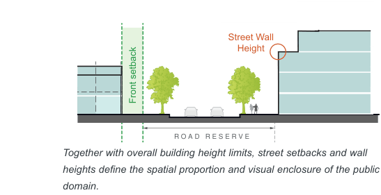
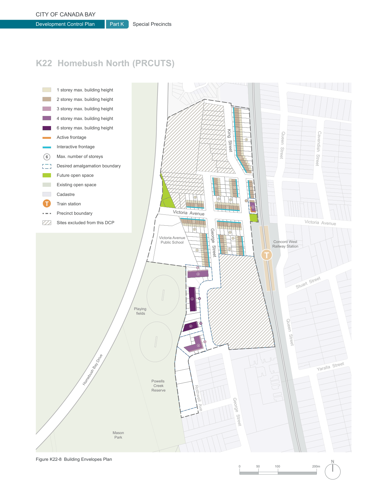

### K22  Homebush North (PRCUTS)

### T

#### T

#### K22.8 Street Setbacks

Street setback areas are an integral part of the streetscape and their treatment is fundamental to the amenity and character of a neighbourhood. Combined with building height and road reserve width, they define the proportion, scale and visual enclosure of the street. Street setbacks not only establish the alignment of buildings along the street, they also provide for landscaping and deep soil areas, building entries and a transition between public and private space.

Street wall heights and upper level setbacks (where relevant) further define the proportion, scale and visual enclosure of the public domain and provide a level of consistency across the precinct. Upper level setbacks lessen the visual impact of taller development and help create a more unified, human-scale streetscape environment.

#### Objectives

O1 To ensure new development reinforces the desired streetscape character and where appropriate retains the character of established residential areas.

O2 To ensure setbacks contribute positively to the pedestrian environment at street level.

O3 To provide a sense of enclosure to the street and contribute to a consistent built form scale across the precinct over time.

O4 To enhance development and its relationship with adjoining sites and the public domain, particularly in regard to access to sunlight, outlook, view sharing, ventilation and privacy.

> [Picture on page 404: a picture, saved as a picture (images/part-k-special-precincts-page-404-32.gif, 150 dpi).]
> [Picture text on page 404 is stored in the PDF without readable letters (no character map), so it could not be copied; see the original PDF.]
> Words printed on the picture (copied from the PDF):
> Street Wall
> Street Wall
> Height
> Height
> Front setback
> Together with overall building height limits, street setbacks and wall
> heights define the spatial proportion and visual enclosure of the public
> domain.

| Controls |  |
|---|---|
| C1. | All development is to comply with the setbacks shown on Figure K22-7. |
| C2. | Where applicable, a portion of the setback area is to provide deep soil zones and tree planting. Refer to Section K22.15 Landscape Design for more detailed controls. |
| C3. | ‘Undesirable’ elements such as vents, electrical substations, or plant and equipment spaces are not permissible within the setback area and should be accommodated within the building. Service cabinets are to be co-located internally, accessible from loading, waste or parking areas where possible to avoid impact on the public realm. |

> [Picture on page 405: a map, saved as a picture (images/part-k-special-precincts-page-405-1.gif, 150 dpi); the street names and other small labels are on the picture.]
> Labels printed on the map (copied from the PDF, in no particular order):
> 1 storey max. building height · 2 storey max. building height · 3 storey max. building height · 4 storey max. building height · 2 · 6 storey max. building height · Active frontage · 1 · Interactive frontage · King  Street · Queen  Street · 2 · Max. number of storeys · 6 · Cavendish  Street · Desired amalgamation boundary · Future open space · Existing open space · 2 2 · 2 · Cadastre Bicentennial · 1 · 1 · 1 · Park · 2 · Train station · 2 · T · 4 · 2 · Precinct boundary · 2 · 2 · Sites excluded from this DCP · Victoria  Avenue · Victoria  Avenue · 1 · 1 · 1 · Victoria Avenue · Public School · 2 · 2 · Concord West · Railway Station · 1 · 1 2 · George  Street · 3 · 4 · Stuart  Street · 4 · 6 · Playing · fields · 4 · 6 · 3 · Queen  Street · 4 · ay Drive · Yaralla  Street · Powells · Homebush B · Creek · Reserve · Rothwell  Ave · George  Street · Mason · Park · N · Figure K22-8 Building Envelopes Plan · 200m · 100 · 50 · 0
