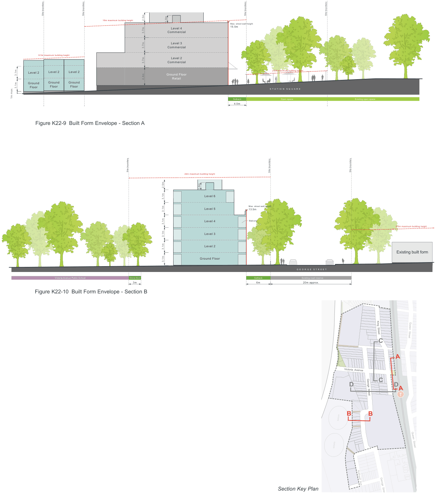

### K22  Homebush North (PRCUTS)

### T

#### T

Development Control Plan

3.1m

1m max.

Part K

Figure K22-9 Built Form Envelope - Section A

Special Precincts

> [Picture on page 406: a map, saved as a picture (images/part-k-special-precincts-page-406-7.gif, 150 dpi); the street names and other small labels are on the picture.]
> Labels printed on the map (copied from the PDF, in no particular order):
> Site boundary · Site boundary · 8.5m maximum building height · Level 2 Level 2 · Level 2 · Ground Ground · Ground · Floor Floor · 3.1m Floor · 16m maximum building height · 3.7m · 4.4m · 3.7m · 3.7m · 2.5m · 1.8m · Level 4 · Commercial · Level 3 · Commercial · Level 2 · Commercial · Ground Floor · Retail · Site boundary · Site boundary · Max. street wall height · 15.5m · 2.5m maximum building height · S T A T I O N S Q U A R E · Setback · Open space · 4.5m · Existing open space

> Labels printed on the map (copied from the PDF, in no particular order):
> Site boundary · Victoria Avenue Public School · Deep Soil · 3m · 22m maximum building height · 1.8m · Level 6 · Level 5 · Level 4 · Level 3 · Level 2 · Ground Floor · 2.5m · 3.1m · 3.1m · 3.1m · 3.1m · 3.1m · 3.1m · Figure K22-10 Built Form Envelope - Section B · Site boundary · Max. street wall height · 13.5m · Balcony · G E O R G E S T R E E T · Setback · Existing road reserve · 6m · 20m approx. · Section Key Plan · Site boundary · 8.5m maximum building height · Existing built form · King  Street · Queen  Street · Cavendish  Street · C · A · Victoria  Avenue · D · D · C · A · George  Street · T · B · B · Queen  Street · Rothwell  Ave · George  Street

Victoria  Avenue

#### T
