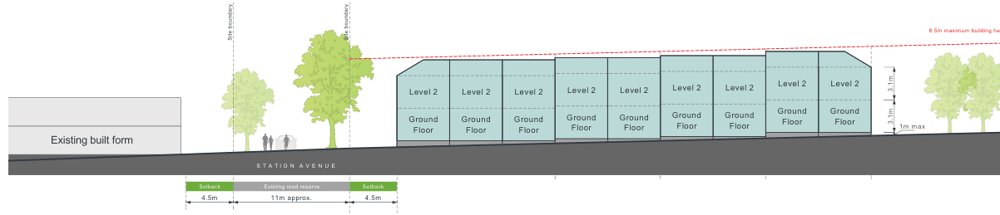
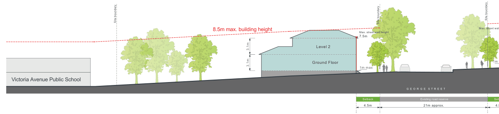
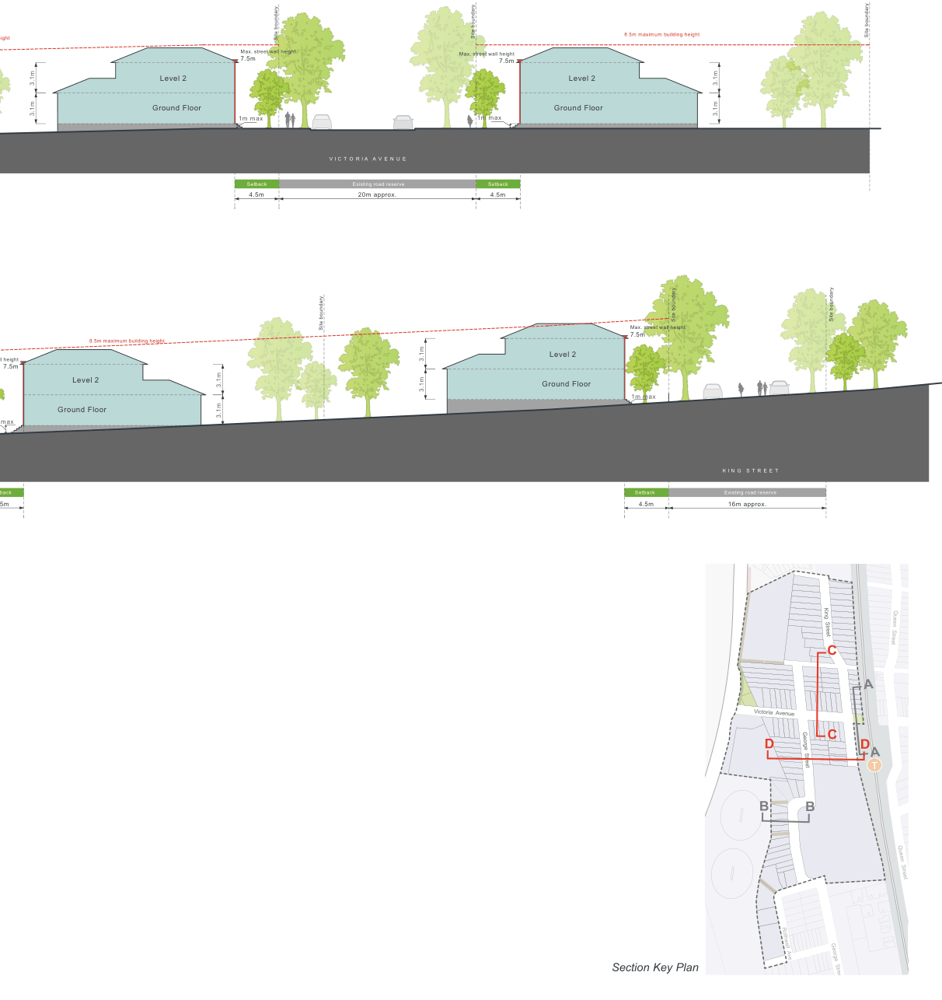

### K22  Homebush North (PRCUTS)

> [Picture on page 407: a map, saved as a picture (images/part-k-special-precincts-page-407-2.gif, 150 dpi); the street names and other small labels are on the picture.]
> Labels printed on the map (copied from the PDF, in no particular order):
> Site boundary · Site boundary · Level 2 · Level 2 Level 2 Level 2 · Ground · Ground Ground Ground · Floor · Floor Floor Floor · Existing built form · S T A T I O N A V E N U E · Existing road reserve · Setback · Setback · 4.5m · 4.5m · 11m approx. · Level 2 · Level 2 · Ground · Ground · Floor · Floor · Level 2 Level 2 · Level 2 · Ground Ground · Ground · Floor Floor · Floor

Figure K22-11 Built Form Envelope - Section C

Victoria Avenue Public School

Figure K22-12 Built Form Envelope - Section D

8.5m maximum building he

3.1m

3.1m 1m max

> [Picture on page 407: a map, saved as a picture (images/part-k-special-precincts-page-407-10.gif, 150 dpi); the street names and other small labels are on the picture.]
> Labels printed on the map (copied from the PDF, in no particular order):
> Site boundary · 8.5m max. building height · 3.1m · 3.1m · Level 2 · Ground Floor · Site boundary · Site boundary · Max. street wal · Max. street wall height · 7.5m · 1m · 1m max · G E O R G E S T R E E T · Existing road reserve · Setback · Set · 4.5m · 21m approx.

4.5

eight

3.1m

3.1m

> [Picture on page 408: a map, saved as a picture (images/part-k-special-precincts-page-408-4.gif, 150 dpi); the street names and other small labels are on the picture.]
> Labels printed on the map (copied from the PDF, in no particular order):
> Site boundary · 8.5m maximum building height · ll height · 7.5m · Level 2 · 3.1m · 3.1m · Ground Floor · 3.1m · 3.1m · max · back · 5m · Site boundary · Max. street wall height · 7.5m · Level 2 · Ground Floor · 1m max · Setback · 4.5m · Section Key Plan · Site boundary · K I N G S T R E E T · Existing road reserve · 16m approx. · King  Street · Queen  Street · C · A · Victoria  Avenue · D · D · C · A · George  Street · T · B · B · Queen  Street · Rothwell  Ave · George  Street

Cavendish  Street

Victoria  Avenue

#### T

> Labels printed on the map (copied from the PDF, in no particular order):
> Site boundary · Site boundary · Max. street wall height · 7.5m · Max. street wall height · 7.5m · Level 2 · Ground Floor · 1m max · 1m max · V I C T O R I A A V E N U E · Existing road reserve · Setback · Setback · 4.5m · 20m approx. · 4.5m · 8.5m maximum building height · Level 2 · Ground Floor · Site boundary · 3.1m · 3.1m
