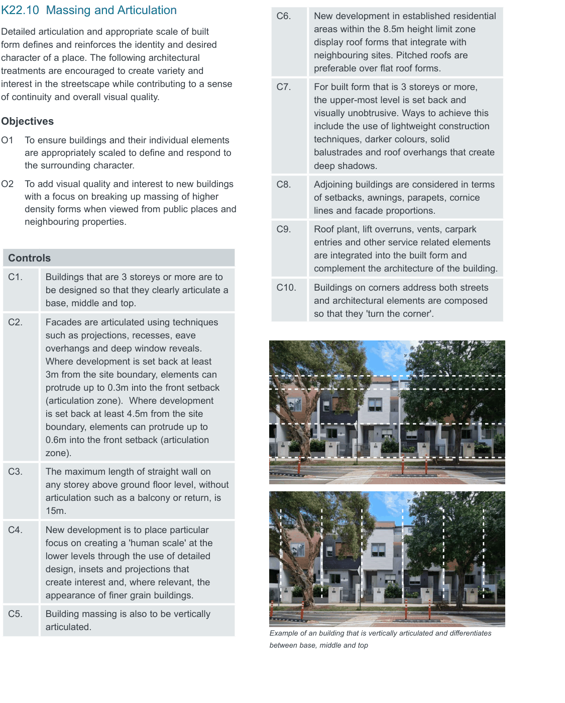

### K22  Homebush North (PRCUTS)

#### K22.9 Transitions and Interfaces

Changes in height and scale will require transitions to sensitive interfaces such as existing low scale residential areas and open spaces. New development will be required to respond to the overall scale and form of existing elements to preserve visual scale and to minimise loss of outlook and privacy and maximise sun access of adjoining properties.

Interface treatments for development adjacent to the rail line and/or Homebush Bay Drive need to support the protection of future residents and building users from negative impacts such as noise, vibration and air pollution.

#### Objectives

O1 To encourage new development that is sensitive and complementary in scale and site location to surrounding properties.

O2 To protect residential amenity at the interface to existing low rise development.

O3 To ensure streets and open spaces receive adequate sunlight and ventilation.

O4 To protect future residents and building users from negative impacts generated by the rail line and Homebush Bay Drive.

#### Controls

| C1. | Where adjacent to low density residential interfaces, new development should gradually step away in height and provide appropriate setbacks. |
|---|---|
| C2. | Development to the east of the playing fields along the open space interface: a) sets back as identified in Figure K22-7 with the setback area to be landscaped and deep soil; and b) addresses the open space and maximises windows and balconies of the upper levels that maximise passive surveillance. |

| C3. | Development along the interface to the rail line, the Victoria Avenue Public School and/or Homebush Bay Drive complies with the setbacks shown in Figure K22-7. The following applies: a) The setback is to be deep soil to allow for mature vegetation in order to create a buffer; and b) Fences and walls can be as high as 2.0m and should be constructed to effectively shield noise. |
|---|---|

#### K22.10 Massing and Articulation

> [Picture on page 410: a picture, saved as a picture (images/part-k-special-precincts-page-410-2.gif, 150 dpi).]
> Words printed on the picture (copied from the PDF):
> the surrounding character.
> neighbouring properties.
> articulated.
> Example of an building that is vertically articulated and differentiates
> between base, middle and top

Detailed articulation and appropriate scale of built form defines and reinforces the identity and desired character of a place. The following architectural treatments are encouraged to create variety and interest in the streetscape while contributing to a sense of continuity and overall visual quality.

#### Objectives

O1 To ensure buildings and their individual elements are appropriately scaled to define and respond to

O2 To add visual quality and interest to new buildings with a focus on breaking up massing of higher density forms when viewed from public places and

#### Controls

C1. Buildings that are 3 storeys or more are to be designed so that they clearly articulate a base, middle and top.

C2. Facades are articulated using techniques such as projections, recesses, eave overhangs and deep window reveals. Where development is set back at least 3m from the site boundary, elements can protrude up to 0.3m into the front setback (articulation zone).  Where development is set back at least 4.5m from the site boundary, elements can protrude up to 0.6m into the front setback (articulation zone).

C3. The maximum length of straight wall on any storey above ground floor level, without articulation such as a balcony or return, is 15m.

C4. New development is to place particular focus on creating a 'human scale' at the lower levels through the use of detailed design, insets and projections that create interest and, where relevant, the appearance of finer grain buildings.

C5. Building massing is also to be vertically

C6. New development in established residential areas within the 8.5m height limit zone display roof forms that integrate with neighbouring sites. Pitched roofs are preferable over flat roof forms.

C7. For built form that is 3 storeys or more, the upper-most level is set back and visually unobtrusive. Ways to achieve this include the use of lightweight construction techniques, darker colours, solid balustrades and roof overhangs that create deep shadows.

C8. Adjoining buildings are considered in terms of setbacks, awnings, parapets, cornice lines and facade proportions.

C9. Roof plant, lift overruns, vents, carpark entries and other service related elements are integrated into the built form and complement the architecture of the building.

C10. Buildings on corners address both streets and architectural elements are composed so that they 'turn the corner'.
