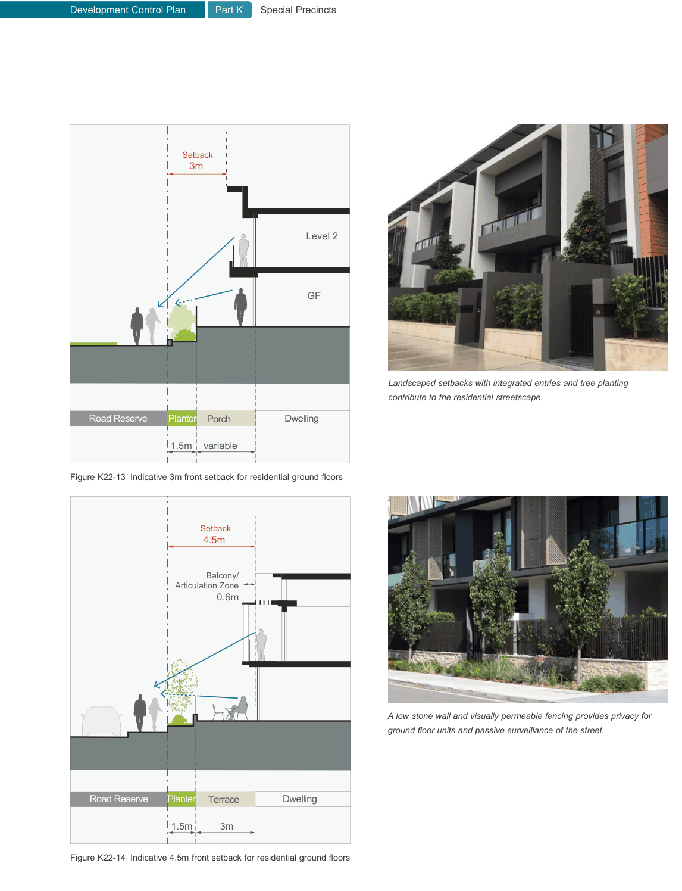

### K22  Homebush North (PRCUTS)

#### K22.11 Interactive Frontages

Within residential zones the design of the development plays an important role in encouraging pedestrian activity and enhancing public safety and security. Developments which allow passive surveillance, where people within buildings are able to overlook the street and where passersby are aware of 'signs of life', promote streetscape activity and local interactions. Multiple entries to residential dwellings which allow residents to physically access homes directly off the street also provide visual interest and encourage streetscape activity.

#### Objectives

O1 To encourage new development that promotes activity on the street and enhances public safety and security.

O2 To encourage new development that provides a high level of passive surveillance.

O3 To ensure development provides a high quality visual experience and creates interest when experienced from a walking pace.

O4 To ensure private spaces and entries facing the street are safe, attractive and comfortable to use.

Front semi-transparent fences and landscaped setbacks with tree planting contribute to the amenity of the streetscape and support a positive pedestrian experience.

| Controls |  |
|---|---|
| C1. | Development that fronts onto streets identified as 'interactive frontage' (see Figure K22-8) must comply with following controls: |
| C2. | Developments are to maximise the number of front doors and private spaces which are visible from the street. At a minimum there is to be a pedestrian entries and/or primary private open space overlooking the street every 15m. |
| C3. | Developments are to provide openable windows and balconies at upper levels that encourage views of the street. |
| C4. | Entries and private open spaces are encouraged within the 3m or 4.5m landscaped setbacks including a 1.5m wide strip of landscaping (see Figure K22-13 and Figure K22-14) and other controls including those identified in Section K22.15 Landscape Design are also to be met. |
| C5. | Deeper front setbacks (greater than 5m) are discouraged and landscaping and fences or structures higher than 0.9m within the front setback are not permitted. |
| C6. | All landscaping within the front setback is to maintain clear views from the footpath to the development. |
| C7. | Front fences are to be a maximum of 1.2m high and at least 50% is to be at least 50% transparent and enable a high level of passive surveillance. |
| C8. | Front terraces and entry areas are to be elevated by between 0.6m and 1.0m above the level of the street to improve privacy and increase opportunities for passive surveillance. |
| C9. | Development is to minimise services (i.e. substations, fire services and water services) located within the front setback, along the site frontage or on building facades. |

> [Picture on page 412: a map, saved as a picture (images/part-k-special-precincts-page-412-1.gif, 150 dpi); the street names and other small labels are on the picture.]
> Labels printed on the map (copied from the PDF, in no particular order):
> Setback · 3m · Level 2 · GF · Planter · Dwelling · Road Reserve · Porch · variable · 1.5m · Figure K22-13 Indicative 3m front setback for residential ground floors · Setback · 4.5m · Balcony/ · Articulation Zone · 0.6m · Planter · Dwelling · Road Reserve · Terrace · 3m · 1.5m · Figure K22-14 Indicative 4.5m front setback for residential ground floors · Landscaped setbacks with integrated entries and tree planting · contribute to the residential streetscape. · A low stone wall and visually permeable fencing provides privacy for · ground floor units and passive surveillance of the street.
