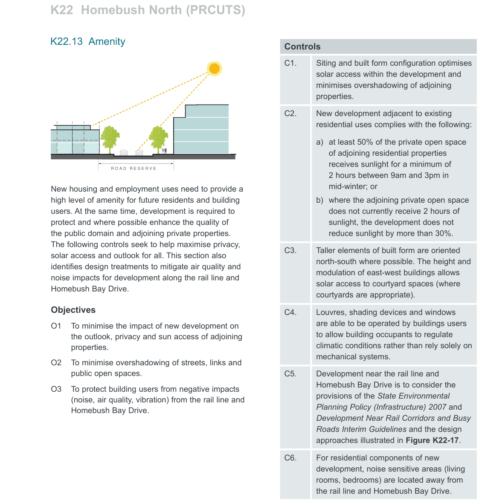
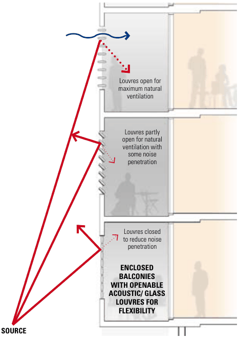
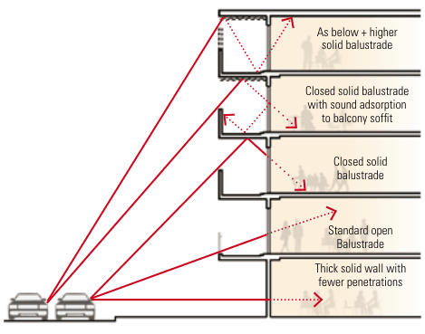

### K22  Homebush North (PRCUTS)

#### K22.13 Amenity

> [Picture on page 415: a picture, saved as a picture (images/part-k-special-precincts-page-415-3.gif, 150 dpi).]
> [Picture text on page 415 is stored in the PDF without readable letters (no character map), so it could not be copied; see the original PDF.]

New housing and employment uses need to provide a high level of amenity for future residents and building users. At the same time, development is required to protect and where possible enhance the quality of the public domain and adjoining private properties. The following controls seek to help maximise privacy, solar access and outlook for all. This section also identifies design treatments to mitigate air quality and noise impacts for development along the rail line and Homebush Bay Drive.

#### Objectives

O1 To minimise the impact of new development on the outlook, privacy and sun access of adjoining properties.

O2 To minimise overshadowing of streets, links and public open spaces.

O3 To protect building users from negative impacts (noise, air quality, vibration) from the rail line and Homebush Bay Drive.

| Controls |  |
|---|---|
| C1. | Siting and built form configuration optimises solar access within the development and minimises overshadowing of adjoining properties. |
| C2. | New development adjacent to existing residential uses complies with the following: a) at least 50% of the private open space of adjoining residential properties receives sunlight for a minimum of 2 hours between 9am and 3pm in mid-winter; or b) where the adjoining private open space does not currently receive 2 hours of sunlight, the development does not reduce sunlight by more than 30%. |
| C3. | Taller elements of built form are oriented north-south where possible. The height and modulation of east-west buildings allows solar access to courtyard spaces (where courtyards are appropriate). |
| C4. | Louvres, shading devices and windows are able to be operated by buildings users to allow building occupants to regulate climatic conditions rather than rely solely on mechanical systems. |
| C5. | Development near the rail line and Homebush Bay Drive is to consider the provisions of the State Environmental Planning Policy (Infrastructure) 2007 and Development Near Rail Corridors and Busy Roads Interim Guidelines and the design approaches illustrated in Figure K22-17. |
| C6. | For residential components of new development, noise sensitive areas (living rooms, bedrooms) are located away from the rail line and Homebush Bay Drive. |

road

| Controls |  |
|---|---|
| C7. | Windows located along the rail line and/ or Homebush Bay Drive are double-glazed (or use laminated glazing) and have acoustic seals. |
| C8. | Habitable rooms of dwellings (excluding balconies) are to be designed to achieve internal noise levels of no greater than 50dBA. |
| C9. | Windows, balconies, terraces and porches should be included on street elevations to increase opportunities for passive surveillance. |
| C10. Where | Front doors should be located where they balconies are visible are from required, the street. solid balustrades with |

sound absorption material added to the underside of balconies above is a good means of reducing noise entering the building.

Providing enclosed balconies (or winter gardens) is another means of reducing the noise entering a building. Where enclosed balconies are used ventilation may need to be considered. By installing acoustic louvres ventilation requirements and reduced noise can be addressed. These approaches are shown in figure 3.16.

> [Picture on page 416: a map, saved as a picture (images/part-k-special-precincts-page-416-13.gif, 150 dpi); the street names and other small labels are on the picture.]
> Labels printed on the map (copied from the PDF, in no particular order):
> figure 3.16: Enclosable · balconies facing the · Louvres open for · maximum natural · ventilation · Louvres partly · open for natural · ventilation with · some noise · penetration · Louvres closed · to reduce noise · penetration · ENCLOSED · BALCONIES · WITH OPENABLE · ACOUSTIC/ GLASS · LOUVRES FOR · FLEXIBILITY

> [Picture on page 416: a map, saved as a picture (images/part-k-special-precincts-page-416-14.gif, 150 dpi); the street names and other small labels are on the picture.]
> Labels printed on the map (copied from the PDF, in no particular order):
> As below + higher · figure 3.15: Balcony treatments · which reduce traffic noise · intrusion · solid balustrade · Closed solid balustrade · with sound adsorption · to balcony soffit · Closed solid · balustrade · Standard open · Balustrade · Thick solid wall with · fewer penetrations

#### SOURCE

Figure K22-17 Noise mitigating facade treatments

(Source: Development Near Rail Corridors And Busy Roads Interim Guideline, NSW)
