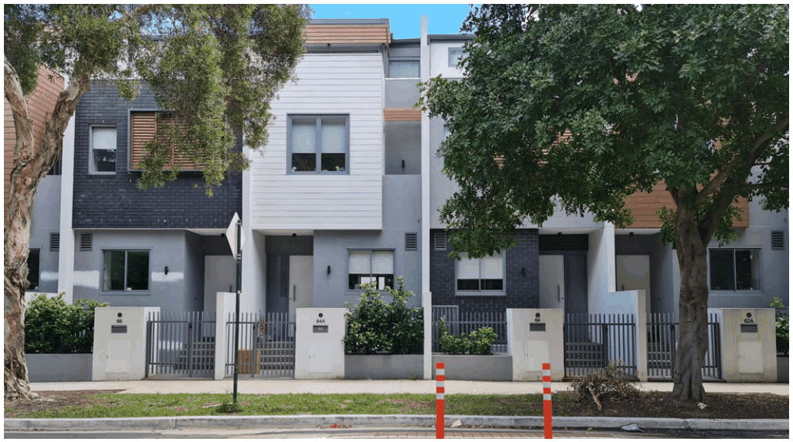

### K22  Homebush North (PRCUTS)

#### K22.14 Appearance

The design of buildings contributes to the streetscape character and adds visual richness, complexity and interest. In addition, the selection of signage, materials, finishes and colours should have regard to compatibility to the surrounds and consider robustness, durability and ease of maintenance.

#### Objectives

O1 To ensure building exteriors positively contribute to the desired future character of the area and streetscape.

O2 To ensure that signage is integrated and not detrimental to the local character by limiting its cumulative impact with other signage.

Facade design

| Controls |  |
|---|---|
| C1. | The composition of facades balances solid and void elements and does not display large areas of a single material, including reflective glass. |
| C2. | External walls are constructed of high quality and durable materials and finishes with low maintenance attributes (‘self-cleaning’) such as face brickwork, rendered brickwork, stone, concrete and glass. |
| C3. | Any blank sidewalls (including temporary walls that may be covered in the future) that are visible from the public domain are designed as an architecturally finished surface that complements the main facade. |
| C4. | Visually prominent elements such as balconies, overhangs, awnings, and roof tops are to be of high design quality. |
| C5. | Roof plant, lift overruns, utilities, vents and other service related elements are to be integrated into the built form design and complementary to the architecture of the building. |

Signage and advertising

| Controls |  |
|---|---|
| C6. | Signage is to comply with the requirements of State Environmental Planning Policy No 64-Advertising and Signage. Also refer to requirements in the City of Canada Bay DCP Part I Signage and Advertising. |
| C7. | Signage is to be integrated into the overall architectural design. Advertising signs should complement the design of buildings and the overall character of the precinct. Signage must relate to an approved use on the site. |
| C8. | The main facades of buildings from the first floor to the rooftop or parapet are to be uncluttered and generally free of signage. |
| C9. | Freestanding signs are not to be located on the top of buildings and should not impact on the skyline when viewed from the street. Signs painted on or applied to the roof of a building are not permitted. |

> [Picture on page 418: a picture, saved as a picture (images/part-k-special-precincts-page-418-1.gif, 150 dpi).]

Example of terrace houses with a variety of solid and void in the facade composition and treatment
