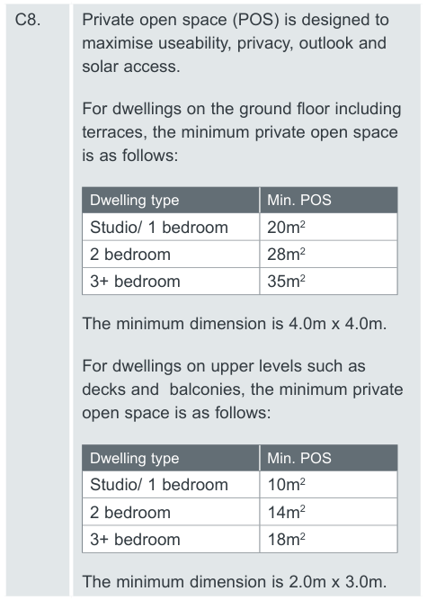
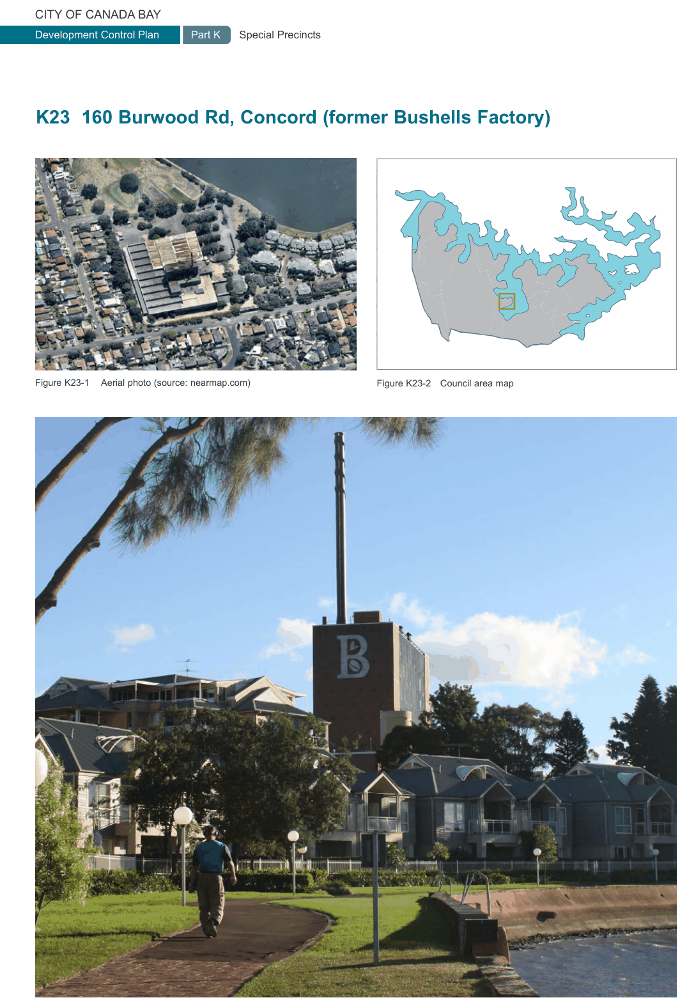

### K22  Homebush North (PRCUTS)

#### K22.18 Housing Diversity

A mix of dwelling types in the precinct will provide greater housing choice and support equitable housing access by offering a diversity of dwelling types, amount of floor space, number of bedrooms and level of accessibility and affordability.

#### Objectives

O1 To provide a diverse range of dwelling types and sizes to cater for the needs of the existing and future residents over time, and encourage social diversity.

O2 To ensure that low to moderate income households can afford to live in the precinct by increasing the stock of appropriate affordable housing.

#### Controls

C1. For mix of residential flat buildings and residential components of mixed use developments, refer to LEP clause - 6.11 Mix of dwelling sizes in residential flat buildings and mixed use development

C2. Regarding the amount of adaptable (accessible) housing to be provided refer to requirements in City of Canada Bay DCP Part B1.1 Adaptable Housing.

C3. Dwellings dedicated to Affordable Housing are to be of equivalent design quality, diversity and mix as all other dwellings.

C4. Contributions towards Affordable Housing are to be provided according to Council’s Affordable Housing Contributions Scheme.

#### K22.19 SEPP 65 and the Apartment Design Guide

SEPP 65 and the NSW Apartment Design Guide (ADG) applies to all apartment buildings that are three or more storeys high and that comprise at least four dwellings.

K22.20 Residential Uses not covered by

#### SEPP 65 and the Apartment Design Guide

The NSW Apartment Design Guide (ADG) applies to buildings that are three or more storeys high and that comprise at least four dwellings. For other residential development developments not covered by these codes such as 2-3 storey terraces, low rise up-over or walk-up apartments, multiplexes, urban courtyard houses and the like, the following controls apply.

#### Objective

O1 To ensure design quality, performance of and amenity created by new residential development is of a high standard and consistent across the precinct.

#### Controls

C1. The maximum building depth is 18m unless it can be demonstrated that all habitable rooms receive adequate ventilation and solar access, e.g. through the use of a courtyard design.

C2. The minimum private open space of a ground floor dwelling is calculated by the number of bedrooms x 4m2.

C3. Single aspect dwellings, if unavoidable, are only permitted if they have a northerly or easterly aspect.

C4. Except for development in the 8.5m height limit zone, parking is not permitted to be visible from streets and open spaces. Access to parking via a driveway, lane or basement carpark entry is permitted if one access point services a minimum of 5 dwellings. Front garages, carports and individual driveways are not permitted.

C5. Living rooms and private open spaces of at least 70% of apartments receive a minimum of 2 hours direct sunlight between 9 am and 3 pm in mid winter (21 June).

C6. Master bedrooms have a minimum area of 10m2 and other bedrooms 9m2.

C7. Building separation is as per the Apartment Design Guide, Section 3F Visual Privacy.

> [Picture on page 426: a picture, saved as a picture (images/part-k-special-precincts-page-426-44.gif, 150 dpi).]

C8. Private open space (POS) is designed to maximise useability, privacy, outlook and solar access.

For dwellings on the ground floor including terraces, the minimum private open space is as follows:

| Dwelling type | Min. POS |
|---|---|
| Studio/ 1 bedroom | 20m2 |
| 2 bedroom | 28m2 |
| 3+ bedroom | 35m2 |

The minimum dimension is 4.0m x 4.0m.

For dwellings on upper levels such as decks and  balconies, the minimum private open space is as follows:

| Dwelling type | Min. POS |
|---|---|
| Studio/ 1 bedroom | 10m2 |
| 2 bedroom | 14m2 |
| 3+ bedroom | 18m2 |

The minimum dimension is 2.0m x 3.0m.

> [Picture on page 427: a picture, saved as a picture (images/part-k-special-precincts-page-427-1.gif, 150 dpi).]
> Words printed on the picture (copied from the PDF):
> Figure K23-1 Aerial photo (source: nearmap.com)
> Figure K23-2 Council area map
