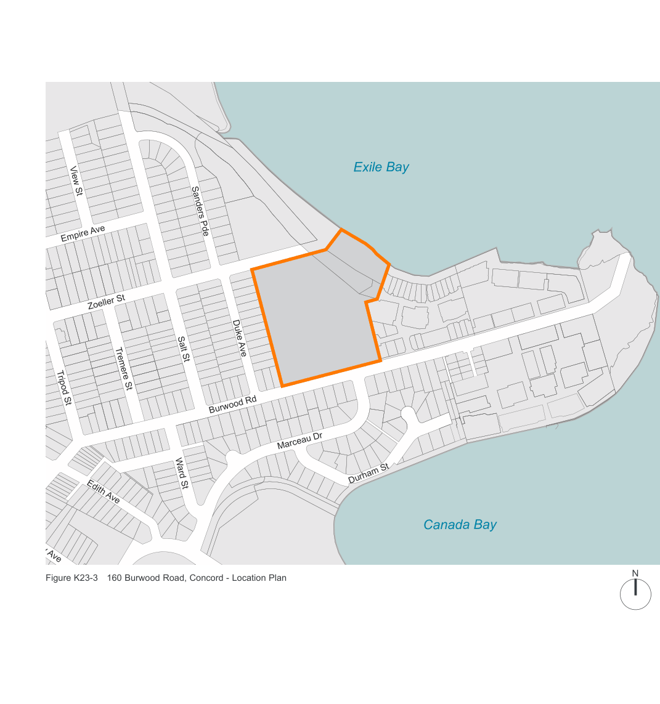

### K23  160 Burwood Rd, Concord (former Bushells Factory)

> [Picture on page 428: a map, saved as a picture (images/part-k-special-precincts-page-428-1.gif, 150 dpi); the street names and other small labels are on the picture.]
> Labels printed on the map (copied from the PDF, in no particular order):
> View St · Sanders Pde · Empire Ave · Zoeller St · Duke Ave · Salt St · Tremere St · Tripod St · Burwood Rd · Marceau Dr · Durham St · Ward St · Edith Ave · Corby Ave · N · Figure K23-3 160 Burwood Road, Concord - Location Plan

#### Exile Bay

#### Canada Bay
