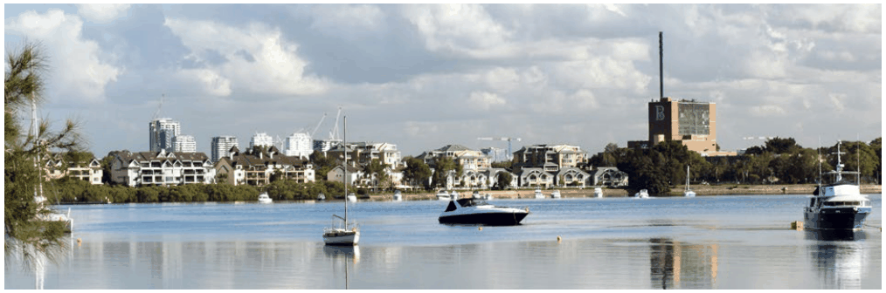
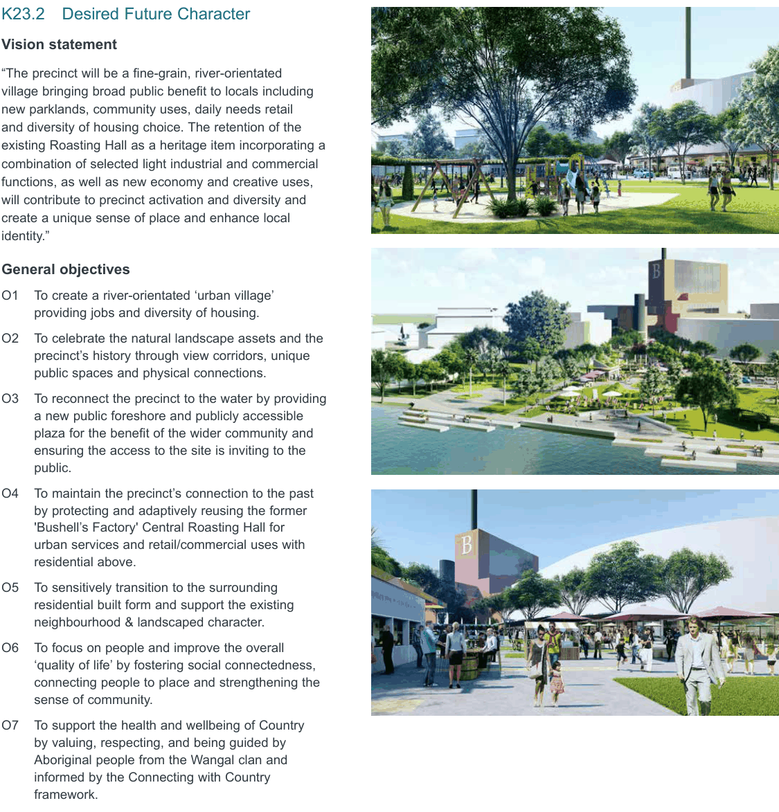

### K23  160 Burwood Rd, Concord (former Bushells Factory)

> [Picture on page 429: a picture, saved as a picture (images/part-k-special-precincts-page-429-2.gif, 150 dpi).]

#### K23.1 Introduction

#### Location

The site is located at 160 Burwood Road, Concord, approximately 15km to the west of the Sydney CBD, 2.6km from Burwood District Centre and Burwood Train Station, 3km from Strathfield Train Station and 5.5km from Rhodes Strategic Centre. The nearest local commercial/ retail centre is located at Majors Bay Road, approximately 1.5kms from the precinct.

The precinct comprises approximately 3.9Ha of land and is bounded by Massey Park Golf Course to the north, Exile Bay foreshore area to the north east, medium density residential developments to the east, and low density residential developments to the west and south. Bayview Park is located further to the east along the foreshore line of Exile Bay and the Parramatta River.

#### Context

The precinct is surrounded by low to medium density residential development. To the east lies a medium density housing development known as ‘Pelican Quays’/ ‘Pelican Point’ which was built in the last 10-20 years. Another medium density development known as ‘Phillips Landing’ is located to the south of the precinct.

The Massey Park Golf Course is located along the northern boundary of the site and is publicly owned. The surrounding streets comprise tree lined avenues with on street parking reinforcing a residential streetscape character.

#### Current use, built form and character

The precinct is located on a small peninsula of land between Exile Bay and Canada Bay. The shape of the peninsula, combined with the generally flat topography of the surrounding area and 2 to 3 storey buildings along the foreshore, creates a landscape that has a strong horizontal dominance, formed by the water, the land and the tree line.

The site currently operates as a coffee manufacturing facility. The main industrial building is a multi-storey brick and concrete structure that is orientated north-south and is sited in the western part of the site and contains an industrial building, known as the ‘Robert Timms Factory’ or ‘Bushell’s Factory’ featuring a prominent 78m high chimney stack. A two storey administration building is located to the eastern side of the factory and a covered walkway joins the two structures. A security booth/ gatehouse and boom gates are located at the Burwood Road frontage.

Vehicular access to the precinct is provided off Burwood Road, which extends along the centre of the peninsula to Bayview Park. A small section of the north west corner of the precinct connects to Zoeller Street.

#### K23.2 Desired Future Character

#### Vision statement

“The precinct will be a fine-grain, river-orientated village bringing broad public benefit to locals including new parklands, community uses, daily needs retail and diversity of housing choice. The retention of the existing Roasting Hall as a heritage item incorporating a combination of selected light industrial and commercial functions, as well as new economy and creative uses, will contribute to precinct activation and diversity and create a unique sense of place and enhance local identity.”

#### General objectives

O1 To create a river-orientated ‘urban village’ providing jobs and diversity of housing.

O2 To celebrate the natural landscape assets and the precinct’s history through view corridors, unique public spaces and physical connections.

O3 To reconnect the precinct to the water by providing a new public foreshore and publicly accessible plaza for the benefit of the wider community and ensuring the access to the site is inviting to the public.

O4 To maintain the precinct’s connection to the past by protecting and adaptively reusing the former 'Bushell’s Factory' Central Roasting Hall for urban services and retail/commercial uses with residential above.

O5 To sensitively transition to the surrounding residential built form and support the existing neighbourhood & landscaped character.

O6 To focus on people and improve the overall ‘quality of life’ by fostering social connectedness, connecting people to place and strengthening the sense of community.

O7 To support the health and wellbeing of Country by valuing, respecting, and being guided by Aboriginal people from the Wangal clan and informed by the Connecting with Country framework.

O8 To achieve a high quality urban development that exhibits design excellence and reflects the desired future character of the area.

> [Picture on page 430: a picture, saved as a picture (images/part-k-special-precincts-page-430-44.gif, 150 dpi).]
