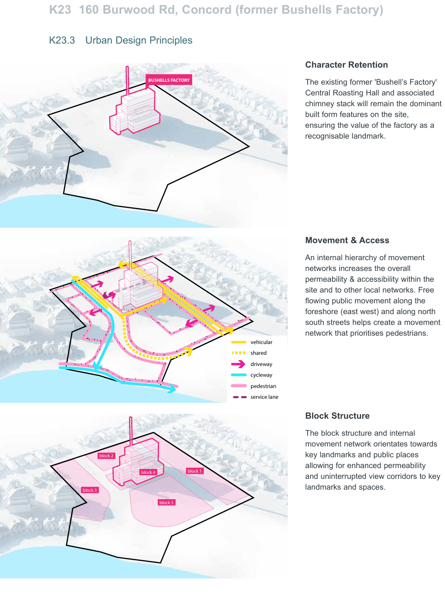
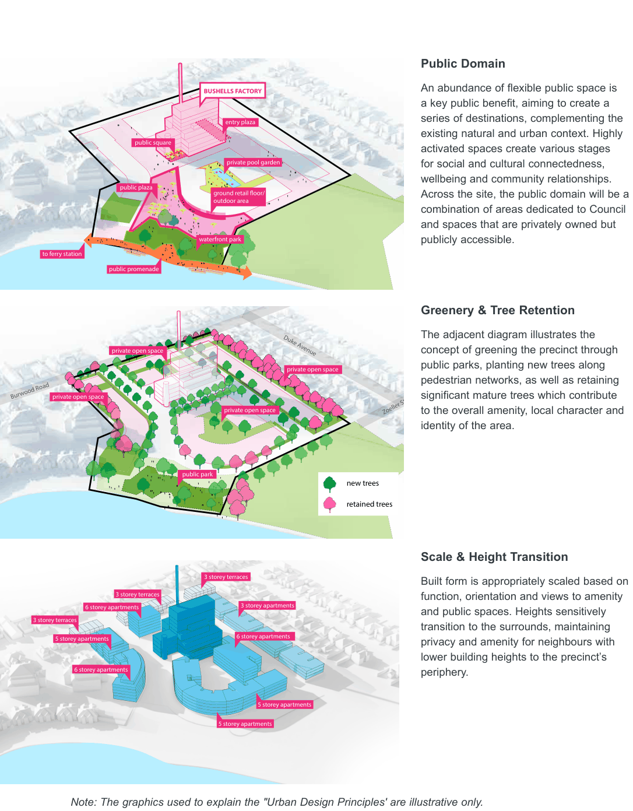

### K23  160 Burwood Rd, Concord (former Bushells Factory)

> [Picture on page 431: a picture, saved as a picture (images/part-k-special-precincts-page-431-2.gif, 150 dpi).]
> Words printed on the picture (copied from the PDF):
> block 2
> block 3
> BUSHELLS FACTORY
> block 4 block 1
> block 5
> vehicular
> shared
> driveway
> cycleway
> pedestrian
> service lane

#### Urban Design Principles

#### K23.3

#### Character Retention

The existing former 'Bushell’s Factory' Central Roasting Hall and associated chimney stack will remain the dominant built form features on the site, ensuring the value of the factory as a recognisable landmark.

#### Movement & Access

An internal hierarchy of movement networks increases the overall permeability & accessibility within the site and to other local networks. Free flowing public movement along the foreshore (east west) and along north south streets helps create a movement network that prioritises pedestrians.

#### Block Structure

The block structure and internal movement network orientates towards key landmarks and public places allowing for enhanced permeability and uninterrupted view corridors to key landmarks and spaces.

> [Picture on page 432: a map, saved as a picture (images/part-k-special-precincts-page-432-1.gif, 150 dpi); the street names and other small labels are on the picture.]
> Labels printed on the map (copied from the PDF, in no particular order):
> BUSHELLS FACTORY · entry plaza · public square · private pool garden · public plaza · outdoor area · waterfront park · to ferry station · public promenade · private open space · Duke Avenue · private open space · private open space · Burwood Road · private open space · Zoeller Street · public park · new trees · retained trees · 3 storey terraces · 3 storey terraces · 3 storey apartments · 6 storey apartments · 3 storey terraces · 6 storey apartments · 5 storey apartments · 6 storey apartments · 5 storey apartments · 5 storey apartments

#### Public Domain

An abundance of flexible public space is a key public benefit, aiming to create a series of destinations, complementing the existing natural and urban context. Highly activated spaces create various stages for social and cultural connectedness, wellbeing and community relationships. Across the site, the public domain will be a combination of areas dedicated to Council and spaces that are privately owned but publicly accessible.

#### Greenery & Tree Retention

The adjacent diagram illustrates the concept of greening the precinct through public parks, planting new trees along pedestrian networks, as well as retaining significant mature trees which contribute to the overall amenity, local character and identity of the area.

#### Scale & Height Transition

Built form is appropriately scaled based on function, orientation and views to amenity and public spaces. Heights sensitively transition to the surrounds, maintaining privacy and amenity for neighbours with lower building heights to the precinct’s periphery.

Note: The graphics used to explain the "Urban Design Principles' are illustrative only. Please refer to specific DCP controls for required outcomes.
