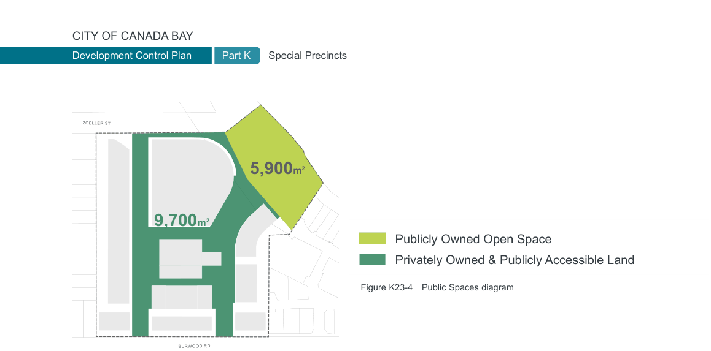

### K23  160 Burwood Rd, Concord (former Bushells Factory)

#### K23.5 Public Spaces & Public Access

#### Objectives

O17 To provide high quality public space and a network of publicly accessible spaces and connections.

O18 To capitalise on the precinct’s unique setting and location by creating strong visual and physical connections to heritage items and the water.

O19 To reconnect the precinct to Exile Bay and provide a highly accessible public park on the foreshore for the benefit of local residents.

O20 To cater for a range of passive recreational activities within the public spaces.

O21 To create memorable places with high quality public domain design that the wider community uses and enjoys.

#### Public Domain Network Controls

C11. A highly permeable and high quality public domain network including various open spaces, foreshore plaza, and new internal streets and pedestrian links, is delivered as per Figure K23-5.

C12. A minimum of 9,700m2 of publicly accessible, privately owned public domain is to be provided within the Precinct and is to be generally consistent with that shown in Figure K23-4. This includes any potential service lane.

C13. The layout of public open space and publicly accessible, privately owned public domain is to be generally consistent with that shown in Figure K23-5. Alterations to that layout will be considered where they demonstrate an improved public benefit and design excellence having regard to:

• The objectives, character statement and principles of this DCP;

• The degree to which any alterations may enhance or detract from public enjoyment of the public benefits associated with the development.

C14. Maximise direct sunlight to streets with active frontages between 9am and 3pm on 21 June.

C15. 50% of public and publicly accessible open space is to receive at least four hours direct sunlight between 9am and 3pm on 21 June.

#### Foreshore Area

| Controls |  |
|---|---|
| C16. | The foreshore public open space is to be designed to provide for a range of passive activities. |
| C17. | A minimum of 5,900m2 of public open space as shown in Figure K23-4 is to be dedicated to Council and is to: |

• create a new and vital public space on the waterfront that may include i.e. seating and furniture, opportunity for markets and events, provision of public BBQ’s & shelter, a community garden, heritage interpretation and public art;

• be located and designed so that it is clearly identifiable as public space and encourages public use;

• reflect and respond to the heritage landscape character;

• have clearly defined pedestrian entrances and paths, appropriate seating, and zones for activities that are clearly defined and encourage use;

• maximise access for people with mobility difficulties, through design and location of paths and entrances;

• the public open space is to primarily feature soft landscaping except for civic spaces, pathways, and small areas ancillary to active frontages;

• minimise area required for stormwater and overland flow paths; and

• provide legible pedestrian and cycle connections along the forshore and connecting to Burwood Road and Zoeller Street.

C18. The concrete sea wall along the boundary of the site to Exile Bay is to be replaced with terraced steps or alternatively repaired to a standard acceptable to Council.

> [Picture on page 436: a picture, saved as a picture (images/part-k-special-precincts-page-436-1.gif, 150 dpi).]
> Words printed on the picture (copied from the PDF):
> ZOELLER ST

### 5,900m2

### 9,700m2

Publicly Owned Open Space Privately Owned & Publicly Accessible Land

Figure K23-4 Public Spaces diagram

BURWOOD RD

#### K23.6 Landscape Design

#### Landscape Screening

| Controls |  |
|---|---|
| C22. | Development is to provide sufficient setbacks with deep soil zones along the boundaries (for more detail see Section K23.9 Built Form Envelopes) in order to create adequate landscape screening to the surrounding residential areas. |
| C23. | Existing trees and vegetation along the western and eastern boundaries of the site are to be retained in a healthy condition to provide screening for adjoining residential areas. If any trees are lost, they are to be replaced with well established trees of similar mature height. |
| C24. | Vegetation in the landscaped setback to Burwood Road is to be provided to soften the appearance of new built form. |

#### Objectives

O22 To control climatic impacts on buildings and outdoor spaces, maximise provision of shade and reduce urban heat island effect.

O23 To improve the local micro-climate, increase native fauna and flora habitats and promote biodiversity.

O24 To promote high quality landscape design as an integral component of the overall design of new development, softening the appearance of buildings.

O25 To allow adequate provision on site for infiltration of stormwater.

O26 To strengthen locally native vegetation and enhance Connecting with Country landscape values on Wangal land.

O27 To encourage passive green roofs that increase building performance, air quality, biodiversity and contribute to urban greening.

#### Native Species Selection

| Controls |  |
|---|---|
| C25. | Native species must comprise at least 75% of the plant schedule, incorporating a mix of locally native trees, shrubs and groundcover appropriate to local climatic conditions. |
| C26. | Where exotic species are proposed to provide a change of form, texture and seasonal colour, these must be consistent with the character outlined in section K23.3 Urban Design Principles. |

#### Deep Soil

| Controls |  |
|---|---|
| C19. | Deep soil zones are to be provided as identified in Figure K23-5 Public Domain Framework Plan. Additional opportunities for deep soil zones beyond the areas identified should also be considered. |
| C20. | Buildings and structures including basements are not to encroach into identified deep soil zones. |
| C21. | Non-permeable hard surfaces (i.e. concrete slabs) are not permitted in identified deep soil zones. |
