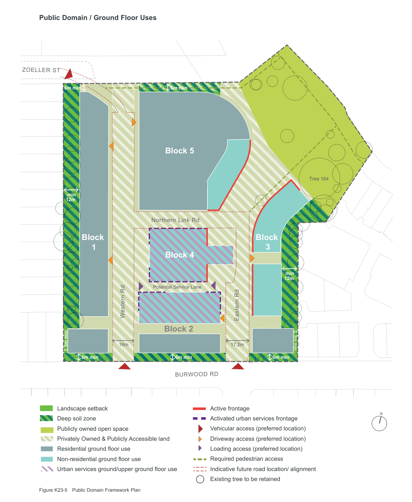

### K23  160 Burwood Rd, Concord (former Bushells Factory)

#### Tree Canopy Cover

| Controls |  |
|---|---|
| C27. | A minimum of 25% of the precinct area is to be covered by tree canopy. |
| C28. | Generous landscape opportunities exist to achieve the above control including the foreshore park, plaza, street verges, communal open space of apartments, and retention of most existing trees along the western boundary. |
| C29. | To demonstrate compliance with the above control, a landscape plan is to be submitted as part of any future development application (DA), prepared by a suitably qualified landscape architect and supported by an arborist statement/ report that includes the following: • A site plan showing the entire precinct and identifying the percentage of canopy of all retained trees, and the percentage of canopy achieved by proposed new tree planting (calculated for all tree species at ‘established age’ of no more than 20 years); and |

• A detailed plan showing the subject site of the DA including:

– all retained trees and their percentage of canopy;

– all new trees and their percentage of canopy at 'established age'; and

– detail in regard to landscaped setbacks and screening, deep soil zones, protection measures for retained trees, and type of tree species to be planted including information on mature canopy size and height.

#### Retention of Trees

| Controls |  |
|---|---|
| C30. | All trees and vegetation identified in Figure K23-5 Public Domain Framework Plan are to be retained, protected and maintained. |
| C31. | Of particular importance are the mature groves of trees along the eastern and western boundary, which are to be retained and protected, to maintain the existing developed landscape and privacy for the neighbours. |
| C32. | Retention and ongoing protection of the large Hill’s Weeping Fig (Tree 184) and its TPZ (tree protection zone) near the north eastern boundary of the site is a key requirement. This particular tree has been identified as "the best tree on the site" and is considered a significant item that contributes to the landscape of the precinct and the ‘Factory in a Garden’ setting. |

#### Green Roofs

| Controls |  |
|---|---|
| C33. | Passive green roofs should be located on serviceable and visible parts of the roof, such as the roof of lower parts of a development with varying heights. |
| C34. | Green roofs must demonstrate adequate drainage, wind impact and waterproofing is provided for the species and volumes of plants and soil. |

#### Other/ Miscellaneous

| Controls |  |
|---|---|
| C35. | Landscape design highlights architectural features, defines entry points, indicates direction, and frames and filters views from and into the site. |
| C36. | Consultation is to occur with the Massey Golf Course to determine if golf safety fences/ netting will be required to be constructed to protect people, vehicles and structures from potential stray golf balls. All fences would need to be of high design quality and visually unobstrusive. |

> [Picture on page 438: a map, saved as a picture (images/part-k-special-precincts-page-438-1.gif, 150 dpi); the street names and other small labels are on the picture.]
> Labels printed on the map (copied from the PDF, in no particular order):
> ZOELLER ST · 6m min · 6m min · Tree 184 · min · 12m · Northern Link Rd · min · 12m · Potential Service Lane · Western Rd · Eastern Rd · 3m min · 16m · 17.2m · 3m min · 6m min · 6m min · 6m min · BURWOOD RD · N · Figure K23-5 Public Domain Framework Plan

#### Public Domain / Ground Floor Uses

#### Block 5

#### Block

#### 3

#### Block

#### 1

#### Block 4

#### Block 2

Active frontage

Landscape setback

Activated urban services frontage

Deep soil zone

Vehicular access (preferred location)

Publicly owned open space

Driveway access (preferred location)

Privately Owned & Publicly Accessible land

Loading access (preferred location)

Residential ground floor use

Required pedestrian access

Non-residential ground floor use

Indicative future road location/ alignment

Urban services ground/upper ground floor use

Existing tree to be retained
