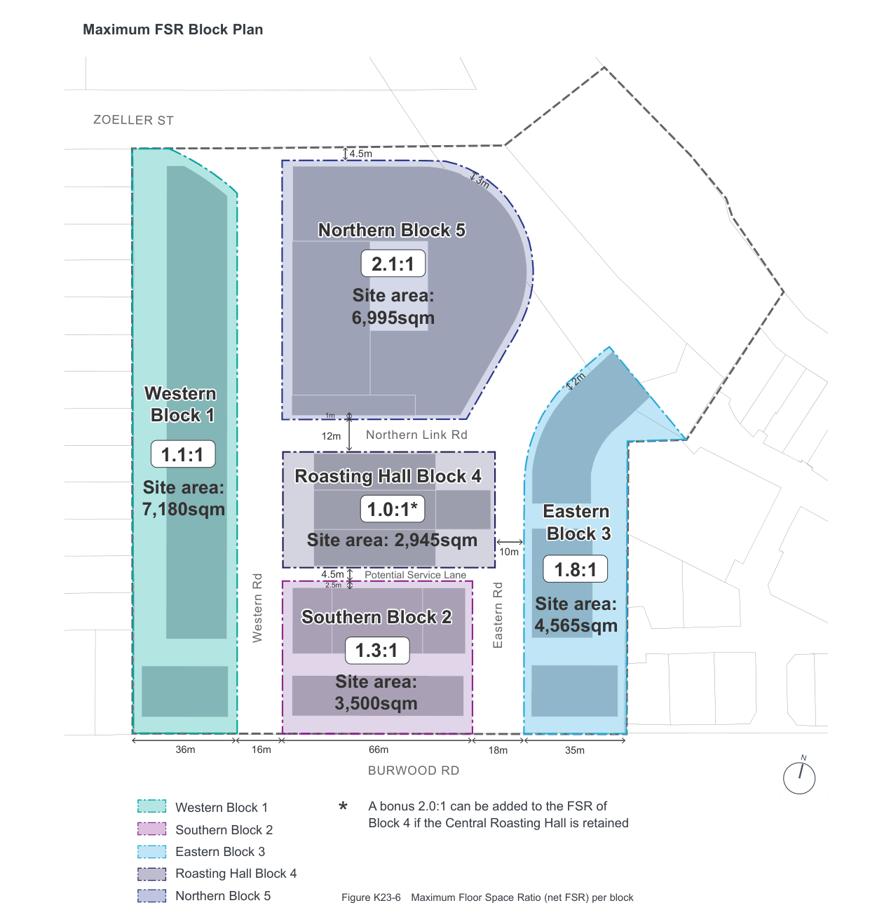

### K23  160 Burwood Rd, Concord (former Bushells Factory)

#### Controls

C55. In granting development consent for non-residential development on sites with proximity to residential uses, the consent authority will have regard to the potential impacts on the amenity of existing and future residential uses. The following matters must be considered and addressed:

a) noise impacts;

b) operating hours;

c) privacy;

d) vehicular and pedestrian traffic;

e) vibration;

f) reflectivity;

g) overlooking; and

h) overshadowing.

C56. All applications for noise generating uses adjacent to or located in a building containing a residential use must be accompanied by a Noise Impact Assessment from a qualified acoustic engineer, certifying that the acoustic standard can be met.

The Noise Impact Assessment should include mitigation strategies, such as utilsing landscape buffers, screened and acoustically sealed balconies, mechanical ventilation, triple glazing, green walls, and the use of other specific building materials or sound walls that manage noise.

#### K23.8 Maximum Density (FSR)

#### Objectives

O37 To ensure the height and density of future development is compatible with the surrounding context.

O38 To ensure each stage of the development contributes appropriately to the overall density of the Precinct.

O39 To concentrate development at the centre of the site and away from the sensitive interfaces with surrounding area.

| Controls |  |
|---|---|
| C57. | The maximum overall density of the Precinct is not to exceed the maximum FSR shown in the LEP. |
| C58. | Development of each part of the site is not to exceed the maximum floor space ratio shown in Figure K23-6. |
| C59. | Each stage of the development is to provide a table showing both the FSR of the parcel and the overall FSR (to date). The maximum FSR of both the parcel and the Precinct is not to be exceeded. If early stages maximise FSR, later stages may be required to have a lower FSR than shown on Figure K23-6 to ensure the maximum overall FSR is not exceeded. |

> [Picture on page 442: a map, saved as a picture (images/part-k-special-precincts-page-442-1.gif, 150 dpi); the street names and other small labels are on the picture.]
> Labels printed on the map (copied from the PDF, in no particular order):
> ZOELLER ST · 4.5m · 3m · 2m · 1m · 12m Northern Link Rd · 10m · Potential Service Lane · 4.5m · 2.5m · Western Rd · Eastern Rd · 66m · 36m 16m · 35m · 18m · N · BURWOOD RD

#### Maximum FSR Block Plan

#### Northern Block 5

### 2.1:1

#### Site area:

#### 6,995sqm

#### Western

#### Block 1

### 1.1:1

#### Roasting Hall Block 4

#### Site area:

#### 7,180sqm

### 1.0:1*

#### Eastern

#### Block 3

#### Site area: 2,945sqm

### 1.8:1

#### Southern Block 2

#### Site area:

#### 4,565sqm

### 1.3:1

#### Site area:

#### 3,500sqm

Western Block 1

A bonus 2.0:1 can be added to the FSR of Block 4 if the Central Roasting Hall is retained

### *

Southern Block 2 Eastern Block 3 Roasting Hall Block 4

Figure K23-6 Maximum Floor Space Ratio (net FSR) per block

Northern Block 5
