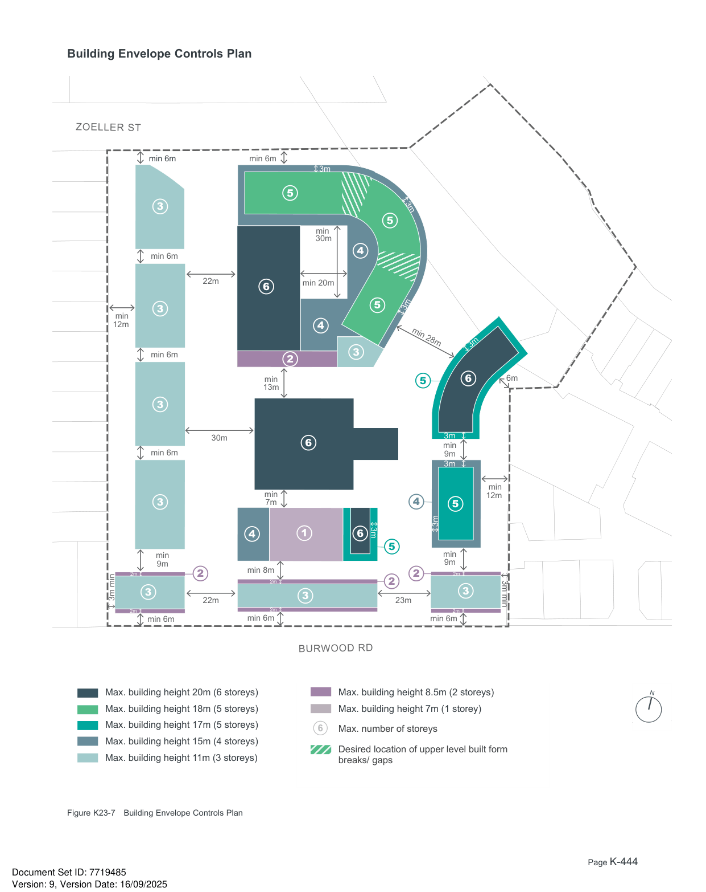

### K23  160 Burwood Rd, Concord (former Bushells Factory)

#### K23.9 Built Form Envelopes

#### Objectives

O40 To create building forms that reinforce the future desired character of the area and protect valued character attributes such as views to the foreshore and the Central Roasting Hall.

O41 To facilitate daylight access and ventilation to streets, public places and neighbouring properties.

O42 To define the proportion, scale and visual enclosure of the public domain and provide a level of consistency across the Precinct.

O43 To ensure rooftop spaces do not create unreasonable amenity impacts such as overlooking, loss of privacy or unacceptable noise.

#### Building Heights

| Controls |  |
|---|---|
| C60. | New development is to conform with the maximum heights (in metres) as shown in Figure K23-7 Building Envelope Controls Plan and Figure K23-8 to Figure K23-14 Building Envelope Controls Sections. |
| C61. | New development is to conform with the maximum number of storeys as shown in Figure K23-7 Building Envelope Controls Plan and Figure K23-8 to Figure K23-14 Building Envelope Controls Sections. |
| C62. | New development in the Southern Block should not exceed the existing Roasting Hall parapet height of RL26.8. |
| C63. | Minimum floor to floor heights for new development are as follows: |

| Use | Minimum floor to floor height | Minimum floor to ceiling height |
|---|---|---|
| Retail | 4.4m | 4m |
| Commercial | 3.7m | 3.3m |
| Adaptable | 3.7m | 3.3m |
| Residential | 3.1m | 2.7m |
| Community | 3.7m | 3.3m |
| Urban Services | 5.4m | 5m |

Note: Exceptions for floor to floor heights within the existing Roasting Hall structure may be acceptable.

#### Height Transition to Adjoining Land

| Controls |  |
|---|---|
| C64. | Building heights are to transition (be lower) towards the Precinct's boundaries and adjoining residential uses as identified in Figure K23-7 Building Envelope Controls Plan and Figure K23-8 to Figure K23-14 Building Envelope Controls Sections. |

#### Heritage Integration

| Controls |  |
|---|---|
| C65. | New development is to minimise the impact on the visual curtilage and setting of the Central Roasting Hall. |
| C66. | New development near the Roasting Hall is to provide visual separation to preserve the iconic nature of the structure. |

#### Solar Access/ Overshadowing

| Controls |  |
|---|---|
| C67. | Overshadowing of neighbouring buildings is minimised while direct sunlight to the public domain and publicly accessible spaces is maximised. |
| C68. | Direct solar access (sunshine) to windows of principal living areas and to the principal area of open space of existing dwellings, particularly along the eastern and western boundary, should not be reduced to less than 3 hours between 9.00am and 3.00pm on 21 June (mid winter). |
| C69. | 50% of publicly accessible open space is to receive at least four hours direct sunlight between 9am and 3pm on 21 June. |
| C70. | Shade from strong sun is available between September and March, for at least 20% of the area used for passive recreation, and protection from strong winds is provided to any space that is open to winds from the south. |

> [Picture on page 444: a map, saved as a picture (images/part-k-special-precincts-page-444-1.gif, 150 dpi); the street names and other small labels are on the picture.]
> Labels printed on the map (copied from the PDF, in no particular order):
> ZOELLER ST · min 6m · min 6m · 3m · 5 · 3 · 3m · 5 · min · 30m · 4 · min 6m · 22m · min 20m · 6 · 5 3m · 3 · min · 12m · 4 · 3m · min 28m · min 6m · 3 · 2 · 6m · 6 · 5 · min · 13m · 3 · 3m · 30m · 6 · min · min 6m · 9m · 3m · min · min · 12m · 7m · 4 · 3 · 5 · 3m · 3m · 6 · 4 1 · 5 · min · 9m · 9m · min · min 8m · 2m · 2m · 2m · 2 · 2 · 2 · 3 · 3m min · 3 · 3 · 23m · 22m · 3m min · 2m · 2m · 2m · min 6m · min 6m · min 6m · BURWOOD RD · N · Max. building height 8.5m (2 storeys) · Max. building height 20m (6 storeys) · Max. building height 7m (1 storey) · Max. building height 18m (5 storeys) · Max. building height 17m (5 storeys) · 6 Max. number of storeys · Max. building height 15m (4 storeys) · Max. building height 11m (3 storeys) · Desired location of upper level built form · breaks/ gaps · Figure K23-7 Building Envelope Controls Plan

#### Building Envelope Controls Plan
