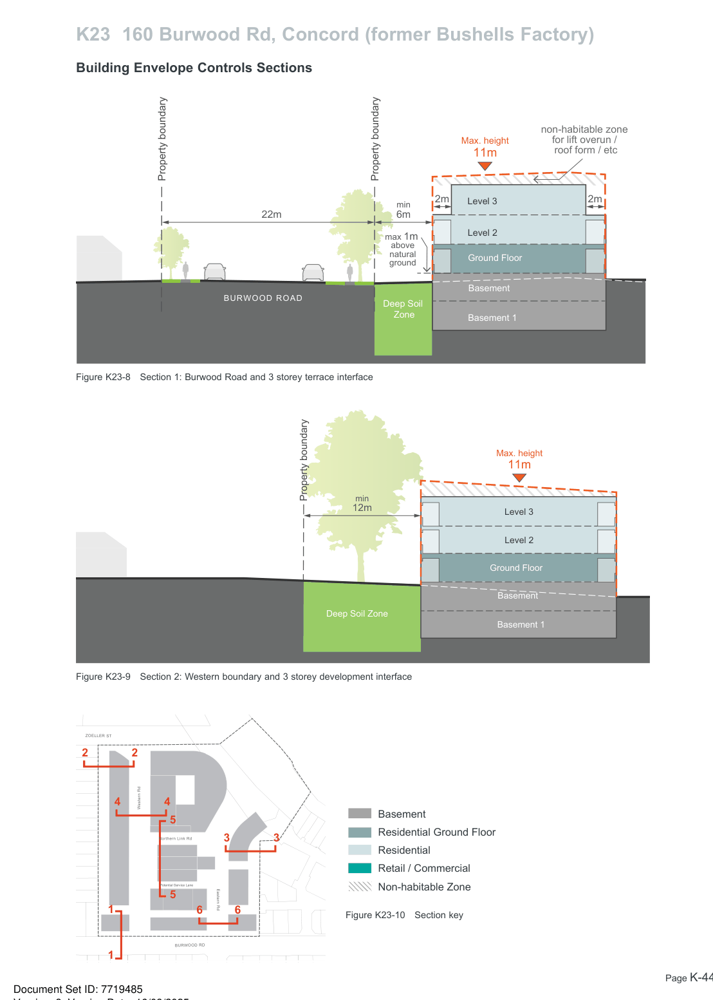
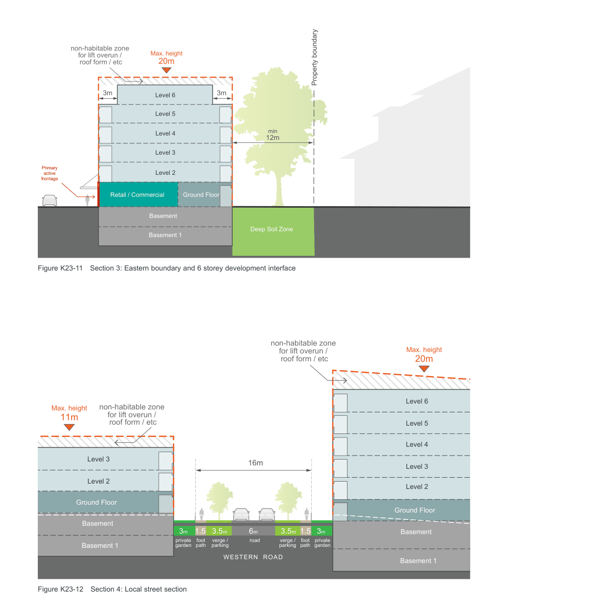
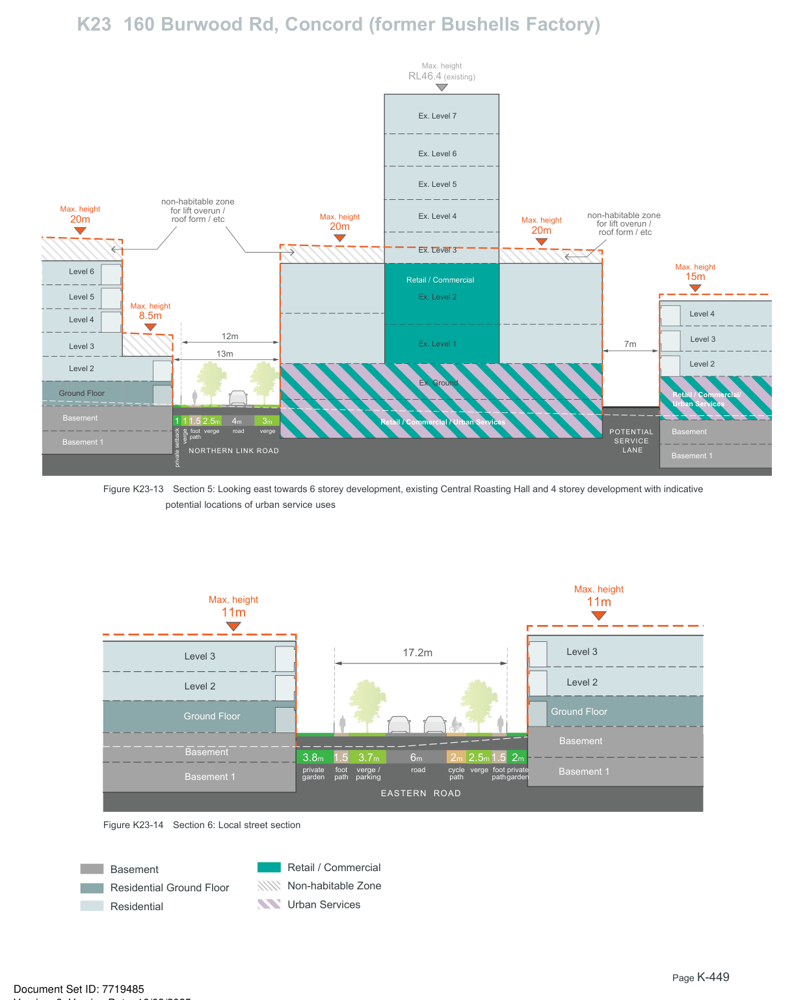

### K23  160 Burwood Rd, Concord (former Bushells Factory)

#### Building Envelope Controls Sections

non-habitable zone

for lift overun /

Max. height

roof form / etc

11m

> [Picture on page 447: a map, saved as a picture (images/part-k-special-precincts-page-447-8.gif, 150 dpi); the street names and other small labels are on the picture.]
> Labels printed on the map (copied from the PDF, in no particular order):
> 2m · 2m Level 3 · 22m · min · 6m · Level 2 · max 1m · above · natural · Ground Floor · ground · Basement · BURWOOD ROAD · Deep Soil · Zone Basement 1 · Figure K23-8 Section 1: Burwood Road and 3 storey terrace interface · Max. height · 11m · Property boundary min · 12m · Level 3 · Level 2 · Ground Floor · Basement · Deep Soil Zone · Basement 1 · Figure K23-9 Section 2: Western boundary and 3 storey development interface · ZOELLER ST · 2 2 · Western Rd · 4 4 · Basement · 5 · Residential Ground Floor · Northern Link Rd · 3 3 · Residential · Retail / Commercial · Potential Service Lane · Non-habitable Zone · Eastern Rd · Urban Services · 5 · 6 6 · Figure K23-10 Section key · BURWOOD RD

Property boundary

Property boundary

> [Picture on page 448: a map, saved as a picture (images/part-k-special-precincts-page-448-1.gif, 150 dpi); the street names and other small labels are on the picture.]
> Labels printed on the map (copied from the PDF, in no particular order):
> non-habitable zone · Max. height · for lift overun / · roof form / etc 20m · Property boundary · 3m · 3m Level 6 · Level 5 · Level 4 · min · 12m · Level 3 · Primary · Level 2 · active · frontage · Ground Floor · Retail / Commercial · Basement · Deep Soil Zone · Basement 1 · Figure K23-11 Section 3: Eastern boundary and 6 storey development interface

non-habitable zone

Max. height

for lift overun /

roof form / etc

20m

> Labels printed on the map (copied from the PDF, in no particular order):
> Level 6 · non-habitable zone · Max. height · for lift overun / · 11m · roof form / etc · Level 5 · Level 4 · Level 3 · 16m · Level 3 · Level 2 · Level 2 · Ground Floor · Ground Floor · Basement · 6m 3.5m · 3.5m · 3m · 1.5 · 1.5 · 3m · Basement · foot · path · private · garden · verge / · parking · foot · path · road · verge / · parking · private · garden · Basement 1 · Basement 1 · WESTERN  ROAD

Figure K23-12 Section 4: Local street section

Retail / Commercial

Basement

Non-habitable Zone

Residential Ground Floor

Urban Services

Residential

> [Picture on page 449: a map, saved as a picture (images/part-k-special-precincts-page-449-1.gif, 150 dpi); the street names and other small labels are on the picture.]
> Labels printed on the map (copied from the PDF, in no particular order):
> Max. height · RL46.4 (existing) · Ex. Level 7 · Ex. Level 6 · Ex. Level 5 · non-habitable zone · Max. height · for lift overun / · non-habitable zone · Ex. Level 4 · roof form / etc · 20m · Max. height · for lift overun / · 20m · Max. height · 20m roof form / etc · Ex. Level 3 · Max. height · Level 6 · 15m · Retail / Commercial · Level 5 · Ex. Level 2 · Max. height · Level 4 · 8.5m · Level 4 · Level 3 · Ex. Level 1 · 12m · 7m · Level 3 · 13m · Level 2 · Level 2 · Ex. Ground · Ground Floor · Retail / Commercial/ · Urban Services · Basement · 1 · 1 2.5m 4m 3m · 1.5 · Retail / Commercial / Urban Services · verge · POTENTIAL Basement · verge · road · foot · path · verge · SERVICE · Basement 1 · LANE · NORTHERN LINK ROAD · Basement 1 · private setback · Figure K23-13 Section 5: Looking east towards 6 storey development, existing Central Roasting Hall and 4 storey development with indicative · potential locations of urban service uses · Max. height · Max. height · 11m · 11m · Level 3 · 17.2m · Level 3 · Level 2 · Level 2 · Ground Floor · Ground Floor · Basement · Basement · 6m 2m 2.5m · 3.7m · 3.8m · 1.5 · 1.5 · 2m · Basement 1 · path · private · garden · verge · foot · path · foot · path · cycle private · garden · road · verge / · parking · Basement 1 · EASTERN  ROAD · Figure K23-14 Section 6: Local street section · Retail / Commercial · Basement · Non-habitable Zone · Residential Ground Floor · Urban Services · Residential
