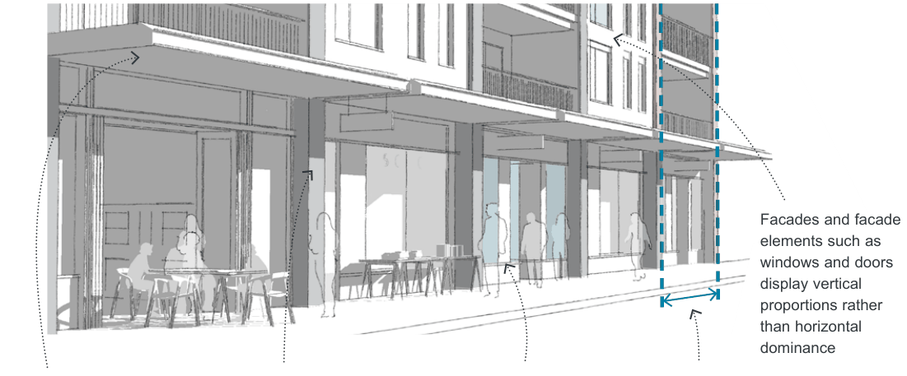

### K23  160 Burwood Rd, Concord (former Bushells Factory)

#### K23.10 Public-Private Interfaces

#### Objectives

C89. Along active frontages:

O44 To provide a safe, interesting and vibrant environment that encourages pedestrian activity and supports the economic success of the Precinct.

• the finished ground floor level is to match the footpath level; where this is not possible, the ground floor level is to be a maximum of 0.35m above or below the footpath;

O45 To maximise opportunities for passive surveillance of the public domain.

• active uses/ tenancies must be a minimum of 10m deep;

O46 To enhance the commercial viability of the area and complement existing retail, commercial, entertainment and community uses.

• continuous awnings must be provided to shelter pedestrians from weather conditions; and

#### Active Frontages on the Ground Floor

| Controls |  |
|---|---|
| C87. | Ground level active uses must be provided along 'Active frontages' as identified in Figure K23-15. |
| C88. | Vehicle access points are generally not permitted along active frontages. Where no alternative access point can be provided, their width must be kept to a minimum. |

• the design guidance shown in Figure K23-15 must be applied.

C90. Residential entries and foyers are permitted along active frontages, however, they are not to compromise the commercial/ retail activity along the street, by keeping their frontage width to a minimum. The maximum width for residential entries/ foyers is 6m. Awnings should be provided at residential entries and foyers.

> [Picture on page 450: a picture, saved as a picture (images/part-k-special-precincts-page-450-36.gif, 150 dpi).]
> Words printed on the picture (copied from the PDF):
> Facades and facade
> elements such as
> windows and doors
> display vertical
> proportions rather
> than horizontal
> dominance

Awnings provide continuous all weather shelter for pedestrians.

Vertical elements such as support walls and columns (ideally continued to the upper levels) support a vertical rhythm along the street.

A maximum of 70% of the ground floor facade is glazing and balanced with solid elements

Tenancies should be as narrow as possible (ideally 5-8m wide) and a minimum of 10m deep.

Figure K23-15 Design guidance for active frontages
