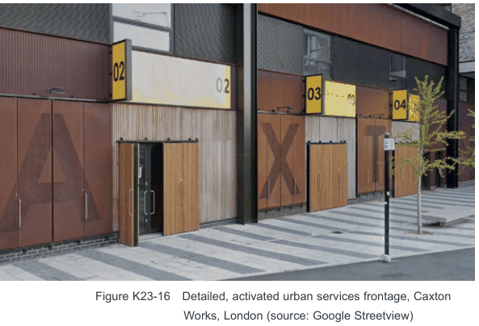

### K23  160 Burwood Rd, Concord (former Bushells Factory)

#### Activated Urban Services Frontage

| Controls |  |
|---|---|
| C91. | Consideration should be given to the nature of 'Activated urban services frontage' as identified in Figure K23-5. |
| C92. | Activated urban services frontage should be high quality with careful industrial detailing and integrated wayfinding. For reference, see the Caxton Works light industrial frontage in London. |

> [Picture on page 451: a picture, saved as a picture (images/part-k-special-precincts-page-451-4.gif, 150 dpi).]

Figure K23-16 Detailed, activated urban services frontage, Caxton Works, London (source: Google Streetview)

#### 'Interactive' Frontages on the Ground Floor Controls

C93. 'Interactive' frontages comprise all ground floor frontages that address the public domain or publicly accessible spaces and are not designated as 'active frontages' in Figure K23-5.

C94. Interactive frontages must:

• display a high level of architectural quality and detail;

• minimise vehicular access points;

• have a high level of visual permeability;

• minimise blank facades;

• avoid visually dominant building services where possible. Co locate service cabinets with loading, waste or parking areas where possible to avoid impact on the public realm;

• maximise the number of doors and windows and have no more than 5m along the ground floor facade that is without a door or window; and

• place a particular focus on 'human scale' and pedestrian views i.e. through the use of detailed design, insets and projections that create interest and diversity.

#### Residential Uses on the Ground Floor

| Controls |  |
|---|---|
| C95. | All ground floor residential units must have individual access directly off a street or laneway to improve activity levels and surveillance. |
| C96. | Where possible, ground floor residential units are to be elevated by up to 1m, with the exception of accessible units where level access off the street/ laneway/ footpath is preferred. |

#### Safety & Surveillance

| Controls |  |
|---|---|
| C97. | New development is to address and define the public domain and publicly accessible spaces through entrances, lobbies, windows and balconies that overlook public spaces, maximising opportunities for passive surveillance. |
| C98. | The building design is to maximise opportunities for casual surveillance of the public domain and any semi-public or common open space, particularly adjacent to public open space. |
| C99. | Ground floor dwellings adjacent to public open space are to have an “address” or “front door” that is visible and directly accessible from the pedestrian paths within the public open space. |
| C100. | Balconies should be designed to balance visual privacy for the resident and opportunities to overlook the public domain. Design treatment may include a combination of solid and transparent balustrade materials. |
| C101. | A high level of surveillance is required from upper levels of buildings adjacent to public open space. |
| C102. | The detailed design of the external areas of the ground floor is to minimise blind- corners, recesses and other areas which have the potential for concealment. |

#### K23.11 Massing and Articulation

#### Objectives

O47 To ensure buildings and their individual elements are appropriately scaled to define the built form and respond to the surrounding character.

| Controls |  |
|---|---|
| C103. | The built form layout is to be generally consistent with that shown in Figure K23-7 Building Envelope Controls Plan and Figure K23-8 to Figure K23-14 Building Envelope Controls Sections. Alterations to the layout will be considered where they demonstrate an improved public benefit and design excellence having regard to: • the objectives, character statement and principles of this DCP; • the degree to which any alterations may enhance or detract from public enjoyment of the public benefits associated with the development; and • the impact on neighbouring properties. |
| C104. | All buildings that are over 4 storeys, are to be clearly articulated i.e. base, middle and top. |
| C105. | The maximum length of straight wall without articulation, such as a balcony, recess, projection or return, is 15m. |
| C106. | Roof plant, lift overruns, vents, carpark entries and other service related elements are to be located within the maximum building height, visually unobtrusive, integrated into the built form and complement the architecture of the building. |
| C107. | Ensure buildings exhibit high design quality, and minimise overshadowing of neighbouring buildings and public and private open spaces. |
