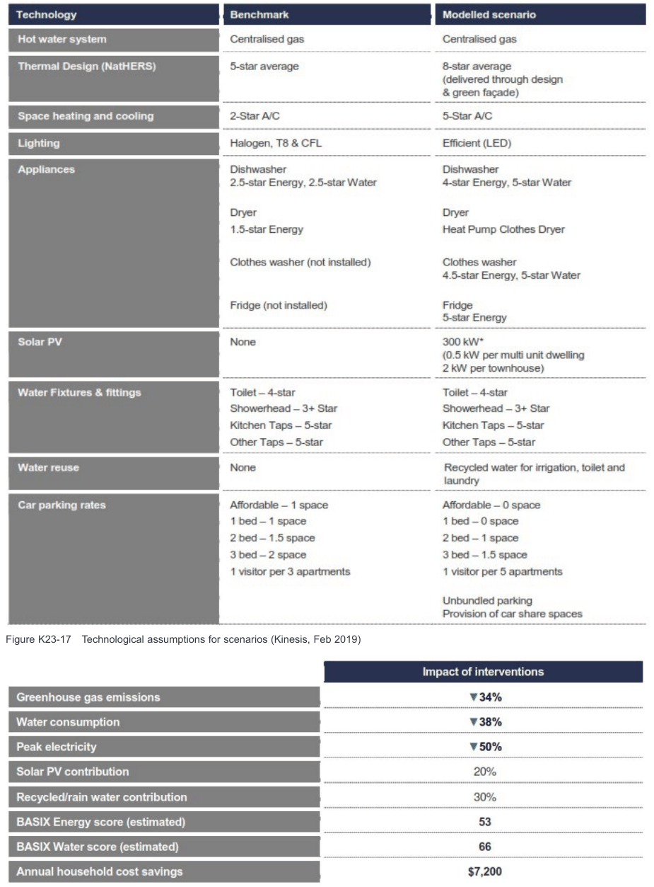
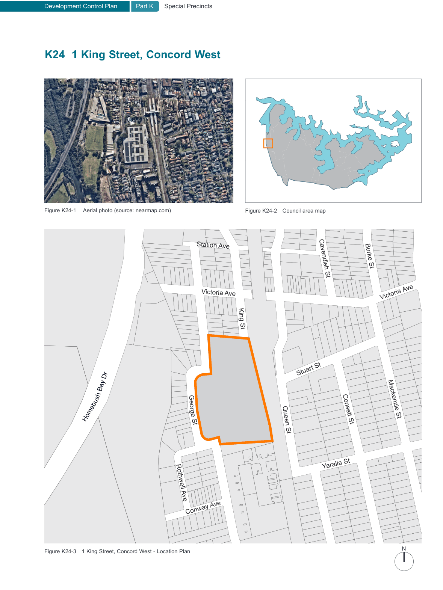

### K23  160 Burwood Rd, Concord (former Bushells Factory)

#### K23.14 Medium Density Housing (Terraces)

#### Objectives

O54 To ensure high quality design of medium density residential typologies with a particular focus on their contribution to the local character.

O55 To transition to lower density residential areas, in particular along the Burwood Road interface.

| Controls |  |
|---|---|
| C125. | The maximum building depth is 14m unless it can be demonstrated that all habitable rooms receive adequate ventilation and solar access, e.g. through the use of a courtyard design. |
| C126. | The minimum overall landscaped area for terraces is 35% of the lot area. The minimum dimension of landscaped area is 1.5m. A minimum of 50% of the overall landscaped area is to be deep soil. |
| C127. | A minimum of 35% of the front setback is to be landscaped area. A minimum of 50% of the landscaped area in the front setback is to be deep soil. |
| C128. | The minimum area of private open space (POS) is linked to the number of bedrooms as follows: • 15m² for 1 bedroom dwellings • 25m² for 2 bedroom dwellings • 30m² for 3+ bedroom dwellings |
| C129. | Master bedrooms have a minimum area of 10m2 and other bedrooms 9m2. |
| C130. | Driveways of front-loaded terraces are a maximum width of 3.5m. |
| C131. | Where basement parking is provided, the following applies: • basement car parking is not to protrude more than 1m above finished ground level except at the carpark entry; • carpark entries are to be set back behind the building line; • the first 4.5 metres of the carpark entry/ driveway measured from the street boundary is to be at grade; and • carpark entries are a maximum 2.7m high and 3.5m wide. |

#### K23.15 Sustainability & Performance

#### Objectives

O56 To celebrate the ecological values of the site and improve the ecology of the waterfront.

O57 To reduce the embodied energy in new development through the retention and adaptive reuse of existing structures.

O58 To achieve Australian leading practice in design, construction and operation to deliver on sustainability outcomes, targeting a net positive ecological impact.

#### Controls

C132. The development is to achieve beyond the baseline compliance requirements set by BASIX through the following key interventions:

• efficient appliances and improved thermal design;

• avoid natural gas in all residential development and provide appliances that can be powered by renewable energy sources such as;

– electric heat pumps for hot water,

– induction cooktops,

– electric heating and cooling e.g. efficient air-conditioners with low GWP (Global Warming Potential);

• solar photovoltaic and battery ready facilities;

• recycled water infrastructure;

• green facade treatment for cooler dwellings; and

• access to car share facilities best practice parking measures including provision of EV charging and smart metering systems for all parking spaces.

C133. All new buildings are to implement the technology (or similar) of the 'Modelled Scenario' identified in Figure K23-17 and achieve the impact performance identified in Figure K23-18.

> [Picture on page 456: a picture, saved as a picture (images/part-k-special-precincts-page-456-1.gif, 150 dpi).]

Figure K23-17 Technological assumptions for scenarios (Kinesis, Feb 2019)

Figure K23-18 Impact of interventions table (Kinesis, Feb 2019)

> [Picture on page 457: a map, saved as a picture (images/part-k-special-precincts-page-457-1.gif, 150 dpi); the street names and other small labels are on the picture.]
> Labels printed on the map (copied from the PDF, in no particular order):
> Figure K24-1 Aerial photo (source: nearmap.com) · Figure K24-2 Council area map · Station Ave · Burke St · Cavendish St · Victoria Ave · Victoria Ave · King St · Stuart St · sh Bay Dr · Geor · Mackenzie St · Homebu · Consett St · ge St · Queen St · Yaralla St · Rothwell Ave · Conway Ave · N · Figure K24-3 1 King Street, Concord West - Location Plan · Argonne St
