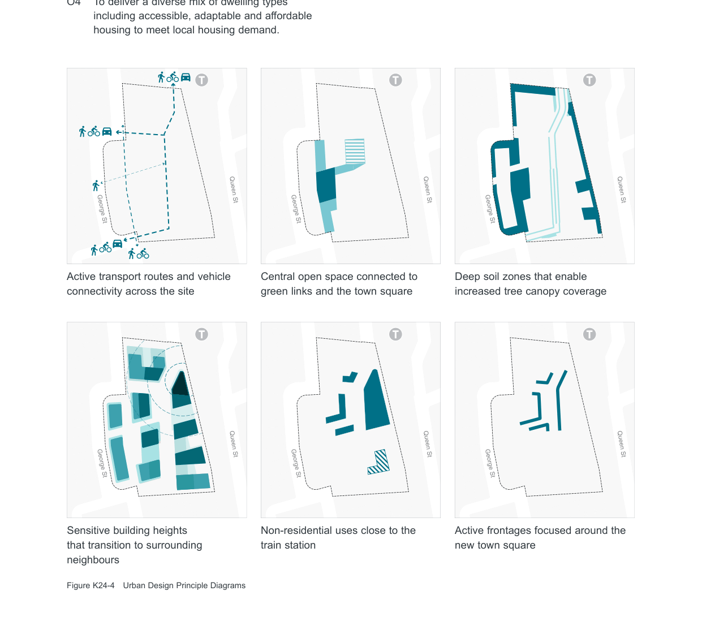

### K24  1 King Street, Concord West

#### K24.1 General Objectives

O1 To facilitate the development of a high quality residential development which also provides mixed and community uses.

O5 To encourage modal shift by providing safe and direct pedestrian, cycle and vehicular links through the site that connect to existing and planned active transport.

O2 To deliver new publicly accessible open spaces for residents and the local community.

O6 To maintain existing views and vistas across the site.

O3 To concentrate height and density close to the railway station and sensitively transition towards lower existing and planned residential dwellings.

O7 To improve tree canopy coverage and ensure

> [Picture on page 458: a map, saved as a picture (images/part-k-special-precincts-page-458-17.gif, 150 dpi); the street names and other small labels are on the picture.]
> Labels printed on the map (copied from the PDF, in no particular order):
> deep soil zones. · T · T · T · Queen St · Queen St · Queen St · George St · George St · George St · T · T · T · Queen St · Queen St · Queen St · George St · George St · George St · Sensitive building heights · that transition to surrounding · neighbours · Figure K24-4 Urban Design Principle Diagrams

adequate landscaping is achieved with sufficient

O4 To deliver a diverse mix of dwelling types including accessible, adaptable and affordable housing to meet local housing demand.

Active transport routes and vehicle connectivity across the site

Central open space connected to green links and the town square

Deep soil zones that enable increased tree canopy coverage

Active frontages focused around the new town square

Non-residential uses close to the train station
