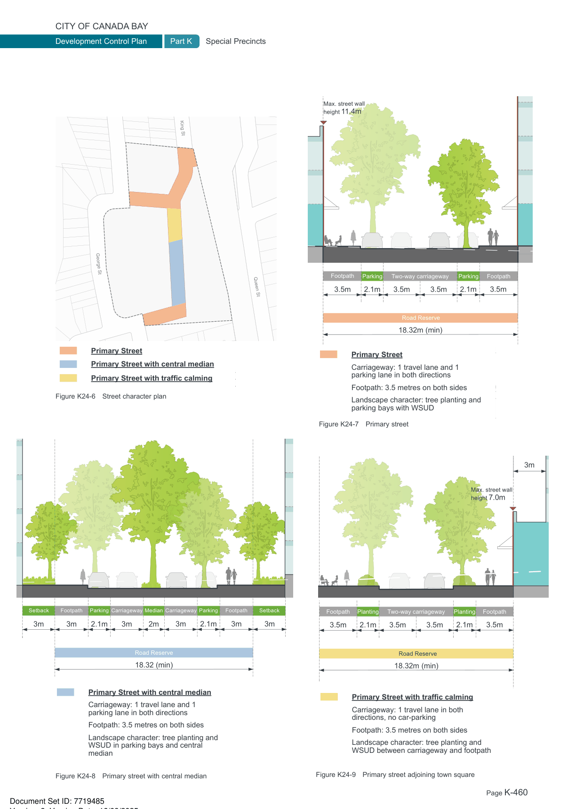

### K24  1 King Street, Concord West

#### K24.2 Movement and Access Network

#### Objectives

O8 To provide increased pedestrian, cycle and vehicular connectivity to Concord West Train Station and encourage active transport across the wider neighbourhood.

O9 To deliver high quality streets which are carefully designed and landscaped to create safe and attractive pedestrian and cycle environments with low traffic speeds.

O10 To minimise the visual impacts of car parking and vehicular services and access points.

O11 To provide a hierarchy of new local streets consistent with their function.

#### Controls

C1. Provide a two-way privately owned, publicly accessible road that services pedestrian, cycle and vehicular access and connects King Street with George Street as shown in Figure K24-5.

C2. Provide a north-south pedestrian and cycle corridor (minimum 8m wide) through the site as shown in Figure K24-5. It should:

• include a separate 2-way cycleway (minimum 3m wide) that connects into the planned neighborhood cycleway; and

• include a pedestrian pathway (minimum 2.5m wide) that connects into the George Street footpath.

C3. Provide a east-west pedestrian through-site link (minimum 6m wide) as shown in Figure K24-5 and should include a minimum footpath width of 2.5m.

C4. All pedestrian and cycle access through the site should:

• be direct and legible;

• be publicly accessible 24 hours a day;

• be open to the sky;

• not feature significant level changes i.e. stairs; and

• be well lit to safety standards.

King St

George St

Queen St

N

0 20m 50m

10m

Site boundary

Easement for publicly accessible pedestrian, cycle and vehicular access (minimum 18.32m wide) Easement for publicly accessible pedestrian and cycle access (minimum 8m wide)

Easement for publicly accessible pedestrian access (minimum 6m wide)

Easement for publicly accessible open space

Figure K24-5 Public Access Plan

| Controls |  |
|---|---|
| C5. | New roads should reflect the street character plan shown in Figure K24-6 and be constructed to the satisfaction of Council in accordance with Figure K24-7 to Figure K24-9. |
| C6. | Proposed vehicular intersections at George Street must also consider cycle and pedestrian movements to ensure the proposed arrangements do not result in adverse or dangerous conflicts. |
| C7. | Basement car park entry points should be consolidated to minimise the impact on the public domain. Preferred driveway access points are identified in Figure K24-10. |

> [Picture on page 460: a map, saved as a picture (images/part-k-special-precincts-page-460-1.gif, 150 dpi); the street names and other small labels are on the picture.]
> Labels printed on the map (copied from the PDF, in no particular order):
> King St · George St · Queen St · Primary Street · Primary Street with central median · Primary Street with traffic calming · Figure K24-6 Street character plan · Median Carriageway · Carriageway · Setback · Setback · Footpath · Footpath · Parking · Parking · 3m · 2m 2.1m · 3m 3m · 2.1m · 3m · 3m · 3m · Road Reserve · 18.32 (min) · Primary Street with central median · Carriageway: 1 travel lane and 1 · parking lane in both directions · Footpath: 3.5 metres on both sides · Landscape character: tree planting and · WSUD in parking bays and central · median · Figure K24-8 Primary street with central median · Max. street wall · height 11.4m · Footpath · Footpath · Parking · Parking Two-way carriageway · 3.5m · 2.1m · 3.5m 3.5m · 2.1m · 3.5m · Road Reserve · 18.32m (min) · Primary Street · Carriageway: 1 travel lane and 1 · parking lane in both directions · Footpath: 3.5 metres on both sides · Landscape character: tree planting and · parking bays with WSUD · Figure K24-7 Primary street · 3m · Max. street wall · height 7.0m · Footpath · Footpath · Planting · Planting Two-way carriageway · 3.5m · 2.1m · 3.5m 3.5m · 2.1m · 3.5m · Road Reserve · 18.32m (min) · Primary Street with traffic calming · Carriageway: 1 travel lane in both · directions, no car-parking · Footpath: 3.5 metres on both sides · Landscape character: tree planting and · WSUD between carriageway and footpath · Figure K24-9 Primary street adjoining town square
