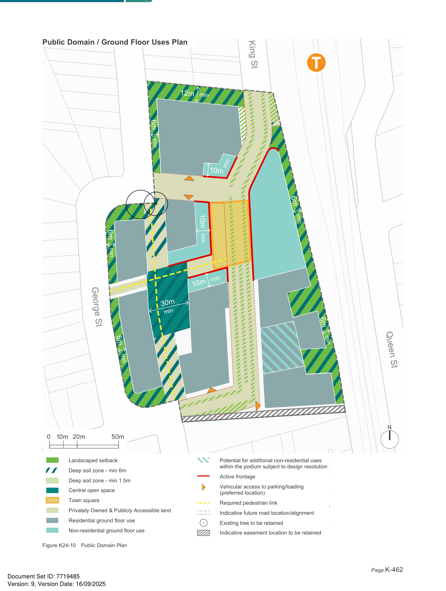
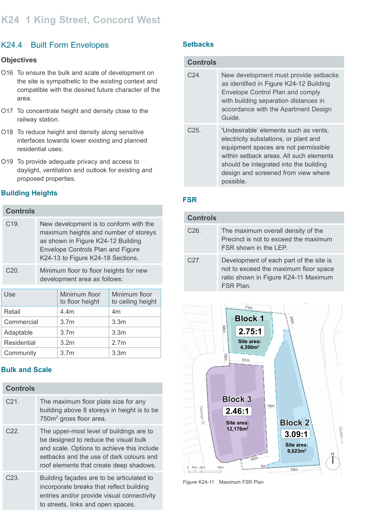

### K24  1 King Street, Concord West

#### K24.3 Landscape and Public Domain

#### Objectives

O12 To provide a centrally located publicly accessible open space that is an adaptable and usable size.

O13 To ensure high quality landscaping that incorporates suitable vegetation of different scales, strengthens indigenous vegetation and enhances Connecting with Country landscape values on Wangal land.

O14 To allow adequate provision on site for stormwater infiltration, deep soil tree planting and areas of communal outdoor recreation.

O15 To increase tree canopy coverage to mitigate climatic impacts on buildings and outdoor spaces, provide shade and reduce urban heat island effects.

#### Open Space

| Controls |  |
|---|---|
| C8. | Provide centrally located publicly accessible, privately owned open space (minimum of 1,400m2) that is generally consistent with that shown in Figure K24-10. This central open space should have a minimum dimension of 30m, be landscaped, green and provide opportunities for children's play. |
| C9. | Provide a centrally located town square that is generally consistent with that shown in Figure K24-10. This 'urban heart' should be a pedestrian priority space that spans both sides of the proposed road and is supported by active frontages and opportunities for public seating and outdoor dining. |
| C10. | A minimum of 50% of the central open space and the town square is to receive at least three hours direct sunlight between 9am and 3pm on 21 June. |

#### Deep Soil

| C12. | Deep soil zones are to achieve a minimum total of 15% (approx. 4700m2) of the overall site area. • At least 90% of the total deep soil area should not have a width of less than 6m. • A maximum of 10% of the total deep soil area can have a width of between 3m and less than 6m. An additional 5% of the site area (20% of total site area) is to be provided along streets as deep soil with a width greater than 1.5m. |
|---|---|
| C13. | Buildings and structures including basements are not to encroach into identified deep soil zones. |
| C14. | Deep soil zones should have a minimum width of 6m. Median strips and verges are also to be deep soil with a minimum width of 1.5m. |
| C15. | Structures, landscaping, deep soil zones or other features are not permitted within the existing easement located along the southern boundary of the site. Detailed design of vehicular and pedestrian access and attractive long term landscaping is required to ensure a successful integration with the easement. |

| Controls |  |
|---|---|
| C11. | Deep soil zones are to be provided as identified in Figure K24-10. Additional opportunities for deep soil zones beyond the areas identified are encouraged. |

#### Tree Canopy Coverage

| Controls |  |
|---|---|
| C16. | A minimum of 30% of the site area is to be covered by tree canopy. |
| C17. | The two trees in the north west corner of the site that are identified to have potential heritage landscape value are to be retained. |
| C18. | Trees which are not planted in deep soil zones should not be included in tree canopy coverage calculations. A maximum of 20% of the required Tree Canopy target can be located above structures. |

> [Picture on page 462: a map, saved as a picture (images/part-k-special-precincts-page-462-1.gif, 150 dpi); the street names and other small labels are on the picture.]
> Labels printed on the map (copied from the PDF, in no particular order):
> 12m min · 6m · min · min · 10m · 10m · min · 6m · min · min · 10m · 30m · min · 6m · min · 6m · min · 6m · min · Landscaped setback · Deep soil zone - min 6m · Deep soil zone - min 1.5m · Central open space · Town square · N · Privately Owned & Publicly Accessible land · 0 20m 50m · 10m · Residential ground floor use · Non-residential ground floor use · Landscaped setback · Potential for additional non-residential uses · within the podium subject to design resolution · Deep soil zone - min 6m · Active frontage · Deep soil zone - min 1.5m · Central open space · Vehicular access to parking/loading · (preferred location) · Town square · Required pedestrian link · Privately Owned & Publicly Accessible land · Indicative future road location/alignment · Residential ground floor use · Existing tree to be retained · Non-residential ground floor use · Indicative easement location to be retained · Figure K24-10 Public Domain Plan · Potential for additional non-residential uses · within the podium subject to design resolution · Active frontage · Vehicular access to parking/loading · (preferred location) · Required pedestrian link

#### Public Domain / Ground Floor Uses Plan

#### King St

### T

#### George St

#### Queen St

Indicative future road location/alignment

> [Picture on page 463: a map, saved as a picture (images/part-k-special-precincts-page-463-1.gif, 150 dpi); the street names and other small labels are on the picture.]
> Labels printed on the map (copied from the PDF, in no particular order):
> area. · railway station. · residential uses. · proposed properties. · FSR · 71m · 24m · 66m · Site area: · 4,390m2 · 18m · 51m · 18m · George St Site area: · 12,176m2 · Queen St · Site area: · 9,023m2 · N · 42m · 5m · 0 20m 50m · 10m · 79m · Figure K24-11 Maximum FSR Plan
