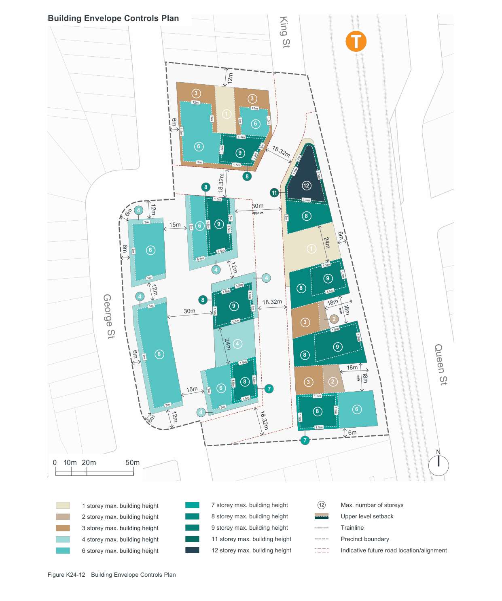

### K24  1 King Street, Concord West

#### K24.4 Built Form Envelopes

#### Objectives

O16 To ensure the bulk and scale of development on the site is sympathetic to the existing context and compatible with the desired future character of the

O17 To concentrate height and density close to the

O18 To reduce height and density along sensitive interfaces towards lower existing and planned

O19 To provide adequate privacy and access to daylight, ventilation and outlook for existing and

#### Building Heights

| Controls |  |
|---|---|
| C19. | New development is to conform with the maximum heights and number of storeys as shown in Figure K24-12 Building Envelope Controls Plan and Figure K24-13 to Figure K24-18 Sections. |
| C20. | Minimum floor to floor heights for new development area as follows: |

| Use | Minimum floor to floor height | Minimum floor to ceiling height |
|---|---|---|
| Retail | 4.4m | 4m |
| Commercial | 3.7m | 3.3m |
| Adaptable | 3.7m | 3.3m |
| Residential | 3.2m | 2.7m |
| Community | 3.7m | 3.3m |

#### Bulk and Scale

| Controls |  |
|---|---|
| C21. | The maximum floor plate size for any building above 8 storeys in height is to be 750m2 gross floor area. |
| C22. | The upper-most level of buildings are to be designed to reduce the visual bulk and scale. Options to achieve this include setbacks and the use of dark colours and roof elements that create deep shadows. |
| C23. | Building façades are to be articulated to incorporate breaks that reflect building entries and/or provide visual connectivity to streets, links and open spaces. |

#### Setbacks

| Controls |  |  |
|---|---|---|
| C24. | New development must as identified in Figure K24-12 Envelope Control Plan and with building separation accordance with the Apartment Guide. | provide setbacks Building comply distances in Design |
| C25. | 'Undesirable’ elements such electricity substations, or equipment spaces are not within setback areas. All should be integrated into design and screened from possible. | as vents, plant and permissible such elements the building view where |

| Controls |  |  |
|---|---|---|
| C26. | The maximum overall density Precinct is not to exceed FSR shown in the LEP. | of the the maximum |
| C27. | Development of each part not to exceed the maximum ratio shown in Figure K24-11 FSR Plan. | of the site is floor space Maximum |

#### Block 1

#### Block 1 2.75:1

#### Block 3

#### Block 3 2.46:1

#### Block 2

#### Block 2 3.09:1

> [Picture on page 464: a map, saved as a picture (images/part-k-special-precincts-page-464-1.gif, 150 dpi); the street names and other small labels are on the picture.]
> Labels printed on the map (copied from the PDF, in no particular order):
> 12m · 3 · 3 · 12m · 12m · 1 · 3m · 3m 1.5m · 6m · 6 · 1.5m · 1.5m · 3m · 1.5m · 6 · 9 · 18.32m · 1.5m · 3m · 1.5m · 1.5m · 3m · 1.5m · 8 · 8 18.32m · 12 · 11 · 1.5m · 1.5m · 30m · 4 · approx. · 12m · 6m · 8 · 3m · 3m · 3m · 9 · 1.5m · 15m 3m 6 · 1.5m · 6m · 1 · 6m 3m · 1.5m · 6 · 5.5m · 1.5m · 4 12m · 1.5m · 3m · 4 · 9 · 8 4.5m · 5.5m · 1.5m · 12m · 1.5m · 4 · 18.32m · 18m · 3m · 9 · 8 · 3m · 1.5m · min · 30m · 24m · 18m · 2 · 1.5m · 3 · 1.5m · 1.5m · 4 · 9 · 24m · 6 · 8 · 6m 3m · 1.5m · 18m · min · 18m · 1.5m · 8 · 3 2 · 1.5m · 6 · 7 · 3m · 15m · 1 storey max. building height · 1.5m · 1.5m · 2 storey max. building height · 3m · 3m · 1.5m 6 · 8 · 4 · 3 storey max. building height · 1.5m · 12m · 6m · 1.5m 4 storey max. building height · 18.32m · 6m · 6 storey max. building height · 7 · 7 storey max. building height · 1 storey max. building height · N · 8 storey max. building height · 2 storey max. building height · 0 20m 50m · 10m · 9 storey max. building height · 3 storey max. building height · 11 storey max. building height · 4 storey max. building height · 12 storey max. building height · 6 storey max. building height · 12 Max. number of storeys · 7 storey max. building height · 1 storey max. building height · Upper level setback · 8 storey max. building height · 2 storey max. building height · Trainline · 9 storey max. building height · 3 storey max. building height · Precinct boundary · 11 storey max. building height · 4 storey max. building height · Indicative future road location/alignment · 12 storey max. building height · 6 storey max. building height · Max. number of storeys · 7 storey max. building height · Upper level setback · 8 storey max. building height · Figure K24-12 Building Envelope Controls Plan · Trainline · 9 storey max. building height · Precinct boundary · 11 storey max. building height

#### Building Envelope Controls Plan

#### King St

### T

#### George St

#### Queen St

Indicative future road location/alignment

12 storey max. building height Max. number of storeys Upper level setback
